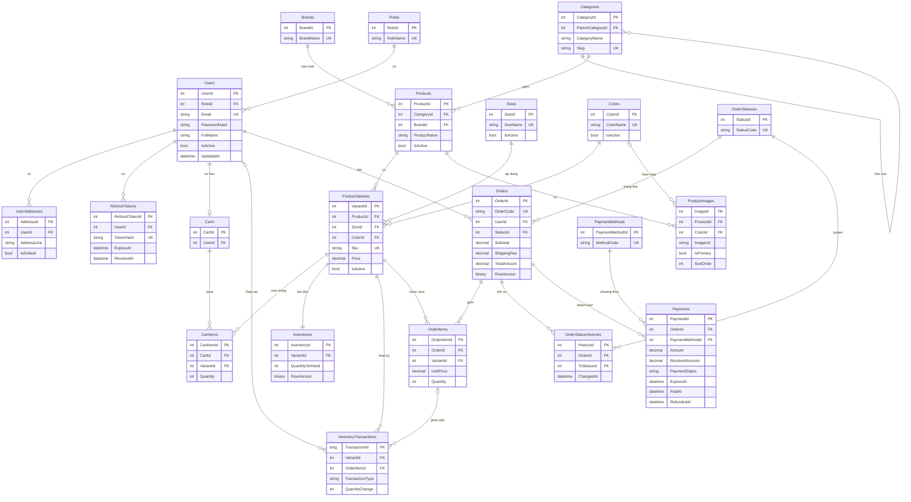
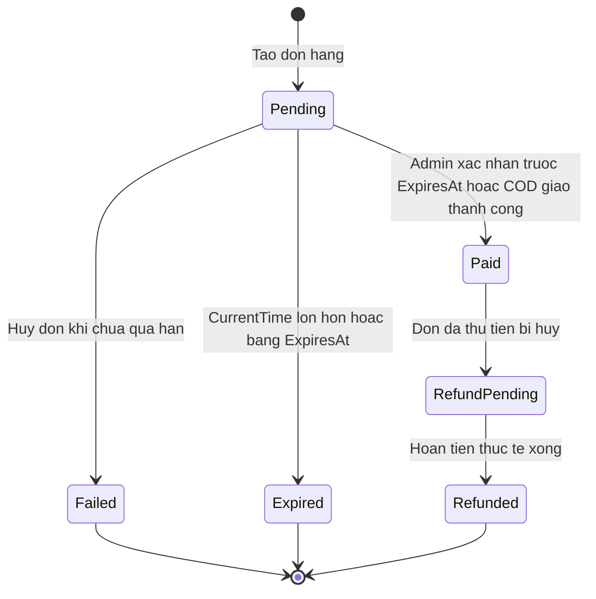
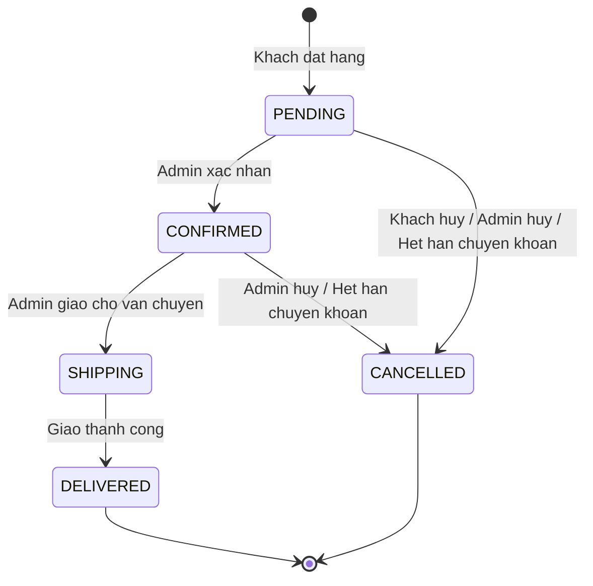

# SportShop – Thiết kế Database (SQL Server)

> **Phiên bản:** 1.2 – 14/11/2026 | **Tác giả:** Agent 3 (System Analyst & Database Architect)
> **Trạng thái:** Chờ duyệt. Chưa có code. Đi cùng `api-contract.md` (v1.0) và `system-overview.md` (v1.1). Hai file này **chưa** được cập nhật theo v1.2, xem mục 13.3.

---

## 1. Mục tiêu, giả định và quy ước

### 1.1. Giả định (cần bạn xác nhận)

| # | Giả định | Lý do |
|---|----------|-------|
| G1 | Mỗi sản phẩm có nhiều **biến thể (Variant)** = tổ hợp *Size + Color*. Giá và tồn kho nằm ở **biến thể**. | Sản phẩm thể thao: cùng 1 áo nhưng giá/tồn kho khác nhau theo size, màu. |
| G2 | Tiền tệ là **VND**, lưu `DECIMAL(18,2)`. | Tránh lỗi làm tròn của số thực. |
| G3 | Một khách hàng chỉ có **1 giỏ hàng**. Đặt hàng = đặt **toàn bộ giỏ**. | Đơn giản, đủ cho giai đoạn 1. |
| G4 | **Trừ tồn kho ngay khi đặt hàng** (trong 1 transaction, trừ có điều kiện). Hủy đơn hoặc hết hạn thanh toán thì hoàn lại đúng một lần. | Tránh bán quá số lượng. |
| G5 | Phương thức thanh toán giai đoạn 1: **COD** và **Chuyển khoản**. VNPay/MoMo có sẵn trong bảng nhưng tắt (`IsActive = 0`). | Cổng thanh toán online cần đăng ký merchant, để giai đoạn sau. |
| G6 | Phí vận chuyển: 30.000đ, **miễn phí khi tổng tiền hàng ≥ 1.000.000đ** (cấu hình trong `appsettings`, không lưu cứng trong DB). | Quy tắc mẫu, dễ đổi. |
| G7 | **Xóa** danh mục/thương hiệu/sản phẩm/biến thể/size/màu = **xóa mềm** (`IsActive = 0`). Xem mục 6.8. | Đơn hàng cũ vẫn tham chiếu được. |
| G8 | Hệ thống chỉ có 2 vai trò: `Customer`, `Admin`. | Đúng đề bài, vẫn mở rộng được nhờ bảng `Roles`. |
| G9 | Không có mã giảm giá/đánh giá sản phẩm (không nằm trong danh sách chức năng). | Không tự thêm chức năng. Xem mục 11. |
| G10 | Đơn `BANK_TRANSFER` chưa thanh toán có **thời hạn 24 giờ** kể từ lúc đặt (mặc định, cấu hình được) và áp dụng **hết hạn tuyệt đối (Strict Expiration)**: từ `CurrentTime >= ExpiresAt` Admin không được xác nhận thanh toán nữa; đơn tự hủy và hoàn kho. Xem mục 6.7.1. | Không giữ hàng vô thời hạn; không để đơn vừa được thanh toán vừa bị hủy do hết hạn. |
| G11 | Ảnh đại diện xác định **theo sản phẩm** (mỗi sản phẩm đúng 1 ảnh đại diện). Ảnh theo màu chỉ để hiển thị khi khách chọn màu. | Đơn giản, đủ cho trang danh sách. Xem mục 6.9. |

### 1.2. Quy ước đặt tên

- Tên bảng: **PascalCase, số nhiều** (`Products`, `OrderItems`).
- Khóa chính: `<TênSốÍt>Id` (`ProductId`). Khóa ngoại **trùng tên** khóa chính bảng cha (`Products.CategoryId` → `Categories.CategoryId`).
- Cột boolean: tiền tố `Is` (`IsActive`, `IsDefault`).
- Thời gian: hậu tố `At`, kiểu `DATETIME2`, lưu **UTC**.
- Tiền: `Price`, `UnitPrice`, `Amount`, `ReceivedAmount`, `Subtotal`, `ShippingFee`, `TotalAmount` đều `DECIMAL(18,2)`.
- Chuỗi tiếng Việt dùng `NVARCHAR`.
- Tên ràng buộc/index: `PK_`, `FK_`, `UQ_` (unique thường), `UX_` (unique **có điều kiện**, filtered), `CK_` (check), `IX_` (index thường). Ví dụ `UX_InventoryTransactions_OrderItem_Type`.
- Collation database: **không phân biệt hoa/thường, có phân biệt dấu** (CI_AS, ví dụ `Vietnamese_100_CI_AS`) để UNIQUE trên `Email`, `SizeName`… hoạt động đúng.
- Cách đặt tên này khớp mặc định của EF Core nên giảm cấu hình khi code.

### 1.3. Quy ước thời gian và `UpdatedAt`

**Quy tắc chung**

1. Mọi thời gian lưu **UTC**. Báo cáo theo ngày chuyển sang giờ Việt Nam (UTC+7) khi truy vấn.
2. Bảng thực thể **có thể sửa** có cặp `CreatedAt` + `UpdatedAt`, cả hai **NOT NULL**.
3. Khi tạo dòng: `UpdatedAt = CreatedAt`. Mỗi lần sửa dòng đó, Backend cập nhật `UpdatedAt` (đặt ở một điểm chung của tầng dữ liệu, không để từng chức năng tự nhớ).
4. Có ràng buộc `CK_<Bảng>_UpdatedAt`: `UpdatedAt ≥ CreatedAt`.
5. Bảng **chỉ ghi thêm (append-only)** hoặc **bất biến** thì **không** có `UpdatedAt`.
6. Bảng danh mục cố định, chỉ đổi bằng migration, thì không có mốc thời gian.

| Bảng | Mốc thời gian | Lý do |
|------|---------------|-------|
| `Roles`, `OrderStatuses` | Không có | Danh mục cố định, đổi bằng migration |
| `Users` | `CreatedAt`, `UpdatedAt`, `LastLoginAt` | Sửa hồ sơ, khóa/mở khóa |
| `RefreshTokens` | `CreatedAt`, `ExpiresAt`, `RevokedAt` | Chỉ có 1 lần "sửa" là thu hồi, đã có `RevokedAt` |
| `UserAddresses` | `CreatedAt`, `UpdatedAt` | Sửa địa chỉ |
| `Categories`, `Brands` | `CreatedAt`, `UpdatedAt` | Admin sửa |
| `Products` | `CreatedAt`, `UpdatedAt` | Admin sửa |
| `Sizes`, `Colors` | `CreatedAt`, `UpdatedAt` | Admin sửa, xóa mềm |
| `ProductVariants` | `CreatedAt`, `UpdatedAt` | Đổi giá, bật/tắt bán |
| `ProductImages` | `CreatedAt`, `UpdatedAt` | Đổi ảnh đại diện, thứ tự |
| `Inventories` | `CreatedAt`, `UpdatedAt` | Tồn kho đổi liên tục |
| `InventoryTransactions` | `CreatedAt` | Append-only (không bao giờ sửa/xóa) |
| `Carts`, `CartItems` | `CreatedAt`, `UpdatedAt` | Đổi số lượng |
| `PaymentMethods` | `CreatedAt`, `UpdatedAt` | Bật/tắt phương thức |
| `Orders` | `CreatedAt`, `UpdatedAt`, `DeliveredAt` | Đổi trạng thái |
| `OrderItems` | Không có (theo `Orders.CreatedAt`) | **Bất biến**: snapshot, không bao giờ sửa sau khi tạo |
| `OrderStatusHistories` | `ChangedAt` | Append-only |
| `Payments` | `CreatedAt`, `UpdatedAt`, `ExpiresAt`, `PaidAt`, `RefundedAt` | Đổi trạng thái thanh toán, hoàn tiền |

---

## 2. Danh sách bảng (21 bảng)

| Nhóm | Bảng | Nhiệm vụ |
|------|------|----------|
| Tài khoản | `Roles` | Danh sách vai trò (Customer, Admin) |
| | `Users` | Tài khoản khách hàng và quản trị viên |
| | `RefreshTokens` | Token làm mới đăng nhập, dùng để đăng xuất/thu hồi |
| | `UserAddresses` | Sổ địa chỉ giao hàng của khách |
| Danh mục sản phẩm | `Categories` | Danh mục (có cấp cha–con) |
| | `Brands` | Thương hiệu |
| | `Products` | Thông tin chung của sản phẩm |
| | `Sizes` | Danh mục kích thước dùng chung (xóa mềm) |
| | `Colors` | Danh mục màu sắc dùng chung (xóa mềm) |
| | `ProductVariants` | Biến thể = Sản phẩm + Size + Color (có giá, SKU, xóa mềm) |
| | `ProductImages` | Ảnh sản phẩm (có thể gắn theo màu) |
| Tồn kho | `Inventories` | Số lượng tồn hiện tại của từng biến thể |
| | `InventoryTransactions` | Nhật ký nhập/xuất/hoàn/điều chỉnh kho |
| Giỏ hàng | `Carts` | Giỏ hàng của khách |
| | `CartItems` | Dòng sản phẩm trong giỏ |
| Đơn hàng | `OrderStatuses` | Danh mục trạng thái đơn hàng |
| | `Orders` | Đơn hàng |
| | `OrderItems` | Chi tiết đơn hàng (lưu **ảnh chụp**, bất biến) |
| | `OrderStatusHistories` | Lịch sử đổi trạng thái (để theo dõi đơn) |
| Thanh toán | `PaymentMethods` | Danh mục phương thức thanh toán |
| | `Payments` | Khoản thanh toán của đơn hàng (số tiền phải trả, số tiền nhận, hạn thanh toán, hoàn tiền) |

---

## 3. Chi tiết từng bảng

> Ký hiệu: **PK** khóa chính, **FK** khóa ngoại, **UQ** duy nhất, **NN** NOT NULL, **NULL** cho phép rỗng. Các dòng "(ràng buộc)" là ràng buộc ở mức bảng; danh sách đầy đủ ở mục 8.

### 3.1. Nhóm tài khoản

#### `Roles` – Vai trò
| Cột | Kiểu | Ràng buộc | Ghi chú |
|-----|------|-----------|---------|
| RoleId | INT | PK, IDENTITY | |
| RoleName | NVARCHAR(30) | NN, UQ | `Customer`, `Admin` |

#### `Users` – Người dùng
| Cột | Kiểu | Ràng buộc | Ghi chú |
|-----|------|-----------|---------|
| UserId | INT | PK, IDENTITY | |
| RoleId | INT | FK → Roles, NN | |
| Email | NVARCHAR(256) | NN, UQ | Dùng để đăng nhập (lưu chữ thường) |
| PasswordHash | NVARCHAR(500) | NN | **Chỉ lưu hash** (PBKDF2/BCrypt + salt), không lưu mật khẩu thuần |
| FullName | NVARCHAR(100) | NN | |
| PhoneNumber | NVARCHAR(20) | NULL | |
| DateOfBirth | DATE | NULL | |
| Gender | NVARCHAR(10) | NULL | CHECK `Male`/`Female`/`Other` |
| IsActive | BIT | NN, DEFAULT 1 | Admin khóa tài khoản = 0 |
| CreatedAt | DATETIME2 | NN, DEFAULT UTC now | |
| UpdatedAt | DATETIME2 | NN | Theo mục 1.3 |
| LastLoginAt | DATETIME2 | NULL | |

#### `RefreshTokens` – Token làm mới
| Cột | Kiểu | Ràng buộc | Ghi chú |
|-----|------|-----------|---------|
| RefreshTokenId | INT | PK, IDENTITY | |
| UserId | INT | FK → Users, NN | |
| TokenHash | NVARCHAR(128) | NN, UQ | Lưu **hash** của token, không lưu token gốc |
| ExpiresAt | DATETIME2 | NN | Ví dụ 7 ngày; CHECK `ExpiresAt > CreatedAt` |
| CreatedAt | DATETIME2 | NN | |
| RevokedAt | DATETIME2 | NULL | Có giá trị = token đã bị thu hồi (đăng xuất); CHECK `RevokedAt ≥ CreatedAt` |

#### `UserAddresses` – Sổ địa chỉ
| Cột | Kiểu | Ràng buộc | Ghi chú |
|-----|------|-----------|---------|
| AddressId | INT | PK, IDENTITY | |
| UserId | INT | FK → Users, NN | |
| RecipientName | NVARCHAR(100) | NN | |
| PhoneNumber | NVARCHAR(20) | NN | |
| Province | NVARCHAR(100) | NN | Tỉnh/Thành phố |
| District | NVARCHAR(100) | NN | Quận/Huyện |
| Ward | NVARCHAR(100) | NN | Phường/Xã |
| AddressLine | NVARCHAR(255) | NN | Số nhà, tên đường |
| IsDefault | BIT | NN, DEFAULT 0 | Mỗi user tối đa 1 địa chỉ mặc định |
| CreatedAt | DATETIME2 | NN | |
| UpdatedAt | DATETIME2 | NN | |

### 3.2. Nhóm danh mục sản phẩm

#### `Categories` – Danh mục
| Cột | Kiểu | Ràng buộc | Ghi chú |
|-----|------|-----------|---------|
| CategoryId | INT | PK, IDENTITY | |
| ParentCategoryId | INT | FK → Categories (tự tham chiếu), NULL | NULL = danh mục gốc |
| CategoryName | NVARCHAR(100) | NN | |
| Slug | NVARCHAR(150) | NN, UQ | Dùng cho URL thân thiện |
| Description | NVARCHAR(500) | NULL | |
| IsActive | BIT | NN, DEFAULT 1 | |
| CreatedAt | DATETIME2 | NN | |
| UpdatedAt | DATETIME2 | NN | |

#### `Brands` – Thương hiệu
| Cột | Kiểu | Ràng buộc | Ghi chú |
|-----|------|-----------|---------|
| BrandId | INT | PK, IDENTITY | |
| BrandName | NVARCHAR(100) | NN, UQ | |
| Slug | NVARCHAR(150) | NN, UQ | |
| LogoUrl | NVARCHAR(500) | NULL | |
| Description | NVARCHAR(500) | NULL | |
| IsActive | BIT | NN, DEFAULT 1 | |
| CreatedAt | DATETIME2 | NN | |
| UpdatedAt | DATETIME2 | NN | |

#### `Products` – Sản phẩm (thông tin chung)
| Cột | Kiểu | Ràng buộc | Ghi chú |
|-----|------|-----------|---------|
| ProductId | INT | PK, IDENTITY | |
| CategoryId | INT | FK → Categories, NN | |
| BrandId | INT | FK → Brands, NN | |
| ProductName | NVARCHAR(200) | NN | |
| Slug | NVARCHAR(250) | NN, UQ | |
| Description | NVARCHAR(MAX) | NULL | |
| IsActive | BIT | NN, DEFAULT 1 | 0 = ẩn/xóa mềm |
| CreatedAt | DATETIME2 | NN | |
| UpdatedAt | DATETIME2 | NN | |

> `Products` **không có cột giá**. Giá nằm ở `ProductVariants`. Giá hiển thị ở trang danh sách = giá thấp nhất trong các biến thể **bán được** (tính khi truy vấn, không lưu thêm để tránh dư thừa).

#### `Sizes` / `Colors` – Danh mục dùng chung (xóa mềm)
| Bảng | Cột | Kiểu | Ràng buộc | Ghi chú |
|------|-----|------|-----------|---------|
| Sizes | SizeId | INT | PK, IDENTITY | |
| | SizeName | NVARCHAR(20) | NN, UQ | `S`, `M`, `L`, `40`, `41`… Tên của size đã xóa mềm vẫn bị giữ chỗ (muốn bán lại thì kích hoạt lại) |
| | SortOrder | INT | NN, DEFAULT 0, CHECK ≥ 0 | Thứ tự hiển thị (S < M < L) |
| | IsActive | BIT | NN, DEFAULT 1 | 0 = ngừng dùng cho biến thể mới (xem BR-23) |
| | CreatedAt / UpdatedAt | DATETIME2 | NN | |
| Colors | ColorId | INT | PK, IDENTITY | |
| | ColorName | NVARCHAR(50) | NN, UQ | `Đen`, `Trắng`… |
| | HexCode | CHAR(7) | NULL | Ví dụ `#000000`; CHECK đúng dạng `#RRGGBB` |
| | IsActive | BIT | NN, DEFAULT 1 | Như `Sizes.IsActive` |
| | CreatedAt / UpdatedAt | DATETIME2 | NN | |

#### `ProductVariants` – Biến thể sản phẩm
| Cột | Kiểu | Ràng buộc | Ghi chú |
|-----|------|-----------|---------|
| VariantId | INT | PK, IDENTITY | |
| ProductId | INT | FK → Products, NN | |
| SizeId | INT | FK → Sizes, NN | |
| ColorId | INT | FK → Colors, NN | |
| Sku | NVARCHAR(50) | NN, UQ | Mã kho, ví dụ `NIKE-DF-M-BLK` |
| Price | DECIMAL(18,2) | NN, CHECK ≥ 0 | Giá bán hiện tại |
| IsActive | BIT | NN, DEFAULT 1 | **0 = ngừng bán** (xóa mềm). Không bao giờ xóa cứng bằng ứng dụng (BR-23) |
| CreatedAt | DATETIME2 | NN | |
| UpdatedAt | DATETIME2 | NN | |
| *(ràng buộc)* | | **UQ (ProductId, SizeId, ColorId)** | Không tạo 2 biến thể trùng tổ hợp, kể cả biến thể đã ngừng bán (muốn bán lại thì kích hoạt lại) |

#### `ProductImages` – Ảnh sản phẩm
| Cột | Kiểu | Ràng buộc | Ghi chú |
|-----|------|-----------|---------|
| ImageId | INT | PK, IDENTITY | |
| ProductId | INT | FK → Products, NN | |
| ColorId | INT | FK → Colors, NULL | NULL = ảnh chung của sản phẩm; có giá trị = ảnh của màu đó |
| ImageUrl | NVARCHAR(500) | NN, **UQ** | Đường dẫn ảnh. Tên file **ngẫu nhiên và bất biến**: không bao giờ ghi đè file cũ (xem 6.9.1) |
| IsPrimary | BIT | NN, DEFAULT 0 | **Ảnh đại diện của SẢN PHẨM** (mỗi sản phẩm tối đa 1, xem BR-24) |
| SortOrder | INT | NN, DEFAULT 0, CHECK ≥ 0 | Thứ tự trong cùng nhóm màu |
| CreatedAt | DATETIME2 | NN | |
| UpdatedAt | DATETIME2 | NN | |
| *(ràng buộc)* | | **UX** (`ProductId`) WHERE `IsPrimary = 1` | Tối đa 1 ảnh đại diện mỗi sản phẩm |
| *(ràng buộc)* | | **UQ (ProductId, ColorId, SortOrder)** | Thứ tự không trùng trong cùng nhóm màu (NULL được coi là một nhóm "ảnh chung") |
| *(ràng buộc)* | | **UQ** (`ImageUrl`) | **Mới v1.2.** Mỗi đường dẫn ảnh chỉ thuộc 1 dòng, không có hai dòng cùng trỏ vào một file (cần SQL Server 2016 trở lên vì khóa index dài 1000 byte) |

### 3.3. Nhóm tồn kho

#### `Inventories` – Tồn kho hiện tại
| Cột | Kiểu | Ràng buộc | Ghi chú |
|-----|------|-----------|---------|
| InventoryId | INT | PK, IDENTITY | |
| VariantId | INT | FK → ProductVariants, NN, **UQ** | Quan hệ 1-1 với biến thể |
| QuantityOnHand | INT | NN, CHECK ≥ 0 | Số lượng còn bán được. **Chốt chặn cuối**: DB từ chối mọi thao tác làm tồn kho âm |
| LowStockThreshold | INT | NN, DEFAULT 5, CHECK ≥ 0 | Dưới ngưỡng này = cảnh báo sắp hết |
| CreatedAt | DATETIME2 | NN | |
| UpdatedAt | DATETIME2 | NN | |
| RowVersion | ROWVERSION | NN | Phát hiện cập nhật chồng chéo (optimistic concurrency của EF Core) |

#### `InventoryTransactions` – Nhật ký kho (append-only)
| Cột | Kiểu | Ràng buộc | Ghi chú |
|-----|------|-----------|---------|
| TransactionId | BIGINT | PK, IDENTITY | |
| VariantId | INT | FK → ProductVariants, NN | |
| TransactionType | NVARCHAR(20) | NN, CHECK | `Import` (nhập), `Sale` (bán), `OrderRestock` (hoàn kho do hủy **hoặc** hết hạn thanh toán), `Adjustment` (kiểm kê) |
| QuantityChange | INT | NN, CHECK ≠ 0 | Âm = xuất, dương = nhập |
| QuantityAfter | INT | NN, CHECK ≥ 0 | Tồn sau giao dịch |
| **OrderItemId** | INT | **FK → OrderItems, NULL** | **Mới v1.1.** Dòng đơn hàng gây ra giao dịch. Bắt buộc có với `Sale`/`OrderRestock`, bắt buộc NULL với `Import`/`Adjustment` |
| Note | NVARCHAR(255) | NULL | Lý do hoàn kho: "Khách hủy", "Admin hủy", "Hết hạn chuyển khoản"… |
| CreatedBy | INT | FK → Users, NULL | Người thao tác. NULL = hệ thống tự chạy (job hết hạn) |
| CreatedAt | DATETIME2 | NN | |
| *(ràng buộc)* | | **UX** (`OrderItemId`, `TransactionType`) WHERE `OrderItemId IS NOT NULL` | **Mỗi dòng đơn hàng chỉ có tối đa 1 giao dịch `Sale` và tối đa 1 giao dịch `OrderRestock`**, tức không thể hoàn kho 2 lần (BR-19) |
| *(ràng buộc)* | | CHECK theo loại | `Sale` ⇒ `QuantityChange < 0` và có `OrderItemId`; `OrderRestock` ⇒ `QuantityChange > 0` và có `OrderItemId`; `Import` ⇒ `> 0`, `OrderItemId` NULL; `Adjustment` ⇒ `OrderItemId` NULL |

> **Thay đổi so với v1.0:** bỏ cột `OrderId` (vì `OrderItemId` đã suy ra được đơn hàng, giữ cả hai dễ lệch nhau) và đổi tên loại `CancelRestock` thành `OrderRestock` để **một** ràng buộc duy nhất chặn hoàn kho dù lý do là hủy hay hết hạn.
> Quy tắc ngoài DB (Service kiểm tra): `VariantId` của giao dịch phải trùng `OrderItems.VariantId`; `|QuantityChange|` phải bằng `OrderItems.Quantity`; `QuantityAfter` = `QuantityAfter` của giao dịch liền trước **cùng biến thể** + `QuantityChange`, và của giao dịch **mới nhất** luôn bằng `Inventories.QuantityOnHand` (Service ghi cùng transaction với việc đổi tồn kho, dùng để đối soát).

### 3.4. Nhóm giỏ hàng

#### `Carts`
| Cột | Kiểu | Ràng buộc | Ghi chú |
|-----|------|-----------|---------|
| CartId | INT | PK, IDENTITY | |
| UserId | INT | FK → Users, NN, **UQ** | 1 user – 1 giỏ |
| CreatedAt | DATETIME2 | NN | |
| UpdatedAt | DATETIME2 | NN | |

#### `CartItems`
| Cột | Kiểu | Ràng buộc | Ghi chú |
|-----|------|-----------|---------|
| CartItemId | INT | PK, IDENTITY | |
| CartId | INT | FK → Carts, NN | |
| VariantId | INT | FK → ProductVariants, NN | |
| Quantity | INT | NN, CHECK từ 1 đến 99 | Khớp quy tắc validate của API |
| CreatedAt | DATETIME2 | NN | Đổi tên từ `AddedAt` (v1.0) cho thống nhất quy ước |
| UpdatedAt | DATETIME2 | NN | Mới v1.1 |
| *(ràng buộc)* | | **UQ (CartId, VariantId)** | Thêm lại cùng biến thể = cộng dồn số lượng |

> `CartItems` **không lưu giá** và **không giữ chỗ tồn kho**. Giỏ hàng luôn hiển thị giá *hiện tại*. Giá chỉ bị "chốt" khi đặt hàng.

### 3.5. Nhóm đơn hàng

#### `OrderStatuses` – Trạng thái đơn
| Cột | Kiểu | Ràng buộc | Ghi chú |
|-----|------|-----------|---------|
| StatusId | INT | PK (không IDENTITY, gán cố định) | |
| StatusCode | NVARCHAR(30) | NN, UQ | Mã dùng trong API |
| StatusName | NVARCHAR(50) | NN | Tên hiển thị tiếng Việt |
| SortOrder | INT | NN | |
| IsFinal | BIT | NN | 1 = trạng thái kết thúc, không đổi tiếp |

#### `Orders` – Đơn hàng
| Cột | Kiểu | Ràng buộc | Ghi chú |
|-----|------|-----------|---------|
| OrderId | INT | PK, IDENTITY | |
| OrderCode | NVARCHAR(30) | NN, UQ | Mã hiển thị, dạng `SP20261105-0001` |
| UserId | INT | FK → Users, NN | |
| StatusId | INT | FK → OrderStatuses, NN | Trạng thái hiện tại |
| RecipientName | NVARCHAR(100) | NN | **Chụp lại** lúc đặt (không phụ thuộc sổ địa chỉ) |
| RecipientPhone | NVARCHAR(20) | NN | |
| ShippingAddress | NVARCHAR(500) | NN | Địa chỉ đầy đủ dạng một chuỗi |
| Note | NVARCHAR(500) | NULL | Ghi chú của khách |
| Subtotal | DECIMAL(18,2) | NN, CHECK ≥ 0 | **Tiền hàng** = tổng `OrderItems.LineTotal` (Service bảo đảm lúc tạo) |
| ShippingFee | DECIMAL(18,2) | NN, DEFAULT 0, CHECK ≥ 0 | **Phí vận chuyển** |
| TotalAmount | DECIMAL(18,2) | NN | **Tổng khách phải trả** = `Subtotal + ShippingFee` (CHECK) |
| CancelReason | NVARCHAR(255) | NULL | Bắt buộc khi `CANCELLED` |
| CreatedAt | DATETIME2 | NN | |
| UpdatedAt | DATETIME2 | NN | |
| DeliveredAt | DATETIME2 | NULL | Dùng cho thống kê doanh thu. Bắt buộc có khi `DELIVERED` |
| **RowVersion** | ROWVERSION | NN | **Mới v1.1, làm rõ v1.2.** Dùng để **giành quyền xử lý đơn** bằng **cập nhật có điều kiện** (`WHERE RowVersion` = giá trị đã đọc, kèm trạng thái cho phép) trong cùng transaction với mọi thay đổi trạng thái/thanh toán/hoàn kho. Chỉ đọc `RowVersion` rồi bỏ đó là **không đủ** (mục 6.7.2) |
| *(ràng buộc)* | | CHECK | `TotalAmount = Subtotal + ShippingFee`; `StatusId = 4` ⇒ `DeliveredAt` NOT NULL; `StatusId = 5` ⇒ `CancelReason` NOT NULL |

#### `OrderItems` – Chi tiết đơn hàng (**bất biến**)
| Cột | Kiểu | Ràng buộc | Ghi chú |
|-----|------|-----------|---------|
| OrderItemId | INT | PK, IDENTITY | |
| OrderId | INT | FK → Orders, NN | |
| VariantId | INT | FK → ProductVariants, NN | Chỉ để hoàn kho khi hủy và "mua lại". **Không** dùng để hiển thị lịch sử |
| ProductName | NVARCHAR(200) | NN | **Snapshot** tên lúc mua |
| Sku | NVARCHAR(50) | NN | Snapshot |
| SizeName | NVARCHAR(20) | NN | Snapshot |
| ColorName | NVARCHAR(50) | NN | Snapshot |
| ImageUrl | NVARCHAR(500) | NULL | Snapshot ảnh nhỏ (ảnh theo màu của biến thể, nếu không có thì ảnh đại diện sản phẩm) |
| UnitPrice | DECIMAL(18,2) | NN, CHECK ≥ 0 | **Giá tại thời điểm mua** |
| Quantity | INT | NN, CHECK > 0 | |
| LineTotal | DECIMAL(18,2) | Cột tính toán (computed, persisted) | = UnitPrice × Quantity |

> Sau khi tạo, **không có thao tác sửa/xóa** nào lên `OrderItems`.

#### `OrderStatusHistories` – Lịch sử trạng thái (append-only)
| Cột | Kiểu | Ràng buộc | Ghi chú |
|-----|------|-----------|---------|
| HistoryId | INT | PK, IDENTITY | |
| OrderId | INT | FK → Orders, NN | |
| FromStatusId | INT | FK → OrderStatuses, NULL | NULL khi tạo đơn |
| ToStatusId | INT | FK → OrderStatuses, NN | |
| ChangedBy | INT | FK → Users, NULL | Ai đổi (khách / admin). **NULL = hệ thống** (job tự hủy hết hạn) |
| Note | NVARCHAR(255) | NULL | |
| ChangedAt | DATETIME2 | NN | |

### 3.6. Nhóm thanh toán

#### `PaymentMethods`
| Cột | Kiểu | Ràng buộc | Ghi chú |
|-----|------|-----------|---------|
| PaymentMethodId | INT | PK, IDENTITY | |
| MethodCode | NVARCHAR(30) | NN, UQ | `COD`, `BANK_TRANSFER`, `VNPAY`, `MOMO` |
| MethodName | NVARCHAR(100) | NN | |
| Description | NVARCHAR(255) | NULL | |
| IsActive | BIT | NN | Chỉ hiển thị cho khách các phương thức đang bật |
| CreatedAt / UpdatedAt | DATETIME2 | NN | Theo mục 1.3 |

#### `Payments`
| Cột | Kiểu | Ràng buộc | Ghi chú |
|-----|------|-----------|---------|
| PaymentId | INT | PK, IDENTITY | |
| OrderId | INT | FK → Orders, NN | |
| PaymentMethodId | INT | FK → PaymentMethods, NN | |
| Amount | DECIMAL(18,2) | NN, CHECK ≥ 0 | **Số tiền phải thanh toán** = `Orders.TotalAmount` tại lúc tạo (Service bảo đảm) |
| ReceivedAmount | DECIMAL(18,2) | NULL, CHECK ≥ 0 | Số tiền thực nhận. Chỉ có giá trị khi `Paid`, `RefundPending`, `Refunded` |
| PaymentStatus | NVARCHAR(20) | NN, CHECK | `Pending` (chờ), `Paid` (đã nhận đủ), `Failed` (không thu được/bị hủy khi chưa quá hạn), `Expired` (quá hạn tuyệt đối), **`RefundPending`** (đã thu tiền nhưng đơn bị hủy, **chưa hoàn tiền xong**, mới v1.2), `Refunded` (**đã hoàn tiền thực tế xong**) |
| TransactionCode | NVARCHAR(100) | NULL | Mã giao dịch ngân hàng/cổng thanh toán |
| ExpiresAt | DATETIME2 | NULL | **Hạn thanh toán tuyệt đối.** Chỉ đặt cho `BANK_TRANSFER` = lúc tạo + thời hạn cấu hình, tính theo **đồng hồ UTC của SQL Server**. Khi `CurrentTime >= ExpiresAt` không thể chuyển sang `Paid` (mục 6.7.1). NULL với COD |
| PaidAt | DATETIME2 | NULL | **Thời điểm hệ thống ghi nhận xác nhận thanh toán** (đồng hồ SQL Server), **không** phải thời điểm khách chuyển tiền. Với `BANK_TRANSFER` luôn **< `ExpiresAt`** |
| RefundedAt | DATETIME2 | NULL | **Mới v1.2.** Thời điểm hoàn tiền thực tế **hoàn tất** được xác nhận. Chỉ có khi `Refunded` |
| CreatedAt | DATETIME2 | NN | |
| UpdatedAt | DATETIME2 | NN | |
| *(ràng buộc)* | | **UX** (`OrderId`) WHERE `PaymentStatus <> 'Failed' AND PaymentStatus <> 'Expired'` (`UX_Payments_Order_Live`) | **Sửa v1.2.** Mỗi đơn có **tối đa 1 khoản "sống" trong toàn bộ lịch sử**, tức khoản không phải `Failed`/`Expired`. Với CHECK chỉ cho phép 6 trạng thái, đó đúng là `Pending`, `Paid`, `RefundPending`, `Refunded`. Vì vậy: tối đa 1 khoản đã thu tiền, **kể cả khi nó đã sang `Refunded`**; tối đa 1 khoản `Pending`; và không thể có khoản `Pending` mới khi đã có khoản đã thu/đang hoàn/đã hoàn. Chỉ khoản "chết" (`Failed`, `Expired`) mới được có nhiều dòng. Điều kiện lọc viết bằng `<>` nối `AND` vì filtered index của SQL Server **không hỗ trợ `IN`/`OR`** (xem ghi chú ở mục 8.2) |
| *(ràng buộc)* | | **UX** (`PaymentMethodId`, `TransactionCode`) WHERE `TransactionCode IS NOT NULL` | Một mã giao dịch chỉ dùng được cho 1 khoản, chặn xác nhận trùng |
| *(ràng buộc)* | | CHECK trạng thái và tiền | `PaymentStatus IN ('Paid','RefundPending','Refunded')` ⇒ `ReceivedAmount = Amount` và `PaidAt` NOT NULL; `PaymentStatus IN ('Pending','Failed','Expired')` ⇒ `ReceivedAmount` NULL và `PaidAt` NULL |
| *(ràng buộc)* | | CHECK hạn thanh toán tuyệt đối | `PaymentStatus IN ('Paid','RefundPending','Refunded')` và `ExpiresAt` NOT NULL ⇒ **`PaidAt < ExpiresAt`**; `PaymentStatus = 'Expired'` ⇒ `ExpiresAt` NOT NULL; `ExpiresAt > CreatedAt` khi có |
| *(ràng buộc)* | | CHECK hoàn tiền | (`PaymentStatus = 'Refunded'`) ⇔ (`RefundedAt` NOT NULL); `RefundedAt ≥ PaidAt` khi có |

**Vòng đời trạng thái thanh toán (chỉ các chuyển sau là hợp lệ):**

| Từ | Sang | Ai/khi nào | Điều kiện |
|----|------|-----------|-----------|
| `Pending` | `Paid` | Admin xác nhận chuyển khoản; hoặc hệ thống khi COD giao thành công | Chuyển khoản: `CurrentTime < ExpiresAt` và số tiền nhận = `TotalAmount` (BR-20, BR-21) |
| `Pending` | `Failed` | Khách/Admin hủy đơn **khi chưa quá hạn** | `CurrentTime < ExpiresAt` hoặc không có `ExpiresAt` |
| `Pending` | `Expired` | Background Service, hoặc quy trình hủy nếu gặp khoản đã quá hạn | `CurrentTime >= ExpiresAt` |
| `Paid` | `RefundPending` | Đơn đã thu tiền bị hủy | Cùng transaction hủy đơn |
| `RefundPending` | `Refunded` | Admin xác nhận **sau khi đã hoàn tiền thực tế xong** | Ghi `RefundedAt` (BR-27) |

`Failed`, `Expired`, `Refunded` là trạng thái cuối. Không có chuyển nào khác (ví dụ không có `Expired → Paid`).

> `Orders` **không** có cột phương thức hay trạng thái thanh toán. Hai thông tin này nằm ở `Payments` (nguồn duy nhất). Đơn hàng hiện tại lấy khoản thanh toán **mới nhất** của đơn.
> Điều DB không tự kiểm được (khác bảng): `Payments.Amount = Orders.TotalAmount`. Service bảo đảm lúc tạo và lúc xác nhận (BR-21). Riêng điều kiện thời gian `PaidAt < ExpiresAt` **được DB bảo vệ bằng CHECK** (phải dùng giờ SQL Server để ghi `PaidAt`, không dùng giờ máy ứng dụng).

---

## 4. Quan hệ giữa các bảng

| Bảng cha | Bảng con | Loại | Giải thích |
|----------|----------|------|-----------|
| Roles | Users | 1-n | 1 vai trò có nhiều user |
| Users | UserAddresses | 1-n | |
| Users | RefreshTokens | 1-n | Mỗi lần đăng nhập 1 token |
| Users | Carts | **1-1** | UQ trên `Carts.UserId` |
| Carts | CartItems | 1-n | |
| Users | Orders | 1-n | |
| Users | InventoryTransactions | 1-n (tùy chọn) | `CreatedBy`; NULL = hệ thống |
| Categories | Categories | 1-n (tự tham chiếu) | Danh mục cha – con |
| Categories | Products | 1-n | |
| Brands | Products | 1-n | |
| Products | ProductVariants | 1-n | |
| Products | ProductImages | 1-n | |
| Sizes / Colors | ProductVariants | 1-n | |
| Colors | ProductImages | 1-n (tùy chọn) | |
| ProductVariants | Inventories | **1-1** | UQ trên `Inventories.VariantId` |
| ProductVariants | InventoryTransactions | 1-n | |
| ProductVariants | CartItems / OrderItems | 1-n | |
| **OrderItems** | **InventoryTransactions** | **1-n (tối đa 1 `Sale` + 1 `OrderRestock`)** | **Mới v1.1**, thay cho quan hệ `Orders` – `InventoryTransactions` của v1.0 |
| **Products ↔ Sizes** | | **n-n** | Qua bảng nối `ProductVariants` |
| **Products ↔ Colors** | | **n-n** | Qua bảng nối `ProductVariants` |
| **Carts ↔ ProductVariants** | | **n-n** | Bảng nối `CartItems` |
| **Orders ↔ ProductVariants** | | **n-n** | Bảng nối `OrderItems` |
| OrderStatuses | Orders / OrderStatusHistories | 1-n | |
| Orders | OrderItems | 1-n | |
| Orders | OrderStatusHistories | 1-n | |
| Orders | Payments | 1-n | Trong toàn bộ lịch sử chỉ **1 khoản "sống"** (`Pending`/`Paid`/`RefundPending`/`Refunded`); các khoản cũ là `Failed`/`Expired` |
| PaymentMethods | Payments | 1-n | |

---

## 5. Sơ đồ ERD

---

## 6. Các quyết định thiết kế quan trọng

### 6.1. Sản phẩm nhiều Size và Color

| Phương án | Mô tả | Ưu | Nhược |
|-----------|-------|----|-------|
| **A. Product + ProductVariants (Size, Color là FK)** ✅ | Mỗi tổ hợp Size×Color là 1 dòng biến thể | Chuẩn hóa tốt, tồn kho/giá theo từng biến thể, lọc theo size/màu dễ, dễ viết với EF Core | Cần form admin tạo nhiều biến thể |
| B. Thuộc tính động (EAV) | Bảng `Attributes`, `AttributeValues`… | Rất linh hoạt | Truy vấn phức tạp, khó với sinh viên, chậm |
| C. Lưu Size/Color dạng chuỗi trong 1 dòng | `Sizes = "S,M,L"` | Đơn giản nhất | Vi phạm chuẩn hóa, không quản lý được tồn kho từng size |

**Chọn A.** Ví dụ: "Áo thun Nike Dri-FIT" là 1 dòng `Products`, có 4 dòng `ProductVariants` (M-Đen, L-Đen, M-Trắng, L-Trắng), mỗi biến thể có 1 dòng `Inventories`.

### 6.2. Quản lý tồn kho theo biến thể

| Phương án | Ưu | Nhược |
|-----------|----|-------|
| A. Cột `Stock` ngay trong `ProductVariants` | Ít bảng | Trộn dữ liệu danh mục với dữ liệu thay đổi liên tục, khó mở rộng nhiều kho, không có lịch sử |
| **B. Bảng `Inventories` (1-1) + `InventoryTransactions`** ✅ | Tách riêng dữ liệu hay đổi, có `RowVersion`, có nhật ký để đối soát và **chặn hoàn kho trùng** | Thêm 2 bảng |

**Chọn B.** `Inventories.QuantityOnHand` là số hiện tại. Mọi thay đổi ghi thêm 1 dòng `InventoryTransactions`. Các giao dịch do đơn hàng gây ra gắn với `OrderItemId` nên luôn trả lời được câu "dòng đơn nào đã trừ/hoàn bao nhiêu".

### 6.3. Đơn hàng cũ: dữ liệu hiển thị lấy từ snapshot

**Nguyên tắc:** màn hình *lịch sử đơn hàng*, *chi tiết đơn*, *email/hóa đơn*, *báo cáo doanh thu* chỉ đọc từ `Orders` + `OrderItems` (+ `Payments`, `OrderStatusHistories`). **Không** join sang `Products`, `ProductVariants`, `Sizes`, `Colors`, `ProductImages` để lấy thông tin hiển thị.

| Thông tin hiển thị | Lấy từ | Không phụ thuộc vào |
|--------------------|--------|---------------------|
| Tên sản phẩm | `OrderItems.ProductName` | `Products.ProductName` (đổi tên, ẩn, xóa mềm) |
| SKU, Size, Màu | `OrderItems.Sku`, `SizeName`, `ColorName` | `ProductVariants`, `Sizes`, `Colors` (đổi tên, ngừng bán) |
| Ảnh | `OrderItems.ImageUrl` | `ProductImages` (xóa/đổi ảnh) |
| Đơn giá, thành tiền | `OrderItems.UnitPrice`, `LineTotal` | `ProductVariants.Price` (đổi giá) |
| Tiền hàng, phí ship, tổng | `Orders.Subtotal`, `ShippingFee`, `TotalAmount` | Cấu hình phí ship hiện tại |
| Người nhận, địa chỉ | `Orders.RecipientName`, `RecipientPhone`, `ShippingAddress` | `UserAddresses` (sửa/xóa) |

Hệ quả: sản phẩm/biến thể bị ngừng bán hay xóa mềm thì đơn cũ **vẫn hiển thị y như lúc mua**. `OrderItems.VariantId` chỉ dùng cho hai việc **kỹ thuật**: hoàn kho khi hủy, và nút "mua lại" (nút này hiển thị giá/tình trạng **hiện tại**, không phải giá cũ). Tên trạng thái đơn và tên phương thức thanh toán lấy từ bảng danh mục, các bảng này **không bao giờ bị xóa** (chỉ tắt `IsActive` với phương thức thanh toán).

### 6.4. Giỏ hàng và đặt hàng (checkout)

- **Giỏ hàng** lưu trong DB (đăng nhập thiết bị nào cũng thấy). Không lưu giá, không giữ chỗ tồn kho. Kiểm tra tồn kho khi thêm vào giỏ chỉ là **sơ bộ** (BR-06).
- **Đặt hàng** là nơi duy nhất quyết định. Backend **không tin Frontend** về giá, tồn kho, tổng tiền, phí ship, chỉ nhận thông tin giao nhận, phương thức thanh toán, ghi chú. Toàn bộ chạy trong **một transaction**:
  1. Đọc giỏ theo `UserId` trong JWT; giỏ rỗng → từ chối.
  2. Với mỗi dòng (xử lý theo `VariantId` tăng dần để tránh khóa chéo giữa hai đơn đồng thời): kiểm tra biến thể **bán được** (BR-22), lấy `Price` từ DB.
  3. **Trừ kho có điều kiện, nguyên tử** trên `Inventories`: chỉ thành công khi tồn kho hiện tại đủ số lượng (không "đọc rồi mới ghi"). Thiếu ở dòng nào → ROLLBACK cả đơn, trả danh sách dòng thiếu.
  4. Tính `Subtotal`, `ShippingFee`, `TotalAmount` từ dữ liệu DB.
  5. Tạo `Orders` (`PENDING`), `OrderItems` (chụp snapshot), `OrderStatusHistories`, `Payments` (`Pending`, `Amount = TotalAmount`, và `ExpiresAt` nếu `BANK_TRANSFER`).
  6. Ghi `InventoryTransactions` loại `Sale` cho **từng** `OrderItems` (gắn `OrderItemId`), xóa `CartItems`.
  7. COMMIT. Lỗi ở bước nào cũng ROLLBACK toàn bộ.
- Lớp bảo vệ cuối: `CHECK (QuantityOnHand ≥ 0)` và `RowVersion` trên `Inventories`.

### 6.5. Thanh toán

- `PaymentMethods` là bảng danh mục, thêm phương thức mới chỉ cần thêm dòng.
- **Số tiền:** `Payments.Amount` = số phải trả (chụp từ `Orders.TotalAmount`). `ReceivedAmount` = số thực nhận, chỉ có khi đã thu.
- **COD:** `Pending` → tự động `Paid` khi đơn sang `DELIVERED` (`ReceivedAmount = Amount`, `PaidAt` theo giờ SQL Server), trong cùng transaction đổi trạng thái đơn. COD không có `ExpiresAt` nên không áp dụng hết hạn.
- **BANK_TRANSFER:** `Pending` kèm `ExpiresAt`. Chỉ Admin xác nhận `Paid`, và **chỉ khi `CurrentTime < ExpiresAt`** (hết hạn tuyệt đối, mục 6.7.1). Quá hạn → Background Service hủy đơn (mục 6.7.4).
- **VNPAY/MOMO (sau này):** cổng gọi lại → dùng **cùng quy trình xác nhận** bên dưới, kể cả quy tắc hết hạn: callback đến sau `ExpiresAt` không được xác nhận.

**Quy trình xác nhận thanh toán chuyển khoản (Admin), trong một transaction:**

Dữ liệu một yêu cầu xác nhận gồm: đơn, `receivedAmount`, `transactionCode`.

1. Mở transaction. Đọc đơn kèm `RowVersion` và khoản `Payments` "sống" hiện tại của đơn.
2. **Phân nhánh theo trạng thái khoản, theo bảng quyết định bên dưới.** Chỉ khoản đang `Pending` mới đi tiếp. Khoản đã `Paid` được xử lý **ngay tại đây** để yêu cầu gửi lại của một xác nhận đã thành công **không bị từ chối nhầm** và **không bao giờ ghi lần hai**.
3. Với khoản `Pending`: kiểm tra sơ bộ để báo lỗi sớm (**không phải chốt chặn**): đơn chưa `CANCELLED`; số tiền nhận = `TotalAmount`; `CurrentTime < ExpiresAt`.
4. **Giành quyền xử lý đơn** (mục 6.7.2): cập nhật có điều kiện `Orders` (ghi `UpdatedAt`) với `RowVersion` = giá trị đã đọc và `StatusId IN (PENDING, CONFIRMED)`.
5. **Cập nhật có điều kiện `Payments`** `Pending → Paid` với điều kiện `PaymentStatus = 'Pending'` **và `CurrentTime < ExpiresAt`** (đọc đồng hồ SQL Server ngay trong câu lệnh), ghi `ReceivedAmount`, `PaidAt = CurrentTime`, `TransactionCode`. Số tiền nhận phải bằng `Orders.TotalAmount` (đọc sau khi đã khóa đơn ở bước 4).
6. Nếu bước 4 hoặc bước 5 cập nhật **0 dòng** → ROLLBACK (hủy mọi thay đổi của lần này) rồi **đọc lại khoản và áp dụng lại đúng bảng quyết định của bước 2**: một yêu cầu giống hệt chạy đồng thời có thể vừa làm khoản thành `Paid`, nên lúc này mới rơi vào nhánh "trả kết quả hiện tại" hoặc "xung đột"; khoản vẫn `Pending` nhưng `CurrentTime >= ExpiresAt` → từ chối vì hết hạn; khoản vẫn `Pending` còn hạn nhưng `RowVersion` bị đổi → thử lại có giới hạn số lần.
7. COMMIT. DB còn chặn thêm: UX "1 khoản sống mỗi đơn", UX mã giao dịch, CHECK `PaidAt < ExpiresAt`.

**Bảng quyết định theo trạng thái khoản (dùng ở bước 2 và bước 6):**

| Trạng thái khoản hiện tại | Dữ liệu yêu cầu so với bản ghi | Kết quả |
|---------------------------|--------------------------------|---------|
| `Pending`, `CurrentTime < ExpiresAt` | Không xét | **Đi tiếp** bước 3 đến 5 (kiểm tra thời hạn, số tiền, giành quyền, cập nhật) |
| `Pending`, `CurrentTime >= ExpiresAt` | Không xét | **Từ chối: hết hạn** (R3, R8), kể cả khi job chưa chạy |
| `Paid` | `transactionCode` **và** `receivedAmount` đều trùng bản ghi đã lưu | **Thành công, trả kết quả hiện tại** (idempotent). **Không ghi gì**, không đổi `PaidAt` và `UpdatedAt`, không tạo khoản mới. Áp dụng **cả khi lúc gửi lại đã quá `ExpiresAt`**, vì đây không phải một lần xác nhận mới |
| `Paid` | Khác `transactionCode` **hoặc** khác `receivedAmount` | **Lỗi xung đột (409)**, không đổi gì |
| `RefundPending`, `Refunded` | Bất kỳ | **Lỗi xung đột (409)**: đơn đã bị hủy, khoản đã thu đang/đã được hoàn |
| `Expired` | Bất kỳ | **Từ chối: đã hết hạn** |
| `Failed`, hoặc đơn `CANCELLED` không còn khoản chờ | Bất kỳ | **Từ chối**: không còn khoản đang chờ thanh toán |

Số tiền thiếu hoặc thừa đều bị từ chối, không đổi trạng thái; chênh lệch xử lý ngoài hệ thống.

- **Bất biến:** đơn `DELIVERED` luôn có khoản `Paid`. Mọi khoản `Paid` của chuyển khoản có `PaidAt < ExpiresAt`.

### 6.6. Trạng thái đơn hàng

Dùng **bảng lookup** `OrderStatuses` cộng với `OrderStatusHistories` để có dòng thời gian theo dõi đơn.

| StatusId | StatusCode | StatusName | IsFinal |
|---------:|-----------|------------|:-------:|
| 1 | PENDING | Chờ xác nhận | 0 |
| 2 | CONFIRMED | Đã xác nhận | 0 |
| 3 | SHIPPING | Đang giao hàng | 0 |
| 4 | DELIVERED | Đã giao thành công | 1 |
| 5 | CANCELLED | Đã hủy | 1 |

### 6.7. Hủy đơn, hết hạn thanh toán, hoàn kho và hoàn tiền an toàn

#### 6.7.1. Chính sách hết hạn: Strict Expiration (hết hạn tuyệt đối) – quyết định đã thống nhất

| # | Quy tắc |
|---|---------|
| R1 | Khoản `BANK_TRANSFER` đang `Pending` được coi là **hết hạn** khi **`CurrentTime >= ExpiresAt`**. Đúng thời điểm `ExpiresAt` đã là hết hạn |
| R2 | `CurrentTime` là **đồng hồ UTC của SQL Server**, đọc ngay trong câu lệnh cập nhật. Không dùng giờ máy chủ ứng dụng hay giờ do client gửi. `ExpiresAt` cũng được tính từ đồng hồ này lúc tạo đơn |
| R3 | Từ thời điểm hết hạn, **Admin tuyệt đối không được xác nhận thanh toán**, kể cả khi Background Service chưa chạy. Backend kiểm tra thời hạn **ngay lúc Admin xác nhận**, không phụ thuộc vào Background Service và không phụ thuộc vào việc trạng thái trong DB còn là `Pending` |
| R4 | Kiểm tra thời hạn nằm **trong chính câu lệnh cập nhật có điều kiện** `Pending → Paid` (điều kiện `CurrentTime < ExpiresAt`). DB bảo vệ thêm bằng CHECK `PaidAt < ExpiresAt`: không thể tồn tại dòng đã thu tiền có `PaidAt >= ExpiresAt` |
| R5 | Nếu khách chuyển tiền **sau** thời hạn, hệ thống **không tự xác nhận** và không thay đổi gì. Khoản tiền đến muộn được **xử lý thủ công ngoài hệ thống** (thường là hoàn tiền cho khách). Không có thao tác nào "mở lại" đơn đã hết hạn |
| R6 | Background Service tìm các khoản `Pending` có `ExpiresAt <= CurrentTime`, rồi hủy đơn, chuyển `Payments` sang `Expired` và hoàn kho theo quy trình mục 6.7.3 |
| R7 | **Xác nhận thanh toán và hết hạn không thể cùng thành công.** Cả hai đều bắt đầu bằng "giành quyền xử lý đơn" (6.7.2) và cập nhật có điều kiện `Payments` với hai điều kiện thời gian **loại trừ nhau** (`CurrentTime < ExpiresAt` / `CurrentTime >= ExpiresAt`). Một đơn **không thể** vừa `Paid` vừa bị hủy do hết hạn |
| R8 | Khoảng từ `ExpiresAt` đến lúc đơn bị hủy thực tế (tối đa bằng chu kỳ quét của job) là **"quá hạn, chờ hủy"**: DB vẫn ghi `Pending`, nhưng hệ thống coi là đã quá hạn, **từ chối xác nhận**, và hàng vẫn đang được giữ cho tới khi job chạy |
| R9 | **Gửi lại yêu cầu xác nhận đã thành công không bị coi là xác nhận mới.** Nếu khoản đã `Paid` và `transactionCode`, `receivedAmount` trùng với bản ghi: trả kết quả thành công hiện tại, kể cả sau `ExpiresAt` (không ghi lại, `PaidAt` giữ nguyên, vẫn `< ExpiresAt`). Nếu dữ liệu khác: lỗi xung đột. Quy tắc hết hạn chỉ chặn việc xác nhận khoản đang `Pending` (bảng quyết định mục 6.5) |

**Minh họa (hạn = 03:00):**

| Tình huống | Kết quả |
|-----------|---------|
| Admin xác nhận lúc 02:59:59 | Thành công, `PaidAt = 02:59:59`, thỏa CHECK `PaidAt < ExpiresAt` |
| Admin xác nhận đúng 03:00:00 | **Từ chối** (`CurrentTime >= ExpiresAt`) |
| 03:02, job chưa chạy, Admin xác nhận | **Từ chối.** Đơn vẫn `Pending`/`PENDING` cho tới khi job hủy |
| Khách chuyển khoản 02:58, Admin chỉ xem sao kê lúc 03:20 | **Từ chối** dù khách chuyển trong hạn. Admin hoàn tiền thủ công (R5) |
| Admin xác nhận và job chạy cùng lúc quanh 03:00 | Ai giành được quyền xử lý đơn trước thì thắng. Nếu xác nhận chạy khi `CurrentTime < ExpiresAt` và commit trước → `Paid`, job thấy khoản không còn `Pending` nên bỏ qua. Nếu job hủy trước → xác nhận bị từ chối. **Không bao giờ cả hai** |
| Admin gửi lại yêu cầu xác nhận đã thành công lúc 02:59:59, gửi lại lúc 03:05 | Dữ liệu trùng: **thành công, trả kết quả hiện tại** (khoản đã `Paid`, không ghi lại). Dữ liệu khác: lỗi xung đột 409 |

#### 6.7.2. Giành quyền xử lý đơn bằng `Orders.RowVersion` (cơ chế)

`RowVersion` là số phiên bản SQL Server tự đổi mỗi khi dòng bị cập nhật. Cách dùng đúng:

1. Đọc đơn kèm `RowVersion`: chỉ để biết "phiên bản mình đã thấy".
2. Thao tác đầu tiên làm thay đổi dữ liệu là **cập nhật có điều kiện** lên `Orders`: chỉ thành công nếu `RowVersion` vẫn đúng **và** trạng thái đơn vẫn cho phép thao tác. **1 dòng** = giành được quyền xử lý; **0 dòng** = có tiến trình khác đã xử lý đơn xen vào.
3. Câu cập nhật này tự đổi `RowVersion` và **giữ khóa dòng `Orders` đến khi COMMIT**, nên transaction khác muốn đổi cùng đơn phải chờ rồi gặp `RowVersion` cũ → 0 dòng. Hai thao tác đồng thời **không thể cùng chạy phần còn lại**.
4. Mọi bước sau (`Payments`, `Inventories`, `InventoryTransactions`, `OrderStatusHistories`) **chỉ chạy khi đã giành được quyền**. 0 dòng → ROLLBACK, **không làm tiếp**.
5. **Chỉ đọc `RowVersion` rồi bỏ đó là không đủ.** Giữa lúc đọc và ghi, giao dịch khác vẫn có thể đổi đơn (mức cô lập mặc định READ COMMITTED không giữ các dòng đã đọc). Chốt chặn nằm ở câu `UPDATE` có điều kiện, không phải ở lần đọc.
6. Mọi UPDATE trên đơn ghi `UpdatedAt`. Thao tác "chỉ giành quyền" (xác nhận thanh toán) dùng chính việc ghi `UpdatedAt`; `ROWVERSION` tự đổi trên mọi cập nhật nên không cần cột phụ.
7. **Thứ tự khóa thống nhất ở mọi nơi:** `Orders` → `Payments` → `Inventories` (theo `VariantId` tăng dần) → ghi `InventoryTransactions`, `OrderStatusHistories`. Nếu vẫn xảy ra deadlock, transaction bị chọn làm nạn nhân được thử lại.

| Thao tác | Điều kiện giành quyền trên `Orders` | Thay đổi kèm theo (cùng transaction) |
|----------|-------------------------------------|--------------------------------------|
| Admin xác nhận đơn | `StatusId = PENDING` → `CONFIRMED` | Ghi `OrderStatusHistories` |
| Admin chuyển `SHIPPING` | `CONFIRMED` → `SHIPPING` | Đọc `Payments`: `BANK_TRANSFER` phải đã `Paid` (an toàn vì đơn đang bị khóa) |
| Chuyển `DELIVERED` | `SHIPPING` → `DELIVERED`, ghi `DeliveredAt` | COD: `Payments` `Pending → Paid` có điều kiện |
| Hủy đơn (khách, Admin, job) | `StatusId IN (PENDING, CONFIRMED)` → `CANCELLED` | Cập nhật `Payments` có điều kiện, hoàn kho (6.7.3) |
| Xác nhận thanh toán | `StatusId IN (PENDING, CONFIRMED)`, chỉ ghi `UpdatedAt` | `Payments` `Pending → Paid` có điều kiện thời hạn (6.5) |
| Xác nhận đã hoàn tiền | Không cần (đơn đã `CANCELLED`, trạng thái cuối) | `Payments` `RefundPending → Refunded` có điều kiện trạng thái (6.7.5) |
| Điều chỉnh kho (Admin) | Không đụng `Orders` | Cập nhật có điều kiện `Inventories` theo `RowVersion` của chính nó |

#### 6.7.3. Quy trình chuẩn hủy đơn (khách hủy, Admin hủy, hết hạn), trong một transaction

Hai lớp bảo vệ độc lập: **(1)** giành quyền bằng cập nhật có điều kiện (6.7.2); **(2)** `UX_InventoryTransactions_OrderItem_Type` khiến việc ghi `OrderRestock` lần hai cho cùng 1 `OrderItemId` bị DB từ chối và ROLLBACK toàn bộ.

1. Mở transaction. Đọc đơn kèm `RowVersion` và khoản `Payments` hiện tại.
2. Kiểm tra sơ bộ quyền và trạng thái (`PENDING`/`CONFIRMED`, BR-10). Với hết hạn: chỉ chọn đơn có khoản `BANK_TRANSFER` đang `Pending` và `CurrentTime >= ExpiresAt`.
3. **Giành quyền:** cập nhật có điều kiện `Orders` → `CANCELLED` (đúng `RowVersion`, `StatusId IN (PENDING, CONFIRMED)`), ghi `CancelReason`, `UpdatedAt`. **0 dòng → ROLLBACK, kết thúc**: khách/Admin nhận lỗi theo quy tắc đọc lại; job bỏ qua đơn.
4. **Cập nhật `Payments` có điều kiện**, tùy trạng thái khoản:
   - `Pending` và `CurrentTime >= ExpiresAt` → `Expired` (dù ai kích hoạt việc hủy);
   - `Pending` còn trong hạn hoặc không có `ExpiresAt` → `Failed`;
   - `Paid` → **`RefundPending`** (không phải `Refunded`, vì chưa hoàn tiền xong).
   - **0 dòng** (ví dụ job muốn hủy vì hết hạn nhưng khoản vừa được `Paid`) → **ROLLBACK toàn bộ, kể cả bước 3**: đơn không bị hủy.
5. Ghi `OrderStatusHistories` (`ChangedBy` = người thao tác, **NULL nếu là job**).
6. Với từng `OrderItems` (theo `VariantId` tăng dần): cộng kho tại chỗ và ghi `InventoryTransactions` loại `OrderRestock` gắn `OrderItemId`. Vi phạm UX → ROLLBACK.
7. COMMIT.

#### 6.7.4. Background Service hết hạn chuyển khoản

| Mục | Quy định |
|-----|----------|
| Áp dụng cho | Đơn `BANK_TRANSFER` có khoản `Payments` đang `Pending` với `CurrentTime >= ExpiresAt`, đơn ở `PENDING` hoặc `CONFIRMED` |
| Thời hạn | `Payments.ExpiresAt` = lúc tạo + **thời hạn cấu hình** (ví dụ khóa `Payment:BankTransferTimeoutMinutes`, **mặc định 1440 phút = 24 giờ**). Giá trị được **chụp vào `ExpiresAt` lúc tạo đơn**, đổi cấu hình sau này không làm lệch đơn đang chờ |
| Chu kỳ | Quét định kỳ (khoảng 5 phút, cấu hình được), xử lý theo lô nhỏ, tìm bằng index lọc trên `ExpiresAt` |
| Vai trò | **Chỉ** tìm đơn hết hạn rồi chạy quy trình 6.7.3 (hủy, `Expired`, hoàn kho). **Không** quyết định việc xác nhận thanh toán, và **không bao giờ** đặt `Paid` |
| Không phải chốt chặn thời hạn | Việc từ chối xác nhận sau `ExpiresAt` do **Backend tự kiểm tra lúc Admin xác nhận** (R3), không chờ job. Job chậm hay ngừng chạy cũng **không** làm xác nhận quá hạn thành công |
| Tác nhân | "Hệ thống": `ChangedBy`/`CreatedBy` = NULL, `CancelReason` = "Hết hạn thanh toán chuyển khoản", `Note` ghi rõ |
| Kết quả | Đơn `CANCELLED`, `Payments` = `Expired`, hoàn kho đúng 1 lần |
| Chạy trùng/nhiều bản | An toàn nhờ giành quyền xử lý đơn và unique index chống hoàn kho trùng |
| Đua với xác nhận thanh toán | Theo R7: loại trừ nhau, không bao giờ cả hai cùng thành công |
| Tiền về sau hạn | Theo R5: không tự xác nhận, xử lý thủ công (hoàn tiền), không đi qua `Payments` |

#### 6.7.5. Hoàn tiền: chỉ `Refunded` sau khi hoàn tiền thực tế xong

- Khi đơn **đã thu tiền** bị hủy (khách hủy lúc `PENDING` sau khi Admin đã xác nhận thanh toán, hoặc Admin hủy lúc `CONFIRMED`), cùng transaction hủy đơn đưa khoản `Paid` sang **`RefundPending`** ("chờ hoàn tiền"). Hoàn kho vẫn thực hiện ngay.
- Hoàn tiền thực tế (chuyển khoản trả lại khách) làm **ngoài hệ thống**.
- **Chỉ khi hoàn tiền đã hoàn tất**, Admin xác nhận trong hệ thống: cập nhật có điều kiện `RefundPending → Refunded` và ghi `RefundedAt`. **Không bao giờ ghi `Refunded` trước** khi tiền đã được hoàn.
- `RefundPending` cho phép lập danh sách "đơn đã hủy cần hoàn tiền" (có index riêng, mục 8.5).
- Số tiền hoàn là toàn bộ `ReceivedAmount`. Hoàn một phần chưa hỗ trợ (mục 11).
- Khoản tiền đến muộn sau hạn (R5) không có dòng `Payments` `Paid` nên không đi qua quy trình này; xử lý thủ công ngoài hệ thống.

### 6.8. Xóa mềm: `Sizes`, `Colors`, `ProductVariants`

**Nguyên tắc:** dữ liệu đã được đơn hàng cũ tham chiếu (trực tiếp hoặc gián tiếp) **không bao giờ bị xóa cứng**. DB chặn bằng FK `NO ACTION/RESTRICT`; ứng dụng không cung cấp thao tác xóa cứng.

| Bảng | "Xóa" nghĩa là | Xóa cứng khi nào | Điều kiện cho phép tắt (`IsActive = 0`) |
|------|----------------|------------------|------------------------------------------|
| `ProductVariants` | `IsActive = 0` (ngừng bán) | **Không bao giờ** bằng ứng dụng | Luôn được. Tồn kho còn lại giữ nguyên |
| `Sizes` | `IsActive = 0` | Chỉ khi **chưa có biến thể nào** (kể cả đã ngừng bán) tham chiếu | Chỉ khi **không còn biến thể đang bán** dùng size này (giống quy tắc danh mục BR-16) |
| `Colors` | `IsActive = 0` | Như `Sizes` | Như `Sizes` |

Quy tắc đi kèm:

- Size/Color `IsActive = 0` **không được chọn** khi tạo biến thể mới. Kích hoạt lại một biến thể chỉ được khi size, màu của nó đang `IsActive = 1`.
- Biến thể đã tắt **vẫn giữ** `SKU` và tổ hợp (`ProductId`,`SizeId`,`ColorId`). Muốn bán lại = **kích hoạt lại**, không tạo biến thể trùng.
- **Biến thể ngừng bán không được dùng để tạo đơn mới** (BR-22): không thêm vào giỏ, và checkout từ chối nếu giỏ còn dòng của biến thể không bán được.
- Hoàn kho khi hủy đơn **vẫn hoạt động** với biến thể đã tắt (`Inventories` luôn còn).
- Đơn cũ **không đổi** khi size/màu/biến thể bị tắt (mục 6.3).

### 6.9. Ảnh đại diện: theo sản phẩm hay theo màu?

| Phương án | Mô tả | Đánh giá |
|-----------|-------|----------|
| **A. 1 ảnh đại diện cho mỗi SẢN PHẨM** ✅ | `IsPrimary = 1` tối đa 1 dòng/sản phẩm. Ảnh theo màu chỉ để hiển thị khi khách chọn màu | Đơn giản, đủ cho trang danh sách và `primaryImageUrl` |
| B. 1 ảnh đại diện cho mỗi (SẢN PHẨM, MÀU) | Nhiều ảnh `IsPrimary = 1` trên cùng sản phẩm | Cần quy tắc index phức tạp hơn, thừa với phạm vi hiện tại |

**Chọn A:**
- **Unique filtered index:** (`ProductId`) WHERE `IsPrimary = 1`.
- Ảnh đại diện có thể là ảnh chung (`ColorId` NULL) hoặc ảnh của một màu; nên chọn ảnh chung.
- Hiển thị theo màu: khi khách chọn màu X, hiển thị các ảnh có `ColorId = X` theo `SortOrder`, nếu không có thì dùng ảnh chung.
- Ảnh snapshot cho giỏ/đơn (`OrderItems.ImageUrl`): ảnh đầu tiên (theo `SortOrder`) của màu biến thể, nếu không có thì ảnh đại diện sản phẩm.
- `UQ (ProductId, ColorId, SortOrder)` đảm bảo "ảnh đầu tiên" luôn xác định, không bị trùng thứ tự.
- Quy tắc Service: `ColorId` của ảnh phải là màu mà sản phẩm đang có biến thể.

#### 6.9.1. Ảnh đã được đơn hàng tham chiếu phải bất biến

`OrderItems.ImageUrl` là snapshot đường dẫn ảnh lúc mua, nên file ảnh đó phải **còn nguyên nội dung** miễn là còn đơn tham chiếu.

| # | Quy tắc |
|---|---------|
| 1 | **Không bao giờ ghi đè file.** Mỗi lần upload tạo file **mới với tên ngẫu nhiên**, không dùng lại một đường dẫn đã có. `ProductImages.ImageUrl` là UNIQUE |
| 2 | **Thay ảnh = tải file mới (tên mới)** rồi cho dòng `ProductImages` trỏ sang đường dẫn mới (hoặc tạo dòng mới và bỏ dòng cũ). Nội dung file cũ **không bị sửa** |
| 3 | **Xóa ảnh = xóa dòng DB trước, không xóa file ngay.** Từ lúc đó đơn mới không còn chụp ảnh này |
| 4 | **Chỉ xóa file vật lý khi chắc chắn không còn tham chiếu:** không còn dòng `ProductImages` nào **và** không còn `OrderItems.ImageUrl` nào trỏ tới (kiểm tra nhanh bằng index `IX_OrderItems_ImageUrl`), **và** file đã tồn tại ở trạng thái "không dùng" đủ lâu (đề xuất ≥ 24 giờ) để loại trừ đơn đang đặt dở vừa đọc ảnh đó |
| 5 | Việc xóa file do **tiến trình dọn dẹp định kỳ** thực hiện (quét thư mục uploads, chưa cần thêm bảng). Có nghi ngờ hoặc lỗi → **giữ file** |
| 6 | Cách chọn ảnh chụp vào `OrderItems.ImageUrl` theo mục 6.9 (ảnh theo màu của biến thể, nếu không có thì ảnh đại diện sản phẩm) |

---

## 7. Dữ liệu mẫu

> Số lượng tồn kho trong mẫu là **số hiện tại** (sau các giao dịch bán/hoàn bên dưới). Thời gian lưu UTC.

### 7.1. Danh mục cố định (seed bắt buộc)

**Roles**
| RoleId | RoleName |
|-------:|----------|
| 1 | Admin |
| 2 | Customer |

**OrderStatuses:** xem bảng ở mục 6.6.

**PaymentMethods**
| PaymentMethodId | MethodCode | MethodName | IsActive |
|----------------:|-----------|------------|:--------:|
| 1 | COD | Thanh toán khi nhận hàng | 1 |
| 2 | BANK_TRANSFER | Chuyển khoản ngân hàng | 1 |
| 3 | VNPAY | Ví/Cổng VNPay (giai đoạn sau) | 0 |
| 4 | MOMO | Ví MoMo (giai đoạn sau) | 0 |

### 7.2. Dữ liệu danh mục sản phẩm

**Categories**
| CategoryId | ParentCategoryId | CategoryName | Slug |
|-----------:|-----------------:|--------------|------|
| 1 | NULL | Quần áo | quan-ao |
| 2 | 1 | Áo thể thao | ao-the-thao |
| 3 | 1 | Quần thể thao | quan-the-thao |
| 4 | NULL | Giày | giay |
| 5 | 4 | Giày chạy bộ | giay-chay-bo |

**Brands**
| BrandId | BrandName |
|--------:|-----------|
| 1 | Nike |
| 2 | Adidas |
| 3 | Puma |

**Sizes** *(tất cả `IsActive = 1`)*
| SizeId | SizeName | SortOrder |
|-------:|----------|----------:|
| 1 | S | 1 |
| 2 | M | 2 |
| 3 | L | 3 |
| 4 | XL | 4 |
| 5 | 40 | 10 |
| 6 | 41 | 11 |
| 7 | 42 | 12 |

**Colors** *(tất cả `IsActive = 1`)*
| ColorId | ColorName | HexCode |
|--------:|-----------|---------|
| 1 | Đen | #000000 |
| 2 | Trắng | #FFFFFF |
| 3 | Xanh dương | #1E40AF |
| 4 | Đỏ | #DC2626 |

**Products**
| ProductId | CategoryId | BrandId | ProductName | IsActive |
|----------:|-----------:|--------:|-------------|:--------:|
| 1 | 2 | 1 | Áo thun chạy bộ Nike Dri-FIT | 1 |
| 2 | 5 | 2 | Giày chạy bộ Adidas Ultraboost | 1 |
| 3 | 3 | 3 | Quần short tập gym Puma | 1 |

**ProductImages** *(ảnh đại diện theo sản phẩm; tên file ngẫu nhiên, bất biến)*
| ImageId | ProductId | ColorId | ImageUrl | IsPrimary | SortOrder |
|--------:|----------:|--------:|----------|:---------:|----------:|
| 1 | 1 | NULL | /uploads/products/1/3f9c1a7e.jpg | 1 | 0 |
| 2 | 1 | 2 (Trắng) | /uploads/products/1/b81d42c0.jpg | 0 | 0 |
| 3 | 2 | NULL | /uploads/products/2/7a5e90d3.jpg | 1 | 0 |
| 4 | 3 | NULL | /uploads/products/3/c04b6e18.jpg | 1 | 0 |

**ProductVariants + Inventories** *(tất cả biến thể `IsActive = 1`)*
| VariantId | ProductId | SizeId | ColorId | Sku | Price | QuantityOnHand |
|----------:|----------:|-------:|--------:|-----|------:|---------------:|
| 1 | 1 | 2 (M) | 1 (Đen) | NIKE-DF-M-BLK | 450.000 | 50 |
| 2 | 1 | 3 (L) | 1 (Đen) | NIKE-DF-L-BLK | 450.000 | 30 |
| 3 | 1 | 2 (M) | 2 (Trắng) | NIKE-DF-M-WHT | 450.000 | 20 |
| 4 | 1 | 3 (L) | 2 (Trắng) | NIKE-DF-L-WHT | 450.000 | 0 (hết hàng) |
| 5 | 2 | 5 (40) | 1 (Đen) | ADS-UB-40-BLK | 3.200.000 | 10 |
| 6 | 2 | 6 (41) | 1 (Đen) | ADS-UB-41-BLK | 3.200.000 | 8 |
| 7 | 2 | 6 (41) | 3 (Xanh dương) | ADS-UB-41-BLU | 3.300.000 | 5 |
| 8 | 3 | 2 (M) | 4 (Đỏ) | PUMA-SH-M-RED | 280.000 | 40 |

### 7.3. Người dùng, đơn hàng, thanh toán, sổ kho

**Users** *(PasswordHash là chuỗi băm, ở đây chỉ minh họa)*
| UserId | RoleId | Email | FullName | PasswordHash | IsActive |
|-------:|-------:|-------|----------|--------------|:--------:|
| 1 | 1 | admin@sportshop.vn | Quản trị viên | `<hash>` | 1 |
| 2 | 2 | an.nguyen@example.com | Nguyễn Văn An | `<hash>` | 1 |

**Orders** *(4 đơn minh họa 4 kịch bản: đã giao; hết hạn chuyển khoản; đã thu tiền rồi bị hủy, chờ hoàn tiền; đang chờ chuyển khoản)*
| OrderId | OrderCode | UserId | StatusId | Subtotal | ShippingFee | TotalAmount | CreatedAt | DeliveredAt | CancelReason |
|--------:|-----------|-------:|---------:|---------:|------------:|------------:|-----------|-------------|--------------|
| 1 | SP20261105-0001 | 2 | 4 (DELIVERED) | 1.180.000 | 0 | 1.180.000 | 2026-11-05 02:10 | 2026-11-08 08:45 | NULL |
| 2 | SP20261110-0001 | 2 | 5 (CANCELLED) | 3.200.000 | 0 | 3.200.000 | 2026-11-10 03:00 | NULL | Hết hạn thanh toán chuyển khoản |
| 3 | SP20261112-0001 | 2 | 5 (CANCELLED) | 3.200.000 | 0 | 3.200.000 | 2026-11-12 03:00 | NULL | Khách yêu cầu hủy, cần hoàn tiền |
| 4 | SP20261114-0001 | 2 | 1 (PENDING) | 450.000 | 30.000 | 480.000 | 2026-11-14 02:20 | NULL | NULL |

**OrderItems** *(snapshot: nếu sau này Nike Dri-FIT tăng lên 500.000đ, đơn 1 vẫn hiển thị 450.000đ)*
| OrderItemId | OrderId | VariantId | ProductName | SizeName | ColorName | UnitPrice | Quantity | LineTotal |
|------------:|--------:|----------:|-------------|----------|-----------|----------:|---------:|----------:|
| 1 | 1 | 1 | Áo thun chạy bộ Nike Dri-FIT | M | Đen | 450.000 | 2 | 900.000 |
| 2 | 1 | 8 | Quần short tập gym Puma | M | Đỏ | 280.000 | 1 | 280.000 |
| 3 | 2 | 5 | Giày chạy bộ Adidas Ultraboost | 40 | Đen | 3.200.000 | 1 | 3.200.000 |
| 4 | 3 | 6 | Giày chạy bộ Adidas Ultraboost | 41 | Đen | 3.200.000 | 1 | 3.200.000 |
| 5 | 4 | 3 | Áo thun chạy bộ Nike Dri-FIT | M | Trắng | 450.000 | 1 | 450.000 |

**Payments** *(chuyển khoản có hạn 24 giờ. Mọi `PaidAt` của chuyển khoản đều < `ExpiresAt`)*
| PaymentId | OrderId | Method | Amount | ReceivedAmount | PaymentStatus | TransactionCode | ExpiresAt | PaidAt | RefundedAt |
|----------:|--------:|--------|-------:|---------------:|---------------|-----------------|-----------|--------|------------|
| 1 | 1 | COD | 1.180.000 | 1.180.000 | Paid | NULL | NULL | 2026-11-08 08:45 | NULL |
| 2 | 2 | BANK_TRANSFER | 3.200.000 | NULL | **Expired** | NULL | 2026-11-11 03:00 | NULL | NULL |
| 3 | 3 | BANK_TRANSFER | 3.200.000 | 3.200.000 | **RefundPending** | FT26111200123 | 2026-11-13 03:00 | 2026-11-12 08:30 | NULL |
| 4 | 4 | BANK_TRANSFER | 480.000 | NULL | Pending | NULL | 2026-11-15 02:20 | NULL | NULL |

> Giải thích kịch bản:
> - **Đơn 2:** quá `ExpiresAt` (11/11 03:00) mà chưa xác nhận → job hủy lúc 03:05, `Expired`, hoàn kho. Nếu khách chuyển tiền sau đó thì Admin **không** xác nhận được, hoàn tiền thủ công.
> - **Đơn 3:** Admin xác nhận thanh toán lúc 11/12 08:30, **trước** hạn 11/13 03:00 (thỏa CHECK `PaidAt < ExpiresAt`). Sau đó Admin hủy đơn: khoản `Paid` → `RefundPending`. Khi hoàn tiền thực tế xong, Admin xác nhận để khoản thành `Refunded` và điền `RefundedAt`. **Hiện chưa hoàn xong nên chưa là `Refunded` và `RefundedAt` còn NULL.**
> - **Đơn 4:** còn hạn tới 11/15 02:20.
> - Mỗi đơn có tối đa 1 khoản "sống" (`Pending`/`Paid`/`RefundPending`/`Refunded`): đơn 1, 3, 4 mỗi đơn 1 khoản; đơn 2 chỉ có khoản `Expired` (không sống).

**InventoryTransactions** *(sổ kho **đầy đủ** của cả 8 biến thể: `QuantityAfter` = số dư lũy kế của từng biến thể, dòng cuối của mỗi biến thể bằng `Inventories.QuantityOnHand` ở mục 7.2)*
| TransactionId | VariantId | TransactionType | QuantityChange | QuantityAfter | OrderItemId | CreatedBy | Note | CreatedAt |
|--------------:|----------:|-----------------|---------------:|--------------:|------------:|----------:|------|-----------|
| 1 | 1 | Import | +52 | 52 | NULL | 1 | Nhập ban đầu | 2026-11-01 08:00 |
| 2 | 2 | Import | +30 | 30 | NULL | 1 | Nhập ban đầu | 2026-11-01 08:00 |
| 3 | 3 | Import | +21 | 21 | NULL | 1 | Nhập ban đầu | 2026-11-01 08:00 |
| 4 | 4 | Import | +10 | 10 | NULL | 1 | Nhập ban đầu | 2026-11-01 08:00 |
| 5 | 5 | Import | +10 | 10 | NULL | 1 | Nhập ban đầu | 2026-11-01 08:00 |
| 6 | 6 | Import | +8 | 8 | NULL | 1 | Nhập ban đầu | 2026-11-01 08:00 |
| 7 | 7 | Import | +5 | 5 | NULL | 1 | Nhập ban đầu | 2026-11-01 08:00 |
| 8 | 8 | Import | +41 | 41 | NULL | 1 | Nhập ban đầu | 2026-11-01 08:00 |
| 9 | 1 | Sale | -2 | 50 | 1 | 2 | | 2026-11-05 02:10 |
| 10 | 8 | Sale | -1 | 40 | 2 | 2 | | 2026-11-05 02:10 |
| 11 | 5 | Sale | -1 | 9 | 3 | 2 | | 2026-11-10 03:00 |
| 12 | 5 | **OrderRestock** | +1 | 10 | 3 | **NULL** | Hết hạn chuyển khoản | 2026-11-11 03:05 |
| 13 | 6 | Sale | -1 | 7 | 4 | 2 | | 2026-11-12 03:00 |
| 14 | 6 | **OrderRestock** | +1 | 8 | 4 | 1 | Admin hủy đơn | 2026-11-13 01:00 |
| 15 | 4 | Adjustment | -10 | 0 | NULL | 1 | Kiểm kê: hàng lỗi, loại khỏi kho | 2026-11-13 09:00 |
| 16 | 3 | Sale | -1 | 20 | 5 | 2 | | 2026-11-14 02:20 |

**Đối chiếu sổ kho với `Inventories.QuantityOnHand`:**
| VariantId | Chuỗi `QuantityAfter` | Dòng cuối | `QuantityOnHand` (mục 7.2) | Khớp |
|----------:|----------------------|----------:|---------------------------:|:----:|
| 1 | 52 → 50 | 50 | 50 | ✅ |
| 2 | 30 | 30 | 30 | ✅ |
| 3 | 21 → 20 | 20 | 20 | ✅ |
| 4 | 10 → 0 | 0 | 0 | ✅ |
| 5 | 10 → 9 → 10 | 10 | 10 | ✅ |
| 6 | 8 → 7 → 8 | 8 | 8 | ✅ |
| 7 | 5 | 5 | 5 | ✅ |
| 8 | 41 → 40 | 40 | 40 | ✅ |

> Mỗi `OrderItemId` có tối đa 1 `Sale` và 1 `OrderRestock` (đơn 2 và 3 có cả hai). Thêm dòng thứ hai `(OrderItemId = 3, OrderRestock)` sẽ bị `UX_InventoryTransactions_OrderItem_Type` từ chối.

**OrderStatusHistories**
| OrderId | FromStatusId | ToStatusId | ChangedBy | Note | ChangedAt |
|--------:|-------------:|-----------:|----------:|------|-----------|
| 1 | NULL | 1 | 2 | | 2026-11-05 02:10 |
| 1 | 1 | 2 | 1 | | 2026-11-05 03:00 |
| 1 | 2 | 3 | 1 | | 2026-11-06 01:30 |
| 1 | 3 | 4 | 1 | | 2026-11-08 08:45 |
| 2 | NULL | 1 | 2 | | 2026-11-10 03:00 |
| 2 | 1 | 5 | **NULL** | Hết hạn thanh toán chuyển khoản | 2026-11-11 03:05 |
| 3 | NULL | 1 | 2 | | 2026-11-12 03:00 |
| 3 | 1 | 2 | 1 | | 2026-11-12 09:00 |
| 3 | 2 | 5 | 1 | Khách yêu cầu hủy, cần hoàn tiền | 2026-11-13 01:00 |
| 4 | NULL | 1 | 2 | | 2026-11-14 02:20 |

---

## 8. Quy tắc nghiệp vụ và ràng buộc dữ liệu

### 8.1. Quy tắc nghiệp vụ

*(Giữ nguyên số thứ tự BR-01…BR-18 của v1.0. **[sửa]** = đổi ở v1.1, **[sửa v1.2]** = đổi ở v1.2, **[mới]** = từ BR-19 trở đi, trong đó BR-25 đến BR-29 mới ở v1.2.)*

| Mã | Quy tắc |
|----|---------|
| BR-01 | Email là duy nhất (không phân biệt hoa/thường). |
| BR-02 | Mật khẩu chỉ lưu dạng hash có salt. Refresh token chỉ lưu hash. |
| BR-03 | Tài khoản `IsActive = 0` không đăng nhập được và các refresh token bị thu hồi. |
| BR-04 | Mỗi tổ hợp (Sản phẩm, Size, Color) chỉ có **một** biến thể. |
| BR-05 | Khách chỉ thấy sản phẩm `IsActive = 1` có ít nhất 1 biến thể **bán được** (BR-22). Hết hàng vẫn hiển thị nhưng không thêm vào giỏ được. |
| BR-06 **[sửa]** | **Kiểm tra tồn kho khi thêm vào giỏ chỉ mang tính sơ bộ**: đọc tồn kho tại thời điểm đó để báo lỗi sớm và chặn số lượng vô lý. Giỏ hàng **không giữ chỗ**, không trừ kho, nên số lượng còn lại có thể đã đổi khi khách đặt hàng. Giá, tồn kho, thành tiền hiển thị ở Frontend chỉ để tham khảo. |
| BR-07 **[sửa]** | **Checkout kiểm tra lại toàn bộ trong Database**: Backend đọc giỏ theo `UserId` trong JWT, lấy giá từ `ProductVariants`, kiểm tra biến thể bán được, và trừ kho có điều kiện trong transaction (mục 6.4). Backend **không tin** giá, tồn kho, thành tiền, tổng tiền, phí ship do Frontend gửi lên (Frontend chỉ gửi thông tin giao nhận, phương thức thanh toán, ghi chú). Không đủ hàng ở bất kỳ dòng nào → từ chối **toàn bộ** đơn, không đặt một phần. |
| BR-08 **[sửa]** | Đặt hàng thành công trong **một transaction** gồm: tạo đơn + chi tiết + lịch sử + thanh toán (`ExpiresAt` nếu chuyển khoản), **trừ kho có điều kiện**, ghi `InventoryTransactions` (`Sale`, gắn `OrderItemId` từng dòng), xóa giỏ. |
| BR-09 | `OrderItems` chụp lại giá, tên, SKU, size, màu, ảnh tại thời điểm mua. **Mọi thông tin hiển thị của đơn cũ lấy từ snapshot** (mục 6.3), không join ngược lấy dữ liệu hiện tại. |
| BR-10 | Khách chỉ tự hủy được đơn ở `PENDING`. Admin hủy được ở `PENDING` hoặc `CONFIRMED`. Đơn `SHIPPING` trở đi không hủy. Hệ thống tự hủy khi hết hạn chuyển khoản (BR-20). |
| BR-11 **[sửa v1.2]** | Hủy đơn (mọi tác nhân) theo **quy trình chuẩn mục 6.7.3**: đổi trạng thái, cập nhật thanh toán và hoàn kho trong **cùng một transaction** (hoàn kho đúng một lần, BR-19). Khoản `Pending` → `Failed` (hoặc `Expired` nếu đã quá hạn); khoản `Paid` → **`RefundPending`** (chờ hoàn tiền). **Chỉ chuyển sang `Refunded` sau khi hoàn tiền thực tế hoàn tất** (BR-27). Bắt buộc có `CancelReason`. |
| BR-12 **[sửa v1.2]** | Chỉ chuyển trạng thái đúng luồng ở mục 6.6, mỗi lần đổi ghi 1 dòng `OrderStatusHistories`. Trạng thái `IsFinal = 1` không đổi tiếp. Mọi lần đổi trạng thái **bắt đầu bằng cập nhật có điều kiện** `Orders` theo `RowVersion` và trạng thái hiện tại (BR-25), không chỉ đọc `RowVersion`. |
| BR-13 | Đơn `BANK_TRANSFER` chỉ được chuyển sang `SHIPPING` khi thanh toán đã `Paid`. |
| BR-14 | Đơn `COD` chuyển `DELIVERED` thì `Payments` tự động thành `Paid` (`ReceivedAmount = Amount`, `PaidAt`) trong cùng transaction. |
| BR-15 **[sửa]** | **Báo cáo doanh thu** tính trên đơn `DELIVERED`, theo `DeliveredAt` (giờ Việt Nam), và **tách riêng 3 chỉ số** (mục 9): tiền hàng `Subtotal`, phí vận chuyển `ShippingFee`, tổng khách thanh toán `TotalAmount`. Đơn hủy không tính. |
| BR-16 **[sửa]** | Không xóa cứng danh mục/thương hiệu/sản phẩm/biến thể/size/màu đã được tham chiếu. Chỉ xóa mềm. Không cho tắt danh mục còn sản phẩm đang bán. Chi tiết size/màu/biến thể ở BR-23. |
| BR-17 | Mỗi user có tối đa 1 địa chỉ `IsDefault = 1`. Địa chỉ đầu tiên tự thành mặc định. |
| BR-18 | Khi tồn kho ≤ `LowStockThreshold`, màn hình quản lý tồn kho đánh dấu "sắp hết". |
| BR-19 **[mới]** | **Mỗi dòng đơn hàng chỉ được hoàn kho tối đa một lần.** DB bảo đảm bằng unique filtered index (`OrderItemId`, `TransactionType`) trên `InventoryTransactions`; Service bảo đảm bằng quy trình "khóa đơn → đổi trạng thái → hoàn kho" trong một transaction. Vi phạm → ROLLBACK toàn bộ. |
| BR-20 **[sửa v1.2]** | **Hết hạn tuyệt đối (Strict Expiration)** cho `BANK_TRANSFER`: `ExpiresAt` = lúc tạo + thời hạn cấu hình (mặc định 24 giờ, theo đồng hồ SQL Server). Khi **`CurrentTime >= ExpiresAt`** khoản thanh toán là hết hạn: **Admin không được xác nhận thanh toán**, kể cả khi Background Service chưa chạy; Backend kiểm tra ngay tại thời điểm xác nhận (R3, R4). Job nền hủy đơn (`PENDING`/`CONFIRMED`), `Payments` → `Expired`, hoàn kho (BR-19). Tiền đến muộn **không bao giờ** được tự xác nhận mà xử lý thủ công (hoàn tiền). Đổi cấu hình không ảnh hưởng đơn đã tạo. Chi tiết mục 6.7.1. |
| BR-21 **[sửa v1.2]** | **Một đơn chỉ có một khoản thanh toán thành công trong toàn bộ lịch sử**, kể cả khi sau đó đã hoàn tiền: tối đa 1 khoản "sống" (không phải `Failed`/`Expired`, tức `Pending`, `Paid`, `RefundPending`, `Refunded`). Số tiền nhận phải **đúng bằng** `Orders.TotalAmount` (= `Payments.Amount`), thiếu hoặc thừa đều bị từ chối. Mỗi `TransactionCode` chỉ dùng 1 lần. **Idempotency:** yêu cầu xác nhận gửi lại cho khoản đã `Paid` với `transactionCode` và `receivedAmount` trùng → trả kết quả thành công hiện tại; khác → lỗi xung đột (bảng quyết định mục 6.5). Không xác nhận thanh toán cho đơn `CANCELLED` hoặc khoản đã quá hạn. Đơn `DELIVERED` phải có khoản `Paid`. |
| BR-22 **[mới]** | **Biến thể "bán được"** = `Products.IsActive = 1` **và** `ProductVariants.IsActive = 1` (size/màu của biến thể đang bán luôn `IsActive = 1` theo BR-23). Chỉ biến thể bán được mới được thêm vào giỏ và đưa vào đơn mới. Checkout kiểm tra lại điều kiện này. |
| BR-23 **[mới]** | **Xóa mềm `Sizes`/`Colors`/`ProductVariants`** theo bảng ở mục 6.8: biến thể không bao giờ bị xóa cứng bằng ứng dụng; size/màu chỉ xóa cứng khi chưa có biến thể nào dùng; chỉ tắt size/màu khi không còn biến thể đang bán dùng nó; kích hoạt lại biến thể phải có size, màu đang bật. |
| BR-24 **[mới]** | **Ảnh đại diện theo sản phẩm:** mỗi sản phẩm tối đa 1 ảnh `IsPrimary = 1`. Ảnh theo màu chỉ để hiển thị khi chọn màu (mục 6.9). |
| BR-25 **[mới v1.2]** | **Giành quyền xử lý đơn bằng cập nhật có điều kiện theo `Orders.RowVersion`.** Mọi xác nhận thanh toán, đổi trạng thái, hủy, hoàn kho đều bắt đầu bằng một `UPDATE` có điều kiện (đúng `RowVersion` và trạng thái cho phép) trong cùng transaction; 0 dòng → ROLLBACK, không làm bước tiếp. Không chỉ đọc `RowVersion`. Thứ tự khóa `Orders` → `Payments` → `Inventories` (mục 6.7.2). |
| BR-26 **[mới v1.2]** | **Một đơn không thể vừa được thanh toán vừa bị hủy do hết hạn.** Xác nhận và hết hạn loại trừ nhau nhờ giành quyền xử lý đơn và hai điều kiện thời gian đối nghịch (R7). Đơn hủy do hết hạn chỉ có khoản `Expired`; đơn đã thu tiền bị hủy thì khoản `Paid` → `RefundPending`. |
| BR-27 **[mới v1.2]** | **Hoàn tiền:** `Refunded` chỉ được ghi **sau khi hoàn tiền thực tế hoàn tất**, kèm `RefundedAt`. Trước đó khoản ở `RefundPending`. Hoàn đủ `ReceivedAmount` (mục 6.7.5). |
| BR-28 **[mới v1.2]** | **Ảnh đã được `OrderItems` tham chiếu không bị ghi đè hoặc xóa.** Thay ảnh dùng tên file mới; chỉ xóa file cũ khi chắc chắn không còn `ProductImages`/`OrderItems.ImageUrl` nào tham chiếu và đã qua thời gian an toàn (mục 6.9.1). |
| BR-29 **[mới v1.2]** | **Sổ kho khớp tồn kho:** với mỗi biến thể, `QuantityAfter` của giao dịch mới nhất luôn bằng `Inventories.QuantityOnHand`, và mỗi `QuantityAfter` bằng số dư trước cộng `QuantityChange`. |

### 8.2. Ràng buộc UNIQUE

| Loại | Bảng / Cột | Mục đích |
|------|-----------|----------|
| UQ | `Users.Email`, `RefreshTokens.TokenHash`, `Roles.RoleName` | Tài khoản/token/vai trò duy nhất |
| UQ | `Categories.Slug`, `Brands.BrandName`, `Brands.Slug`, `Products.Slug` | URL, tên duy nhất |
| UQ | `Sizes.SizeName`, `Colors.ColorName` | Danh mục không trùng (kể cả đã xóa mềm) |
| UQ | `ProductVariants.Sku`, `ProductVariants(ProductId, SizeId, ColorId)` | Mã kho, tổ hợp biến thể |
| UQ | `ProductImages(ProductId, ColorId, SortOrder)` | Thứ tự ảnh xác định |
| UQ | `ProductImages.ImageUrl` | **Mới v1.2.** Mỗi file ảnh chỉ thuộc 1 dòng, đường dẫn không tái sử dụng |
| UQ | `Inventories.VariantId` | 1-1 với biến thể |
| UQ | `Carts.UserId`, `CartItems(CartId, VariantId)` | 1 giỏ/user, gộp dòng |
| UQ | `Orders.OrderCode`, `OrderStatuses.StatusCode`, `PaymentMethods.MethodCode` | Mã duy nhất |
| UX (filtered) | `UserAddresses(UserId)` WHERE `IsDefault = 1` | Tối đa 1 địa chỉ mặc định |
| UX (filtered) | `ProductImages(ProductId)` WHERE `IsPrimary = 1` | Tối đa 1 ảnh đại diện/sản phẩm |
| UX (filtered) | **`InventoryTransactions(OrderItemId, TransactionType)` WHERE `OrderItemId IS NOT NULL`** | **Chặn hoàn kho (và trừ kho) trùng cho 1 dòng đơn** |
| UX (filtered) | **`Payments(OrderId)` WHERE `PaymentStatus <> 'Failed' AND PaymentStatus <> 'Expired'`** (`UX_Payments_Order_Live`) | **Sửa v1.2.** Mỗi đơn **tối đa 1 khoản "sống" (`Pending`/`Paid`/`RefundPending`/`Refunded`) trong toàn bộ lịch sử**, kể cả khi khoản đó đã `Refunded` ⇒ tối đa 1 khoản thanh toán thành công và tối đa 1 `Pending` |
| UX (filtered) | **`Payments(PaymentMethodId, TransactionCode)` WHERE `TransactionCode IS NOT NULL`** | **Chặn dùng một mã giao dịch hai lần** |

> **Giới hạn của filtered index (SQL Server) và cách tuân thủ**
>
> - Điều kiện lọc của filtered index chỉ cho phép **so sánh đơn giản** (`=`, `<>`, `IS NULL`, `IS NOT NULL`) nối bằng **`AND`**. **Không dùng** `IN`, `OR`, `LIKE`, hàm hay biểu thức phức tạp. Vì vậy `UX_Payments_Order_Live` dùng `<> 'Failed' AND <> 'Expired'` thay cho `IN (...)`.
> - Cột `PaymentStatus` là NOT NULL nên điều kiện `<>` không bị lọt dòng NULL.
> - Lưu ý khi sau này thêm trạng thái thanh toán mới: trạng thái đó sẽ **tự động được tính là "sống"** (vì chỉ loại trừ `Failed`/`Expired`). Phải xem lại index này cùng lúc cập nhật CHECK `PaymentStatus`.
> - Mọi filtered index còn lại trong tài liệu đã tuân thủ giới hạn: `IsDefault = 1`, `IsPrimary = 1`, `TransactionCode IS NOT NULL`, `OrderItemId IS NOT NULL`, `ImageUrl IS NOT NULL`, `DeliveredAt IS NOT NULL`, `PaymentStatus = 'Pending' AND ExpiresAt IS NOT NULL`, `PaymentStatus = 'RefundPending'`.
> - **Việc bắt buộc ở giai đoạn code:** khi tạo Migration bằng EF Core, **mở script SQL được sinh ra** và kiểm tra từng filtered index (đúng điều kiện lọc, đúng tên) rồi chạy thử trên SQL Server thật. Kiểm thử thêm: cố tạo hai khoản "sống" cho cùng một đơn và xác nhận DB từ chối.

### 8.3. Ràng buộc CHECK

| Bảng | Ràng buộc |
|------|-----------|
| Mọi bảng có `UpdatedAt` | `UpdatedAt ≥ CreatedAt` |
| Users | `Gender IN ('Male','Female','Other')` (khi có giá trị) |
| RefreshTokens | `ExpiresAt > CreatedAt`; `RevokedAt ≥ CreatedAt` (khi có) |
| Colors | `HexCode` đúng dạng `#RRGGBB` (khi có) |
| Sizes, ProductImages | `SortOrder ≥ 0` |
| ProductVariants | `Price ≥ 0` |
| Inventories | `QuantityOnHand ≥ 0`; `LowStockThreshold ≥ 0` |
| InventoryTransactions | `QuantityChange ≠ 0`; `QuantityAfter ≥ 0`; `TransactionType IN ('Import','Sale','OrderRestock','Adjustment')`; ràng buộc theo loại: `Sale` ⇒ âm + có `OrderItemId`; `OrderRestock` ⇒ dương + có `OrderItemId`; `Import` ⇒ dương + `OrderItemId` NULL; `Adjustment` ⇒ `OrderItemId` NULL |
| CartItems | `Quantity` từ 1 đến 99 |
| Orders | `Subtotal ≥ 0`; `ShippingFee ≥ 0`; `TotalAmount = Subtotal + ShippingFee`; `StatusId = 4` ⇒ `DeliveredAt` NOT NULL; `StatusId = 5` ⇒ `CancelReason` NOT NULL |
| OrderItems | `UnitPrice ≥ 0`; `Quantity > 0` |
| Payments | `Amount ≥ 0`; `ReceivedAmount ≥ 0` (khi có); `PaymentStatus IN ('Pending','Paid','Failed','Expired','RefundPending','Refunded')`; `Paid`/`RefundPending`/`Refunded` ⇒ `ReceivedAmount = Amount` và `PaidAt` NOT NULL; `Pending`/`Failed`/`Expired` ⇒ `ReceivedAmount` và `PaidAt` NULL; **hạn tuyệt đối:** (`Paid`/`RefundPending`/`Refunded` và `ExpiresAt` NOT NULL) ⇒ **`PaidAt < ExpiresAt`**; `Expired` ⇒ `ExpiresAt` NOT NULL; `ExpiresAt > CreatedAt` (khi có); **hoàn tiền:** (`PaymentStatus = 'Refunded'`) ⇔ (`RefundedAt` NOT NULL), `RefundedAt ≥ PaidAt` |

**Ràng buộc nghiệp vụ DB không tự kiểm được (khác bảng, Service bắt buộc kiểm trong transaction):** `Orders.Subtotal = SUM(OrderItems.LineTotal)`; `Payments.Amount = Orders.TotalAmount`; `InventoryTransactions.VariantId = OrderItems.VariantId` và `|QuantityChange| = OrderItems.Quantity` với `Sale`/`OrderRestock`; `QuantityAfter` lũy kế và khớp `Inventories.QuantityOnHand` (BR-29); đơn `DELIVERED` có khoản `Paid`; so sánh `CurrentTime` với `ExpiresAt` **tại thời điểm cập nhật** (phần thời gian của khoản đã thu thì DB giữ bằng CHECK `PaidAt < ExpiresAt`); đơn hủy do hết hạn chỉ có khoản `Expired` (BR-26).

### 8.4. Hành vi khóa ngoại khi xóa

| Quan hệ | Hành vi |
|---------|---------|
| `Carts → CartItems`, `Users → RefreshTokens`, `Users → UserAddresses`, `Products → ProductImages` | CASCADE (dữ liệu phụ, không ảnh hưởng đơn hàng) |
| **Mọi quan hệ còn lại**, đặc biệt `ProductVariants → OrderItems`, `OrderItems → InventoryTransactions`, `Orders → OrderItems/Payments/OrderStatusHistories`, `Sizes/Colors → ProductVariants` | **RESTRICT / NO ACTION**: DB không cho xóa cứng dữ liệu đã được tham chiếu |

### 8.5. Index đề xuất (ngoài PK và UNIQUE ở mục 8.2)

> EF Core tự tạo index cho các cột khóa ngoại; bảng dưới là các index **thêm** để phục vụ truy vấn thật.

| Bảng | Index | Phục vụ |
|------|-------|---------|
| Products | (CategoryId, IsActive), (BrandId, IsActive), ProductName | Lọc và tìm kiếm sản phẩm |
| ProductVariants | (ProductId, IsActive) kèm `Price`; (SizeId); (ColorId) | Tính giá thấp nhất, lọc size/màu |
| Orders | (UserId, CreatedAt DESC); (StatusId, CreatedAt) | Lịch sử đơn của khách; admin lọc theo trạng thái |
| Orders | (DeliveredAt) WHERE `DeliveredAt IS NOT NULL`, kèm `Subtotal`, `ShippingFee`, `TotalAmount` | **Báo cáo doanh thu** (index phủ, không phải đọc bảng) |
| OrderItems | (OrderId); (VariantId); **(ImageUrl) WHERE `ImageUrl IS NOT NULL`** | Xem chi tiết đơn; hoàn kho; **kiểm tra nhanh ảnh còn được đơn tham chiếu trước khi xóa file (6.9.1)** |
| Payments | (OrderId, CreatedAt DESC); **(ExpiresAt) WHERE `PaymentStatus = 'Pending' AND ExpiresAt IS NOT NULL`**; **(UpdatedAt) WHERE `PaymentStatus = 'RefundPending'`** | Lấy khoản mới nhất; **job hết hạn quét nhanh**; **danh sách đơn cần hoàn tiền** |
| InventoryTransactions | (VariantId, CreatedAt DESC) | Xem lịch sử kho |
| CartItems | (VariantId) | Kiểm tra giỏ khi biến thể ngừng bán |

---

## 9. Báo cáo doanh thu: tách tiền hàng, phí vận chuyển, tổng thanh toán

Ba chỉ số **phải hiển thị tách bạch**, không gộp thành một con số mơ hồ:

| Chỉ số | Nguồn | Ý nghĩa |
|--------|-------|---------|
| **Tiền hàng** | `SUM(Orders.Subtotal)` | Doanh thu bán hàng thuần. **Đề xuất dùng làm số "Doanh thu" chính**, vì phí vận chuyển thường chuyển cho đơn vị giao hàng |
| **Phí vận chuyển** | `SUM(Orders.ShippingFee)` | Phí thu của khách |
| **Tổng khách thanh toán** | `SUM(Orders.TotalAmount)` | Tiền thực thu = Tiền hàng + Phí vận chuyển (luôn khớp nhờ CHECK) |

Quy tắc:
- Chỉ tính đơn `DELIVERED` (đồng nghĩa đã `Paid`, BR-21), lọc và nhóm theo `DeliveredAt` **đổi sang giờ Việt Nam** (ngày/tháng).
- Đơn `CANCELLED` (kể cả hết hạn) không tính. Hoàn trả sau khi đã giao **chưa hỗ trợ** (mục 11).
- Tính trực tiếp từ `Orders`, không cần bảng báo cáo riêng; index phủ ở mục 8.5 đủ cho quy mô dự án. Số đơn cũng đếm từ đây.
- Ví dụ từ dữ liệu mẫu (11/2026): chỉ đơn 1 đã giao ⇒ Tiền hàng 1.180.000, Phí ship 0, Tổng thanh toán 1.180.000. Đơn 2 (hết hạn), đơn 3 (đã hủy, chờ hoàn tiền) và đơn 4 (đang chờ) **không** được tính.

---

## 10. Bảo mật ở tầng dữ liệu

- Không lưu mật khẩu thuần, không lưu refresh token thuần.
- Tài khoản SQL của ứng dụng chỉ có quyền cần thiết (không dùng `sa`). Chuỗi kết nối để trong biến môi trường hoặc User Secrets, **không commit lên GitHub**.
- Dữ liệu thanh toán: chỉ lưu mã giao dịch, **không lưu số thẻ**.
- Khách chỉ được truy cập dữ liệu của chính mình (giỏ, đơn, địa chỉ). Kiểm tra ở tầng API theo `UserId` trong JWT.
- Giá, tồn kho, tổng tiền **luôn do Backend tính từ DB**, không nhận từ client (BR-07).
- Job hết hạn chạy trong Backend dưới danh nghĩa "hệ thống" (không mượn tài khoản người dùng); mọi thao tác của job đều để lại dấu vết (`ChangedBy`/`CreatedBy` = NULL, kèm `Note`).

---

## 11. Khả năng mở rộng

| Nhu cầu sau này | Cách mở rộng, không phá cấu trúc cũ |
|-----------------|-------------------------------------|
| Mã giảm giá | Thêm `Coupons`, `OrderCoupons`; thêm `DiscountAmount` vào `Orders` (cập nhật CHECK `TotalAmount`) |
| Đánh giá sản phẩm | Thêm `Reviews(UserId, ProductId, Rating…)` |
| Wishlist | Thêm `WishlistItems(UserId, VariantId)` |
| Nhiều kho | Thêm `Warehouses`; `Inventories` thêm `WarehouseId` |
| Cổng thanh toán online | Bật `IsActive` ở `PaymentMethods`; dùng sẵn `Payments.TransactionCode`, `ExpiresAt`, quy trình xác nhận ở mục 6.5 |
| Thanh toán/hoàn tiền từng phần | Cho phép nhiều khoản `Paid` bù nhau và nhiều lần hoàn (thay UX `UX_Payments_Order_Live` bằng kiểm tra tổng, thêm số tiền hoàn). Chưa hỗ trợ |
| Ghi nhận khoản tiền đến muộn | Thêm bảng ghi nhận khoản tiền không khớp đơn hoặc đến sau hạn (ví dụ `UnmatchedTransfers`) để đối soát và hoàn tiền thủ công. **Không** làm khoản quá hạn thành `Paid` (R5) |
| Trả hàng/hoàn tiền sau giao | Thêm `Returns`, `Refunds`; điều chỉnh công thức doanh thu |
| Thêm thuộc tính (chất liệu…) | Thêm bảng thuộc tính; hoặc cột mới ở `Products` |
| Giảm giá theo biến thể | Thêm `SalePrice`, `SaleStartAt`, `SaleEndAt` vào `ProductVariants` |
| Phân quyền chi tiết | Thêm dòng vào `Roles` (ví dụ `Staff`) |
| Ảnh đại diện theo màu | Đổi UX ảnh đại diện thành (`ProductId`, `ColorId`) WHERE `IsPrimary = 1` (phương án B, mục 6.9) |
| Snapshot thêm (thương hiệu, danh mục) | Thêm `BrandName`, `CategoryName` vào `OrderItems` nếu cần báo cáo theo nhóm |

---

## 12. Tự kiểm tra

### 12.1. Với yêu cầu đề bài

| Yêu cầu | Đáp ứng ở |
|---------|-----------|
| Liệt kê bảng, cột, kiểu dữ liệu, PK/FK | Mục 2, 3 |
| Quan hệ 1-1, 1-n, n-n | Mục 4 |
| Nhiều Size/Color | Mục 6.1 |
| Tồn kho theo biến thể | Mục 6.2, 3.3 |
| Giỏ hàng, đơn hàng, chi tiết đơn | Mục 3.4, 3.5, 6.4 |
| Phương thức thanh toán | Mục 3.6, 6.5 |
| Trạng thái đơn hàng | Mục 6.6 |
| ERD Mermaid | Mục 5 |
| Dữ liệu mẫu | Mục 7 |
| Quy tắc nghiệp vụ, ràng buộc | Mục 8 |
| Giá đổi vẫn đúng đơn hàng | Mục 6.3, BR-09 |
| Không lưu mật khẩu thuần | Mục 3.1, BR-02 |
| Khả năng mở rộng | Mục 11 |

### 12.2. Với 10 yêu cầu cập nhật v1.1 (còn hiệu lực, đã cập nhật theo v1.2)

| # | Yêu cầu | Đáp ứng ở |
|---|---------|-----------|
| 1 | Chống hoàn kho hai lần | `InventoryTransactions.OrderItemId`, `UX_InventoryTransactions_OrderItem_Type`, giành quyền xử lý đơn (6.7.2, 6.7.3), BR-11, BR-19, BR-25 |
| 2 | Hết hạn chuyển khoản | `Payments.ExpiresAt`, trạng thái `Expired`, 6.7.1 đến 6.7.4, BR-20, G10 |
| 3 | Một thanh toán thành công, kiểm tra số tiền | `ReceivedAmount`, `UX_Payments_Order_Live`, UX mã giao dịch, CHECK, mục 6.5 (kèm idempotency), BR-21 |
| 4 | `UpdatedAt` | Mục 1.3 và cột `UpdatedAt` ở mục 3 |
| 5 | Xóa mềm Sizes/Colors/Variants | `IsActive`, mục 6.8, BR-22, BR-23 |
| 6 | Đơn cũ dùng snapshot | Mục 6.3, BR-09 |
| 7 | Ảnh đại diện | Mục 6.9, UX theo `ProductId`, BR-24 |
| 8 | Giỏ hàng/checkout | BR-06, BR-07, BR-08, mục 6.4 |
| 9 | Tách Subtotal/ShippingFee/TotalAmount | Mục 9, BR-15 |
| 10 | CHECK, UNIQUE, INDEX | Mục 8.2 đến 8.5 |

### 12.3. Với yêu cầu cập nhật v1.2

| # | Yêu cầu | Đáp ứng ở |
|---|---------|-----------|
| 1 | Strict Expiration (bắt buộc) | G10; 6.5 (quy trình xác nhận: bước 2 phân nhánh, bước 5 và 6, bảng quyết định); 6.7.1 (R1 đến R8); 6.7.3; 6.7.4; BR-20, BR-21, BR-26; CHECK `PaidAt < ExpiresAt`; dữ liệu mẫu đơn 2, 3, 4 |
| 2.1 | Sửa `QuantityAfter`, kiểm tra toàn bộ dữ liệu mẫu | Mục 7.3: sổ kho đầy đủ 16 giao dịch cho cả 8 biến thể, bảng đối chiếu với `QuantityOnHand`; quy tắc ở 3.3 và BR-29 |
| 2.2 | Làm rõ `Orders.RowVersion` | Mục 6.7.2 (7 điểm và bảng thao tác), 3.5 (dòng `RowVersion`), BR-12, BR-25 |
| 2.3 | Unique filtered index của `Payments` | `UX_Payments_Order_Live` (mục 3.6, 8.2), BR-21 |
| 2.4 | `Refunded` chỉ sau khi hoàn tiền xong, `RefundedAt` | Mục 3.6 (`RefundPending`, `RefundedAt`, vòng đời), 6.5 (sơ đồ), 6.7.5, BR-11, BR-27 |
| 2.5 | Ảnh đã được `OrderItems` tham chiếu không bị ghi đè/xóa | Mục 3.2 (`ProductImages`), 6.9.1, 8.2, 8.5 (`IX_OrderItems_ImageUrl`), BR-28 |

### 12.4. Kiểm tra nội bộ

- **Bảng và quan hệ:** 21/21 bảng có mô tả (mục 3), có trong bảng quan hệ (mục 4) và ERD (mục 5). Cột mới `RefundedAt` có ở mục 3.6, ERD và dữ liệu mẫu.
- **Hết hạn tuyệt đối:** mọi nơi nói về xác nhận thanh toán chuyển khoản đều gắn điều kiện `CurrentTime < ExpiresAt` (G10, 3.6, 6.5, 6.7.1, 6.7.4, BR-20, BR-21, CHECK `PaidAt < ExpiresAt`). Không còn quy tắc "xác nhận sau hạn nhưng trước khi job hủy thì được chấp nhận" của v1.1, và đã bỏ phần mở rộng "mở lại đơn đã hết hạn" ở mục 11.
- **Filtered index:** mọi điều kiện lọc chỉ dùng `=`, `<>`, `IS NOT NULL` nối bằng `AND`; không còn `IN`/`OR` (ghi chú mục 8.2).
- **Idempotency xác nhận thanh toán:** bước 2 của mục 6.5 xử lý khoản `Paid` trước khi yêu cầu khoản `Pending`; bảng quyết định được dùng lại ở bước 6 cho trường hợp chạy đồng thời. Quy tắc hết hạn không chặn việc trả kết quả hiện tại cho xác nhận đã thành công (R9).
- **Trạng thái thanh toán** thống nhất là `Pending/Paid/Failed/Expired/RefundPending/Refunded` ở 3.6, 6.5, 6.7.3, 6.7.5, 7.3, 8.3. **Loại giao dịch kho** thống nhất là `Import/Sale/OrderRestock/Adjustment`.
- **Dữ liệu mẫu thỏa mọi CHECK/UNIQUE:**
  - `TotalAmount = Subtotal + ShippingFee` ở cả 4 đơn; phí ship đúng G6 (đơn 4: 450.000 < 1.000.000 nên 30.000).
  - Đơn `CANCELLED` (2, 3) có `CancelReason`; đơn `DELIVERED` (1) có `DeliveredAt`.
  - Khoản `Paid`/`RefundPending` có `ReceivedAmount = Amount` và `PaidAt`; `PaidAt < ExpiresAt` (khoản 3: 12/11 08:30 < 13/11 03:00). Khoản `Pending`/`Expired` có `ReceivedAmount` và `PaidAt` NULL; không khoản nào `Refunded` nên `RefundedAt` NULL ở mọi dòng.
  - Mỗi đơn tối đa 1 khoản sống (đơn 2 chỉ có khoản `Expired`).
  - Mỗi `OrderItemId` có tối đa 1 `Sale` và 1 `OrderRestock`; `OrderRestock` do job có `CreatedBy` NULL.
  - Sổ kho: mọi `QuantityAfter` bằng số dư lũy kế, dòng cuối của mỗi biến thể bằng `QuantityOnHand`.
  - Đơn 4 chưa quá hạn (`ExpiresAt` 15/11 02:20, sau thời điểm hiện tại 14/11).
- **Quy trình đặt hàng, thanh toán, hết hạn, hủy, hoàn kho, hoàn tiền** nhất quán với nhau và cùng dùng thứ tự khóa `Orders` → `Payments` → `Inventories`: 6.4 (đặt hàng), 6.5 (thanh toán), 6.7.3 (hủy/hết hạn/hoàn kho), 6.7.5 (hoàn tiền).
- BR-01 đến BR-24 giữ số thứ tự; BR-25 đến BR-29 là mới.

---

## 13. Nhật ký thay đổi và điểm cần xác nhận

### 13.0. Chỉnh sửa sau rà soát (vẫn thuộc v1.2)

| # | Lỗi được báo | Cách sửa |
|---|--------------|----------|
| 1 | Filtered index `UX_Payments_Order_Live` dùng `IN (...)`, SQL Server không hỗ trợ trong điều kiện lọc | Đổi thành `PaymentStatus <> 'Failed' AND PaymentStatus <> 'Expired'` (mục 3.6, 8.2); thêm ghi chú giới hạn filtered index và yêu cầu kiểm tra script SQL do EF Core Migration sinh ra |
| 2 | Quy trình xác nhận yêu cầu khoản `Pending` ở bước 2 nhưng lại có nhánh `Paid` idempotent ở bước 5, nên nhánh này không bao giờ chạy tới | Sắp xếp lại mục 6.5: bước 2 phân nhánh theo bảng quyết định (`Pending` đi tiếp; `Paid` trùng dữ liệu → trả kết quả hiện tại; `Paid` khác dữ liệu → xung đột); bước 6 dùng lại bảng cho trường hợp chạy đồng thời; thêm R9, cập nhật BR-21 |

### 13.1. Thay đổi v1.1 → v1.2

| # | Nội dung | Trước (v1.1) | Sau (v1.2) |
|---|----------|--------------|------------|
| 1 | **Hết hạn thanh toán** | Xác nhận thanh toán sau `ExpiresAt` nhưng trước khi job hủy **được chấp nhận** (ai commit trước thắng); có phương án "mở lại đơn" | **Strict Expiration**: `CurrentTime >= ExpiresAt` thì Admin **không** xác nhận được, Backend tự kiểm tra lúc xác nhận; tiền đến muộn xử lý thủ công; không "mở lại đơn" |
| 2 | Bảo vệ hạn tuyệt đối ở DB | Không có | CHECK `PaidAt < ExpiresAt`; `PaidAt` ghi theo đồng hồ SQL Server; điều kiện thời gian nằm trong chính câu cập nhật `Pending → Paid` |
| 3 | `QuantityAfter` trong dữ liệu mẫu | Chỉ có các giao dịch đơn hàng, không có nhập ban đầu nên không suy ra được số dư | Sổ kho đầy đủ 16 giao dịch cho 8 biến thể (có `Import`, `Adjustment`), kèm bảng đối chiếu `QuantityOnHand`; thêm BR-29 |
| 4 | `Orders.RowVersion` | "Khóa đơn" nêu chung chung | Mục 6.7.2: giành quyền bằng `UPDATE` có điều kiện, giữ khóa đến COMMIT, 0 dòng → ROLLBACK; áp dụng cho xác nhận thanh toán và mọi đổi trạng thái; thứ tự khóa `Orders` → `Payments` → `Inventories`; thêm BR-25 |
| 5 | Unique index `Payments` | (`OrderId`) WHERE `Pending`/`Paid` | (`OrderId`) WHERE `Pending`/`Paid`/**`RefundPending`/`Refunded`** (`UX_Payments_Order_Live`): tối đa 1 khoản thanh toán thành công trong lịch sử kể cả sau hoàn tiền, và tối đa 1 `Pending` |
| 6 | Hoàn tiền | Hủy đơn đã thu tiền: `Paid → Refunded` ngay | `Paid → RefundPending`; chỉ `Refunded` khi hoàn tiền xong, kèm cột mới `RefundedAt`; thêm CHECK, index danh sách cần hoàn tiền, BR-27 |
| 7 | Trạng thái `Expired` khi hủy | `Expired` chỉ do job | Khoản `Pending` đã quá hạn luôn thành `Expired` dù ai kích hoạt hủy; còn trong hạn thì `Failed` |
| 8 | Ảnh sản phẩm | Giữ file nếu còn đơn tham chiếu | Không ghi đè; thay ảnh dùng tên mới; UQ `ImageUrl`; `IX_OrderItems_ImageUrl`; xóa file chỉ khi chắc chắn không còn tham chiếu và đã qua thời gian an toàn; BR-28; ảnh mẫu đổi sang tên ngẫu nhiên |
| 9 | Dữ liệu mẫu | 3 đơn | 4 đơn (thêm đơn đã thu tiền bị hủy, chờ hoàn tiền); `OrderItems` 5 dòng; `Payments` 4 dòng kèm `TransactionCode`, `RefundedAt`; `OrderStatusHistories` đủ 4 đơn |
| 10 | Quy tắc BR | BR-11, BR-12, BR-20, BR-21 | Sửa 4 BR trên; thêm BR-25 đến BR-29 |

### 13.2. Điểm còn cần xác nhận

| # | Nội dung | Ghi chú |
|---|----------|---------|
| 1 | **Thêm trạng thái `RefundPending`** | Là hệ quả của quy tắc "chỉ `Refunded` sau khi hoàn tiền xong": cần trạng thái trung gian để biết đơn nào còn nợ hoàn tiền. Phương án khác là để khoản ở `Paid` trên đơn `CANCELLED`, nhưng khó phân biệt và dễ nhầm với khoản đã thu hợp lệ |
| 2 | **Ý nghĩa `PaidAt` của chuyển khoản** | Là thời điểm hệ thống ghi nhận xác nhận, không phải lúc khách chuyển. Hệ quả của chính sách đã chốt: khách chuyển trong hạn nhưng Admin xác nhận sau hạn vẫn bị từ chối và hoàn tiền thủ công. Cần xác nhận cách vận hành (ví dụ danh sách đơn sắp hết hạn cho Admin) |
| 3 | Ghi nhận tiền đến muộn | Hiện xử lý ngoài hệ thống, chưa có bảng ghi. Có cần bảng như `UnmatchedTransfers` (mục 11) để đối soát? |
| 4 | Thông tin hoàn tiền | `RefundedAt` đã đủ chưa, hay thêm mã giao dịch hoàn tiền và người xác nhận? |
| 5 | Chu kỳ quét của job | Mặc định 5 phút: hàng bị giữ thêm tối đa khoảng 5 phút sau `ExpiresAt` (R8) |
| 6 | Dọn file ảnh | Thời gian an toàn đề xuất ≥ 24 giờ và chu kỳ dọn dẹp; tiến trình dọn dẹp quét thư mục, chưa thêm bảng |
| 7 | Phiên bản SQL Server | UQ trên `ProductImages.ImageUrl` (`NVARCHAR(500)` = 1000 byte) cần SQL Server 2016 trở lên. Nếu cần bản cũ thì rút độ dài cột |
| 8 | Ai được xác nhận hoàn tiền | Giả định là Admin; chưa có API tương ứng (mục 13.3) |
| 9 | Gửi lại xác nhận khi khoản đã `RefundPending`/`Refunded` | Mình để trả lỗi xung đột (đơn đã hủy) thay vì "thành công", vì khoản không còn ở trạng thái đã thanh toán. Chỉ khoản `Paid` mới trả kết quả idempotent |

### 13.3. Điểm tài liệu khác đang **lệch** so với v1.2 (chưa sửa, theo yêu cầu)

**`api-contract.md` (v1.0)**

| # | Nội dung cần cập nhật |
|---|----------------------|
| 1 | `PUT /admin/orders/{id}/payment`: từ chối khi `CurrentTime >= ExpiresAt` (đề xuất mã lỗi `409 PAYMENT_EXPIRED`); thêm `receivedAmount`; lỗi `409` khi đơn đã `CANCELLED` |
| 2 | `paymentStatus` thêm `Expired`, `RefundPending`; hủy đơn đã thu tiền trả `RefundPending` (không phải `Refunded`) |
| 3 | Chưa có API xác nhận hoàn tiền (`RefundPending → Refunded`) và danh sách khoản cần hoàn tiền |
| 4 | Upload/xóa ảnh: file mới tên mới, xóa ảnh không xóa file ngay. Xác nhận thanh toán gửi lại: thành công idempotent khi trùng `transactionCode`/`receivedAmount`, `409` khi khác (đề xuất mã `PAYMENT_ALREADY_CONFIRMED`) |
| 5 | Các điểm đã nêu ở lượt trước: `expiresAt` trong response, doanh thu tách 3 chỉ số, `CONCURRENCY_CONFLICT`, cookie refresh token |

**`system-overview.md` (v1.1)**

| # | Nội dung cần cập nhật |
|---|----------------------|
| 6 | Mục 3.5 và 4.3: "Admin xác nhận tiền đua với job hết hạn, ai commit trước thắng" phải đổi thành hết hạn tuyệt đối: xác nhận sau `ExpiresAt` luôn bị từ chối |
| 7 | Mục 4.3: bảng và sơ đồ trạng thái thanh toán chưa có `RefundPending`; "`Paid → Refunded`" cần là `Paid → RefundPending → Refunded`; sơ đồ chuyển khoản cần bước kiểm tra hạn lúc xác nhận |
| 8 | Mục 3.2: thứ tự khóa hiện là `Orders` → `Inventories`, v1.2 là `Orders` → `Payments` → `Inventories` |
| 9 | Mục 5.4: quy tắc xóa/thay ảnh cần khớp mục 6.9.1 của tài liệu này |

### 13.4. Nhật ký v1.0 → v1.1 (tóm tắt)

| Bảng | Thay đổi |
|------|----------|
| `InventoryTransactions` | Thêm `OrderItemId`, bỏ `OrderId`, đổi `CancelRestock` → `OrderRestock`, thêm UX và CHECK theo loại |
| `Orders` | Thêm `RowVersion`; `UpdatedAt` NN; thêm CHECK theo trạng thái |
| `Payments` | Thêm `ReceivedAmount`, `ExpiresAt`, `UpdatedAt`; trạng thái `Expired`; UX và CHECK |
| `Sizes`, `Colors` | Thêm `IsActive`, `CreatedAt`, `UpdatedAt` |
| `ProductVariants` | Thêm `UpdatedAt` |
| `CartItems` | `AddedAt` → `CreatedAt`; thêm `UpdatedAt`; CHECK `Quantity` ≤ 99 |
| Các bảng khác | Thêm `CreatedAt`/`UpdatedAt` còn thiếu; `Users`, `Products` có `UpdatedAt` NN; thêm UQ thứ tự ảnh |
