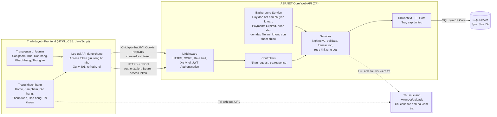
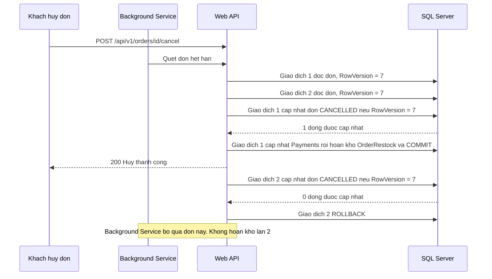
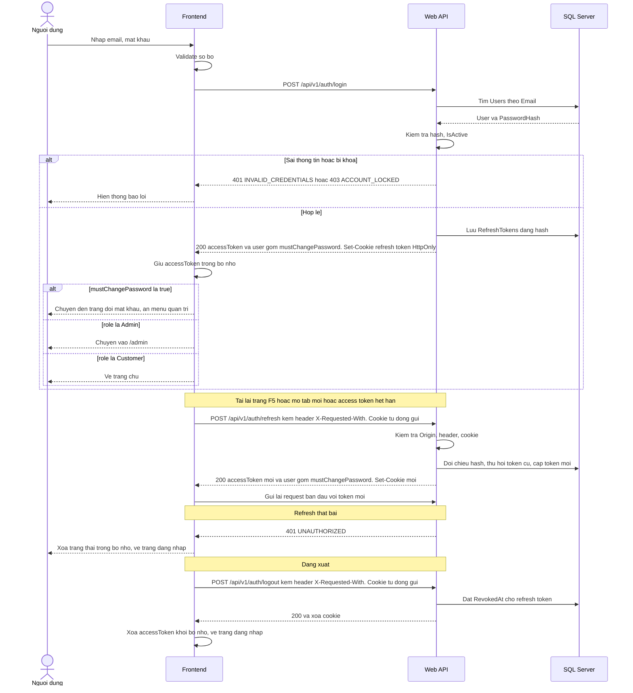
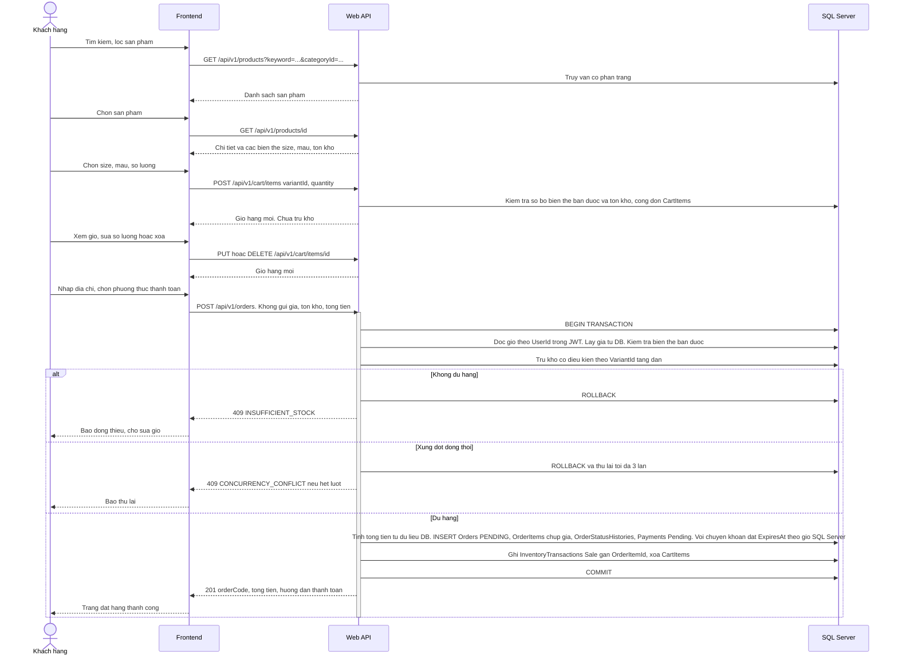
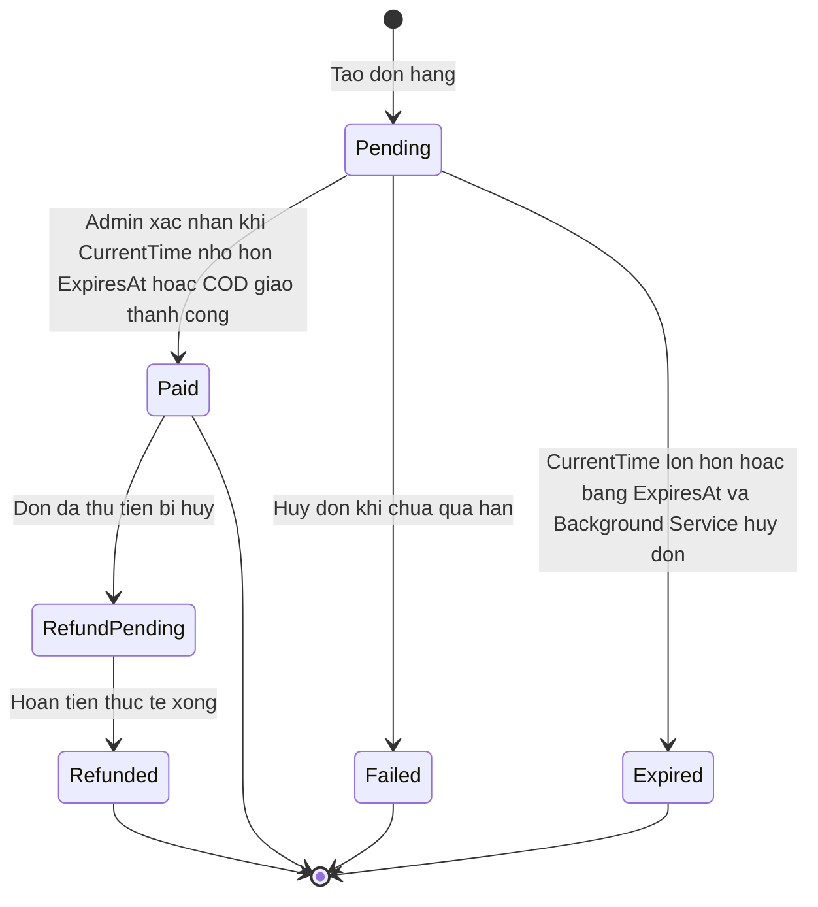
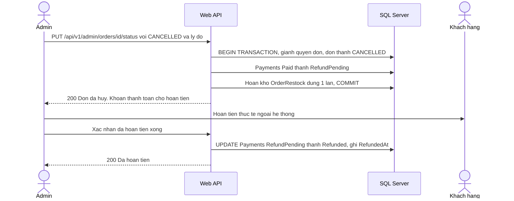
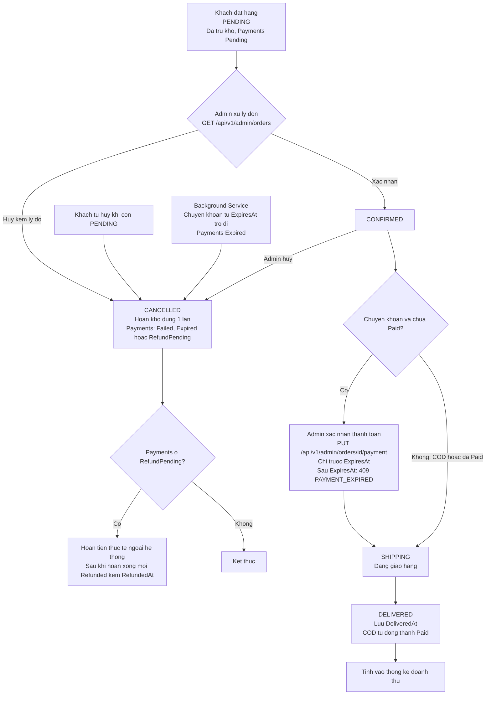
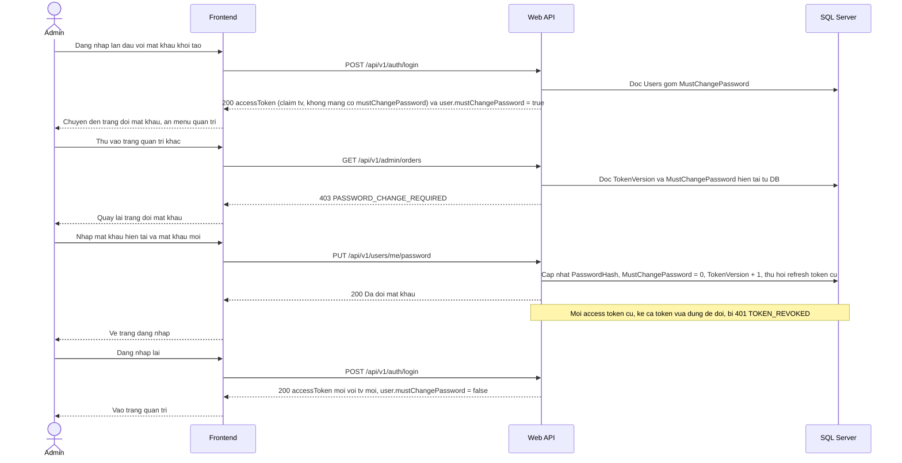
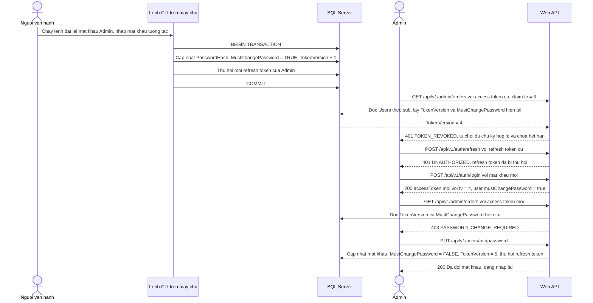

# SportShop – Tổng quan kiến trúc hệ thống

> **Phiên bản:** 1.6 – 20/11/2026 (đồng bộ với API Contract v1.1) | **Tác giả:** Agent 3
> **Trạng thái:** Bản đồng bộ, chờ duyệt. Chưa có code. Đọc cùng `database-design.md` (**v1.3**) và `api-contract.md` (**v1.1**, nguồn quyết định API). Các danh sách “chưa cập nhật” trong nhật ký lịch sử chỉ ghi lại tình trạng cũ. Mọi đường dẫn API có tiền tố `/api/v1`.

---

## 1. Kiến trúc tổng thể

Mô hình **3 lớp tách biệt**: Frontend (giao diện) ↔ Backend (nghiệp vụ, bảo mật) ↔ Database (dữ liệu). Frontend **không bao giờ** truy cập database trực tiếp, mọi thứ đi qua REST API.



### 1.1. Vai trò từng lớp

| Lớp | Công nghệ | Trách nhiệm chính |
|-----|-----------|-------------------|
| Frontend | HTML, CSS, JavaScript | Hiển thị, nhận thao tác người dùng, gọi API, validate sơ bộ cho tiện dùng, giữ access token trong **bộ nhớ** |
| Backend | ASP.NET Core Web API, C# | Xác thực, phân quyền, **validate thật**, nghiệp vụ, transaction, tính tiền, kiểm tra và trừ/hoàn kho, **kiểm tra hạn thanh toán bằng giờ của database**, kiểm tra file upload, **Background Service hủy đơn hết hạn** |
| Database | SQL Server + EF Core | Lưu trữ, ràng buộc toàn vẹn (UNIQUE, CHECK, FK, filtered unique index), `RowVersion`, đồng hồ thời gian chuẩn (UTC) |

### 1.2. Cấu trúc nội bộ Backend

| Phương án | Mô tả | Đánh giá |
|-----------|-------|----------|
| **A. 1 project, chia thư mục theo lớp** ✅ | `Controllers`, `Services`, `BackgroundJobs`, `Data` (DbContext, Entities, Migrations), `DTOs`, `Validators`, `Middleware`, `Configuration` | Đơn giản, dễ học, đủ cho quy mô dự án sinh viên |
| B. Clean Architecture nhiều project | Domain / Application / Infrastructure / API | Chuẩn doanh nghiệp nhưng nặng, dễ lạc hướng khi mới học |

**Đề xuất A.** Quy tắc: Controller **mỏng** (chỉ nhận/trả dữ liệu), nghiệp vụ nằm ở Service, Entity không trả thẳng ra ngoài mà luôn qua DTO (khớp JSON trong `api-contract.md`). Background Service cũng **gọi lại đúng Service hủy đơn** mà API dùng, không viết logic hủy/hoàn kho lần thứ hai.

### 1.3. Cấu trúc thư mục dự án (đề xuất)

```text
SportShop/
├── docs/                    <- 3 file tài liệu này
├── backend/
│   └── SportShop.Api/
│       └── wwwroot/uploads/ <- ảnh sản phẩm (KHÔNG commit lên Git)
├── frontend/
│   ├── index.html ...       <- trang khách hàng
│   ├── admin/               <- trang quản trị
│   ├── css/
│   └── js/
│       ├── api.js           <- lớp gọi API dùng chung (giữ access token trong bộ nhớ)
│       ├── auth.js          <- đăng nhập, refresh im lặng, đăng xuất
│       └── pages/           <- script riêng từng trang
├── .gitignore               <- loại uploads, file bí mật, chứng chỉ/khóa HTTPS cục bộ, bin/obj
└── README.md                <- hướng dẫn chạy, khởi tạo Admin (không chứa mật khẩu thật)
```

---

## 2. Frontend giao tiếp với Backend, xác thực và bảo vệ phiên

### 2.1. Quy ước chung

| Nội dung | Quy ước |
|----------|---------|
| Giao thức | REST qua **HTTPS**, JSON, theo `api-contract.md` |
| Tiền tố đường dẫn API | **Mọi** API dùng tiền tố **`/api/v1`** (ví dụ `POST /api/v1/auth/login`) và tài liệu này luôn ghi đầy đủ tiền tố. Đường dẫn ảnh `/uploads/...` là **file tĩnh**, không thuộc API nên không có tiền tố. `/admin` (không có `/api/v1`) là **trang giao diện** quản trị, khác với API `/api/v1/admin/*` |
| HTTPS và HSTS | **Production:** bắt buộc HTTPS, chuyển hướng HTTP sang HTTPS và **bật HSTS** (header `Strict-Transport-Security`; bắt đầu với `max-age` ngắn rồi tăng dần tới khoảng 1 năm khi đã chạy ổn định; chỉ thêm `includeSubDomains` khi mọi subdomain đều có HTTPS). **Development:** chạy **HTTPS với chứng chỉ phát triển cục bộ** (development certificate); **HSTS không bắt buộc** và không nên bật cho `localhost`, vì trình duyệt sẽ ghi nhớ và ép HTTPS cho mọi dự án khác dùng cùng tên máy |
| Gọi API | Dùng `fetch` thông qua **một** hàm dùng chung trong `api.js`: tự gắn `Authorization: Bearer`, đọc `success/message/errors`, xử lý 401 |
| Ảnh | Backend trả đường dẫn (`/uploads/...`); frontend ghép với địa chỉ server để hiển thị |
| Cấu hình | Địa chỉ API đặt ở 1 chỗ duy nhất trong `js` |

### 2.2. Lưu token: bộ nhớ + Cookie HttpOnly

| | Access token | Refresh token |
|---|--------------|---------------|
| Nơi lưu | **Biến JavaScript trong bộ nhớ** (mất khi tải lại trang/đóng tab) | **Cookie `HttpOnly`, `Secure`, `SameSite=Strict`**, JavaScript không đọc được |
| Sống bao lâu | 60 phút | 7 ngày (khớp `RefreshTokens.ExpiresAt`) |
| Gửi đi như thế nào | Header `Authorization: Bearer ...` do frontend gắn | Trình duyệt **tự gửi** cookie, chỉ tới đường dẫn `/api/v1/auth` |
| Trả về ở đâu | Trong body response của `login` và `refresh` | **Chỉ** qua `Set-Cookie`, **không** có trong body |
| Nội dung | JWT (claims: `sub`, `email`, `role`, `jti`, `iat`, `exp`, `tv`). Backend đối chiếu `tv` với DB ở mỗi request (mục 2.7) | Chuỗi ngẫu nhiên không mang thông tin; DB chỉ lưu **hash** (`RefreshTokens.TokenHash`) |

**Vì sao không dùng `localStorage`:**

| Nguy cơ | `localStorage` | Bộ nhớ + Cookie HttpOnly |
|---------|---------------|--------------------------|
| Mã độc XSS đọc được token để mang đi dùng ở nơi khác | **Có**, cả hai token | Refresh token **không đọc được**. Access token trong bộ nhớ chỉ bị lộ khi trang đang mở và sống tối đa 60 phút |
| Token tồn tại lâu trong ổ đĩa trình duyệt | Có | Không (access token); refresh token nằm trong cookie jar được trình duyệt bảo vệ |
| Bị tấn công CSRF | Không (không dùng cookie) | Có thể, **nhưng chỉ ở `/api/v1/auth/refresh`, `/api/v1/auth/logout`** và đã có biện pháp ở mục 2.5 |

> XSS vẫn nguy hiểm: kẻ tấn công chạy mã trong trang đang mở vẫn gọi được API thay người dùng. Vì vậy các quy tắc chống XSS ở mục 8 **vẫn bắt buộc**. Cách lưu token này chỉ làm thiệt hại nhỏ hơn.

**Thông tin hiển thị (tên, vai trò):** lưu trong bộ nhớ, lấy từ `user` trong response `login`/`refresh`. Có thể giữ 1 cờ **không nhạy cảm** (ví dụ "đã từng đăng nhập") trong `localStorage` chỉ để biết có nên gọi `refresh` lúc mở trang hay không, vì JavaScript không đọc được cookie HttpOnly.

### 2.3. Thông số cookie refresh token

| Thuộc tính | Giá trị | Lý do |
|-----------|---------|-------|
| `HttpOnly` | Bật | JavaScript không đọc được |
| `Secure` | Bật ở **mọi** môi trường, kể cả dev (API chạy HTTPS) | Chỉ gửi qua HTTPS |
| `SameSite` | `Strict` | Trình duyệt không gửi cookie khi yêu cầu xuất phát từ trang **khác site**. Chỉ hoạt động đúng khi chọn đúng cách triển khai ở mục 2.4 |
| `Path` | `/api/v1/auth` | Cookie chỉ đi kèm `login/refresh/logout`, không đi kèm các API khác |
| `Max-Age` | 7 ngày (theo cấu hình) | Khớp `ExpiresAt` |
| `Domain` | Không đặt (chỉ áp dụng cho đúng host của API) | Không chia sẻ cho subdomain khác |
| Giá trị | Chuỗi ngẫu nhiên ≥ 32 byte | Khó đoán; DB lưu hash |

### 2.4. Cách triển khai, cookie `SameSite=Strict` và CORS

#### Kiểm tra lại nhận định của v1.1

v1.1 coi Frontend `http://localhost:5500` và Backend `https://localhost:5001` là "cùng site" vì chỉ khác cổng. **Nhận định đó không được bảo đảm và nay được bỏ:**

- **Cổng** không ảnh hưởng đến khái niệm "site", nhưng **scheme (`http`/`https`) thì có**. Theo cơ chế "schemeful same-site" mà các trình duyệt hiện đại đã và đang triển khai, `http://localhost` và `https://localhost` là **hai site khác nhau**.
- Mức độ và phiên bản trình duyệt áp dụng cơ chế này khác nhau, nên **không thể mặc định** cookie `SameSite=Strict` được gửi khi Frontend chạy `http` còn Backend chạy `https`.
- Nếu cookie không được gửi, `POST /api/v1/auth/refresh` luôn bị `401` và người dùng mất phiên mỗi lần tải lại trang.
- **Không** "chữa" bằng cách hạ xuống `SameSite=None` hay bỏ `Secure`: làm mất lớp chống CSRF và hạ bảo mật. Phải sửa **cách triển khai**, không nới lỏng cookie.

#### Các phương án

| Phương án | Ví dụ | CORS | Đánh giá |
|-----------|-------|------|----------|
| **A. Cùng origin** (reverse proxy, hoặc Backend phục vụ luôn file frontend) ✅ **Khuyến nghị cho cả dev và chạy thật** | Dev: `https://localhost:5001` phục vụ giao diện và `/api/v1`, hoặc một reverse proxy cục bộ gom cả hai. Thật: `https://sportshop.vn` và `https://sportshop.vn/api/v1` | **Không cần** | Không phụ thuộc cách trình duyệt tính "site". Đơn giản và an toàn nhất |
| **B. Khác origin, cùng site, cả hai HTTPS** ✅ (phương án dự phòng) | Dev: `https://localhost:5500` gọi `https://localhost:5001`. Thật: `https://sportshop.vn` gọi `https://api.sportshop.vn` | Cần (như bảng dưới) | **Cùng scheme (`https`) và cùng tên máy/tên miền gốc.** Phải dùng đúng **một** tên máy cho cả hai (không trộn `localhost` và `127.0.0.1`). Vẫn phải kiểm thử ở trình duyệt thật (mục dưới) |
| C. Frontend `http`, Backend `https` ❌ | `http://localhost:5500` gọi `https://localhost:5001` | Cần | **Không bảo đảm** cookie được gửi. **Không dùng** |
| D. Khác site ❌ | Frontend ở `*.github.io`, API ở tên miền khác | Cần, thêm `SameSite=None` | **Tránh.** Mất lớp bảo vệ SameSite, phải thêm token CSRF riêng |

- **Dev với phương án B:** chạy máy chủ frontend bằng **HTTPS** với chứng chỉ phát triển cục bộ do công cụ tạo (được tin cậy trên máy dev). **Không commit** chứng chỉ và khóa riêng lên Git (đã có trong `.gitignore`).
- Mỗi lập trình viên trong nhóm dùng **cùng một phương án** để tránh lỗi "chạy trên máy này, hỏng trên máy kia".

#### Quy tắc CORS (chỉ cần với phương án B)

| Mục | Quy định |
|-----|----------|
| Origin được phép | **Danh sách tường minh** theo môi trường, đọc từ cấu hình (dev: `https://localhost:5500`; thật: `https://sportshop.vn`). **Không** dùng `*`. Không để origin dev lọt vào bản chạy thật |
| Cho phép gửi cookie (credentials) | **Bật**. Trình duyệt **cấm** kết hợp với `*`, nên bắt buộc dùng origin cụ thể |
| Method | `GET, POST, PUT, DELETE, OPTIONS` |
| Header được phép | `Authorization`, `Content-Type`, `X-Requested-With` |
| Header trả về cho JS đọc | Không cần thêm |
| Preflight | Cho cache (ví dụ 10 phút) để giảm số request `OPTIONS` |
| Phía Frontend | Các lời gọi `/api/v1/auth/*` phải bật chế độ gửi cookie khi gọi `fetch` (`credentials: include`); các API còn lại không cần |

#### Kiểm thử bắt buộc trước khi chốt cách triển khai

1. Đăng nhập xong, kiểm tra cookie refresh xuất hiện với đủ `HttpOnly`, `Secure`, `SameSite=Strict`, `Path=/api/v1/auth` (công cụ nhà phát triển của trình duyệt).
2. Tải lại trang (F5): `POST /api/v1/auth/refresh` thành công và phiên vẫn còn.
3. Làm lại trên **ít nhất hai trình duyệt** (ví dụ Chrome và Firefox).
4. Từ một trang **khác site**, gọi thử `/api/v1/auth/refresh`: phải bị chặn (không có cookie hoặc bị CORS chặn).
5. Nếu bước 1 hoặc 2 hỏng: **đổi sang phương án A**, không hạ `SameSite`, không bỏ `Secure`.

### 2.5. Chống CSRF

**Tình hình:** Backend chỉ dùng cookie ở `/api/v1/auth/refresh` và `/api/v1/auth/logout`. Các API còn lại dùng header `Authorization` mà trình duyệt **không tự gắn**, nên trang lạ không thể lợi dụng, tức **không có nguy cơ CSRF** với các API đó.

**Rủi ro ở `refresh`/`logout`:** trang độc hại có thể ép trình duyệt gọi hai API này kèm cookie. Kẻ tấn công **không đọc được** kết quả (bị CORS chặn) nhưng có thể làm người dùng bị đăng xuất hoặc xoay token ngoài ý muốn. Các lớp phòng thủ, dùng **đồng thời**:

| # | Biện pháp | Tác dụng |
|---|-----------|----------|
| 1 | Cookie `SameSite=Strict` (với cách triển khai A hoặc B ở mục 2.4) | Trình duyệt không gửi cookie từ trang khác site |
| 2 | Cookie `Path=/api/v1/auth` | Giới hạn nơi cookie được dùng |
| 3 | Bắt buộc header tùy chỉnh `X-Requested-With` trên `refresh`/`logout` | Header tùy chỉnh buộc trình duyệt hỏi CORS (preflight) trước; trang lạ bị chặn bởi danh sách origin |
| 4 | Kiểm tra header `Origin`/`Referer` với danh sách origin cho phép | Thêm một lớp xác minh phía server |
| 5 | Chỉ nhận `Content-Type: application/json` | Chặn form HTML cổ điển |
| 6 | Xoay vòng refresh token (mỗi lần refresh cấp token mới, thu hồi token cũ) | Giới hạn thiệt hại nếu token lọt ra ngoài |
| 7 | *(Chỉ khi buộc dùng phương án D)* Token CSRF kiểu double-submit | Bù cho việc mất SameSite |

### 2.6. Vòng đời token ở Frontend

| Tình huống | Xử lý |
|-----------|-------|
| Đăng nhập thành công | Giữ access token trong bộ nhớ, trình duyệt tự giữ cookie refresh |
| `login` hoặc `refresh` trả `user.mustChangePassword = true` | Chuyển ngay đến **trang đổi mật khẩu**, không cho vào trang khác. Cũng chuyển về trang này khi bất kỳ API nào trả `403 PASSWORD_CHANGE_REQUIRED` (mục 6.5) |
| API trả `401 TOKEN_REVOKED` (access token cũ sau khi đổi hoặc đặt lại mật khẩu) | Thử `refresh` một lần như mọi 401; thất bại thì xóa trạng thái trong bộ nhớ và chuyển về trang đăng nhập (mục 2.7) |
| Tải lại trang (F5) hoặc mở tab mới | Access token đã mất → nếu có cờ "đã từng đăng nhập" thì gọi `refresh` **trước khi** vẽ trang cần đăng nhập (hiện trạng thái chờ) |
| Access token sắp hết hạn | Tự `refresh` trước vài phút (dựa `accessTokenExpiresAt`) hoặc khi gặp 401 |
| Nhiều request cùng gặp 401 | Chỉ **một** lời gọi `refresh` chạy (các request khác chờ kết quả rồi gửi lại) |
| Nhiều tab cùng refresh | Dùng cơ chế khóa/giao tiếp giữa các tab của trình duyệt để chỉ một tab refresh, tránh dùng cùng một refresh token hai lần (vì token xoay vòng) |
| `refresh` thất bại (401) | Xóa trạng thái trong bộ nhớ, chuyển về trang đăng nhập |
| Đăng xuất | Gọi `logout` (server thu hồi token và xóa cookie), xóa access token khỏi bộ nhớ |

> Giai đoạn 1 **chưa** phát hiện "token bị dùng lại" theo cả họ token. Muốn có cần thêm cột trong `RefreshTokens` (xem mục 12.2).


### 2.7. Kiểm tra access token ở Backend và vô hiệu hóa token cũ (mới v1.5)

**Vấn đề:** JWT tự chứa chữ ký và hạn dùng nên vẫn hợp lệ tới hết 60 phút, kể cả khi mật khẩu đã bị đổi hoặc Admin vừa bị đặt lại mật khẩu bằng lệnh CLI. Thu hồi refresh token **không** làm access token cũ mất hiệu lực. Claim `MustChangePassword` nằm sẵn trong token cũ cũng **không đáng tin** vì chỉ phản ánh lúc cấp token.

**Các phương án:**

| Phương án | Cách hoạt động | Đánh giá |
|-----------|----------------|----------|
| **A. `Users.TokenVersion` + claim `tv`** ✅ | Mỗi tài khoản có một số phiên bản. Token mang `tv` lúc cấp. Backend so `tv` với DB ở mỗi request. Tăng `TokenVersion` là vô hiệu hóa **mọi** access token đã cấp trước đó | Tức thì, không phụ thuộc đồng hồ, đơn giản. Cần một lần đọc `Users` theo khóa chính ở mỗi request |
| B. Mốc `TokensValidAfter` so với `iat` | Từ chối token có `iat` trước mốc | Phụ thuộc đồng hồ giữa máy chủ ứng dụng và DB, độ chính xác giây nên dễ sai ở sát biên |
| C. Danh sách chặn theo `jti` | Ghi `jti` của token bị thu hồi | Phải biết trước từng token; bảng tăng dần; không thu hồi được token chưa biết |
| D. Rút ngắn thời hạn access token | Token sống 5 đến 10 phút | Vẫn còn khoảng hở, phải refresh liên tục |

**Chọn A.** Claims của access token: `sub`, `email`, `role`, `jti`, `iat`, `exp`, **`tv`**. JWT **không còn** claim `MustChangePassword`.

**Backend kiểm tra mỗi request đã xác thực, theo thứ tự:**

| Bước | Kiểm tra | Nếu không đạt |
|------|----------|---------------|
| 1 | Chữ ký, `exp`, `iss`/`aud` của JWT (không cần DB) | `401 UNAUTHORIZED` hoặc `401 TOKEN_EXPIRED` |
| 2 | Đọc dòng `Users` theo `sub` (khóa chính, đọc thông thường, không giữ khóa) để lấy `TokenVersion` và `MustChangePassword` **hiện tại** | Không có tài khoản: `401 UNAUTHORIZED` |
| 3 | `tv` trong token **bằng** `Users.TokenVersion` hiện tại | **`401 TOKEN_REVOKED`** (mã đề xuất). Từ chối **mọi** API, kể cả các API được phép khi `MustChangePassword = TRUE` |
| 4 | Nếu `MustChangePassword` hiện tại bằng `TRUE`: API phải thuộc danh sách được phép (`GET /api/v1/users/me`, `PUT /api/v1/users/me/password`, `POST /api/v1/auth/logout`, `POST /api/v1/auth/refresh`) | **`403 PASSWORD_CHANGE_REQUIRED`** |
| 5 | Phân quyền theo role và chủ sở hữu dữ liệu (mục 8) | `403 FORBIDDEN` hoặc `404` |

**Quy tắc đi kèm:**
- Bước 2 đến 4 áp dụng cho **mọi API cần đăng nhập**, và **bắt buộc** với `/api/v1/admin/*`. Cờ `MustChangePassword` luôn lấy **từ DB tại thời điểm request**, không lấy từ JWT.
- **Không dùng cache có thời hạn** cho hai giá trị này, vì cache mở lại đúng khoảng hở cần đóng. Nếu sau này cần tối ưu, phải xóa cache ngay khi cột đổi.
- **Khi nào tăng `TokenVersion`** (cùng transaction với thay đổi liên quan): (a) lệnh CLI đặt lại mật khẩu Admin (mục 6.6); (b) `PUT /api/v1/users/me/password` thành công (token vừa dùng để đổi cũng bị vô hiệu hóa nên phải đăng nhập lại). **Không** tăng khi đăng nhập, refresh, đăng xuất.
- **Cấp token:** access token luôn mang `TokenVersion` hiện tại lúc cấp (login, refresh). Việc so sánh làm ở **lúc dùng**, nên token cấp đúng lúc CLI đang chạy (đọc trước, cấp sau khi CLI commit) vẫn bị từ chối ở request kế tiếp.
- **Giới hạn còn lại:** request đang xử lý dở đúng lúc CLI commit vẫn hoàn tất; từ request tiếp theo trở đi mọi token cũ bị từ chối.
- Đăng xuất thông thường (`POST /api/v1/auth/logout`) vẫn chỉ thu hồi refresh token, **không** tăng `TokenVersion` (giữ nguyên quyết định trước đó: access token tự hết hạn tối đa 60 phút).
- Database: cần thêm cột `Users.TokenVersion` (mục 12.2).

---

## 3. Backend giao tiếp với SQL Server

### 3.1. Nền tảng

- Dùng **Entity Framework Core**, cách tiếp cận **Code First**: viết Entity theo `database-design.md` → tạo **Migration** → cập nhật database. Migration được commit lên Git để cả nhóm có cùng cấu trúc DB.
- **Với các index lọc (filtered index)**, sau khi tạo Migration phải **mở script SQL được sinh ra** để kiểm tra điều kiện lọc và chạy thử trên SQL Server thật (theo `database-design.md` mục 8.2).
- Chuỗi kết nối nằm trong cấu hình môi trường/User Secrets, không commit.
- Dữ liệu mẫu cố định bằng **seed data trong migration** chỉ gồm dữ liệu **không bí mật**: `Roles`, `OrderStatuses`, `PaymentMethods`. **Tài khoản Admin không nằm trong seed**, xem mục 6.
- Truy vấn danh sách luôn **phân trang ở phía database** và chỉ lấy các cột cần (dùng DTO).
- Mật khẩu hash bằng thuật toán chuẩn (PBKDF2 của ASP.NET Core hoặc BCrypt), không tự chế.

### 3.2. Transaction, thứ tự khóa và đồng hồ thời gian

**Quy tắc chung**

- Các thao tác nhiều bước (đặt hàng, hủy đơn, hết hạn, xác nhận thanh toán, hoàn tiền, điều chỉnh kho) chạy trong **một transaction**: lỗi giữa chừng thì ROLLBACK hết.
- **Mỗi thao tác đổi trạng thái đơn bắt đầu bằng "giành quyền xử lý đơn"**: cập nhật có điều kiện dòng `Orders` theo `RowVersion` và trạng thái hiện tại. Không cập nhật được dòng nào thì dừng, **không đụng tới thanh toán/kho**. Chỉ đọc `RowVersion` rồi bỏ đó là không đủ (`database-design.md` mục 6.7.2).
- **Đồng hồ thời gian:** mọi so sánh với `ExpiresAt` dùng **đồng hồ UTC của SQL Server**, đọc ngay trong câu lệnh cập nhật, bên trong transaction. Không dùng giờ máy chủ ứng dụng hay giờ do client gửi.

**Thứ tự khóa thống nhất cho mọi transaction: `Orders` → `Payments` → `Inventories`**

- Khi xử lý nhiều biến thể, khóa/cập nhật `Inventories` theo **`VariantId` tăng dần**, ở **mọi** thao tác (đặt hàng, hoàn kho khi hủy/hết hạn, nhập kho).
- Các dòng nhật ký (`InventoryTransactions`, `OrderStatusHistories`) chỉ **INSERT dòng mới**, làm sau cùng.
- **Cấm** lấy khóa theo thứ tự ngược (ví dụ đã giữ `Inventories` rồi quay lại cập nhật `Payments` hoặc `Orders`).

| Thao tác | Trình tự truy cập |
|----------|-------------------|
| Đặt hàng | Đọc giỏ và giá (đọc sơ bộ, không khóa) → `Inventories` (trừ có điều kiện, `VariantId` tăng dần) → **INSERT dòng mới** `Orders`, `OrderItems`, `OrderStatusHistories`, `Payments` → INSERT `InventoryTransactions` (`Sale`), xóa `CartItems` (đúng trình tự `database-design.md` v1.2 mục 6.4) |
| Xác nhận thanh toán (chỉ `BANK_TRANSFER`) | Đọc sơ bộ (không khóa) → `Orders` (giành quyền) → đọc lại `Payments` (đã khóa đơn) → `Payments` (cập nhật có điều kiện) |
| Hủy đơn (khách, Admin, Background Service) | `Orders` → `Payments` → `Inventories` (`VariantId` tăng dần) → ghi nhật ký |
| Chuyển `DELIVERED` (COD) | `Orders` → `Payments` |
| Chuyển `SHIPPING` | `Orders` → đọc `Payments` (sau khi đã khóa `Orders`) |
| Xác nhận đã hoàn tiền | `Payments` |
| Nhập kho / điều chỉnh kho (Admin) | `Inventories` (`VariantId` tăng dần nếu nhiều biến thể) |
| Đổi mật khẩu, lệnh CLI đặt lại mật khẩu Admin | `Users` (mật khẩu, `MustChangePassword`, `TokenVersion`) → `RefreshTokens` (thu hồi); không đụng `Orders`, `Payments`, `Inventories` |

Mỗi thao tác chỉ dùng một **phần** của chuỗi `Orders` → `Payments` → `Inventories` và luôn theo chiều đó, nên không tạo vòng chờ. Nếu vẫn xảy ra deadlock, transaction bị chọn làm nạn nhân được thử lại (mục 3.3).

**Quy tắc đọc sơ bộ và khóa (bổ sung v1.3):**

- **Đọc `Payments` (và `Inventories`) trước khi giành quyền `Orders` chỉ mang tính sơ bộ**: dùng để loại sớm các yêu cầu chắc chắn bị từ chối (trạng thái không thể quay lại) và báo lỗi sớm. Lần đọc này dùng mức đọc thông thường (READ COMMITTED) và **không giữ khóa sau khi đọc xong**. **Không bao giờ** trả kết quả thành công (ví dụ `200` idempotent) chỉ dựa trên lần đọc này.
- **Cấm** giữ khóa trên `Payments` hoặc `Inventories` (khóa cập nhật, giữ khóa đọc, mức cô lập REPEATABLE READ hoặc SERIALIZABLE) **trước khi đã khóa `Orders`**. Làm vậy đảo thứ tự khóa và có thể gây deadlock với thao tác khác.
- **Quyết định cuối chỉ dựa trên trạng thái sau khi đã giành quyền `Orders`**: điều kiện trên `Payments` được kiểm tra lại **ngay trong câu cập nhật có điều kiện** (hoặc đọc lại khi `Orders` đã bị khóa). Kết quả đọc sơ bộ **không** được dùng làm căn cứ để ghi dữ liệu.
- Đọc lại sau khi giành quyền thất bại (0 dòng) cũng chỉ để chọn mã lỗi. Nếu cần ghi tiếp thì phải mở transaction mới và giành quyền `Orders` từ đầu.

> **Phạm vi của thứ tự khóa.** Thứ tự `Orders` → `Payments` → `Inventories` áp dụng cho việc **khóa và cập nhật các dòng đã tồn tại**. Khi đặt hàng, `Orders`, `OrderItems`, `OrderStatusHistories`, `Payments` là các dòng **INSERT mới trong chính transaction**: chưa transaction nào khác nhìn thấy hay khóa được, nên chúng không tham gia vào thứ tự khóa và không thể tạo vòng chờ. Vì vậy trình tự đặt hàng theo `database-design.md` v1.2 mục 6.4 (trừ kho có điều kiện trước, tạo dòng mới sau) **không vi phạm** quy tắc, và hai tài liệu đã khớp nhau. Phần duy nhất của đặt hàng có thể tranh chấp với transaction khác là `Inventories`, luôn theo `VariantId` tăng dần.

### 3.3. Phân biệt `INSUFFICIENT_STOCK` và `CONCURRENCY_CONFLICT`

`RowVersion` (trên `Inventories` và `Orders`) là "số phiên bản" SQL Server tự đổi mỗi khi dòng bị sửa. Ghi dữ liệu kèm phiên bản đã đọc: nếu phiên bản **đã đổi**, nghĩa là có người khác sửa xen giữa, đó là **xung đột đồng thời** chứ **chưa chắc** là hết hàng. Vì vậy hai lỗi được tách riêng:

| | `INSUFFICIENT_STOCK` | `CONCURRENCY_CONFLICT` |
|---|----------------------|------------------------|
| Bản chất | **Lỗi nghiệp vụ**: tồn kho thật sự nhỏ hơn số lượng cần | **Lỗi kỹ thuật tạm thời**: dữ liệu bị đổi giữa lúc đọc và ghi (`RowVersion` không khớp), hoặc SQL Server chọn giao dịch này làm "nạn nhân" của deadlock |
| Cách phát hiện | Trừ kho có điều kiện không thành công vì tồn kho hiện tại < số lượng; hoặc đọc lại sau xung đột thấy không đủ | EF Core báo xung đột `RowVersion`; hoặc lỗi deadlock từ SQL Server |
| Thử lại có ích? | **Không**, trừ khi khách giảm số lượng | **Có**, thường thành công ở lần sau |
| Server làm gì | ROLLBACK, trả danh sách dòng thiếu và số còn lại | **Tự thử lại tối đa 3 lần** (mỗi lần mở transaction mới, đọc lại toàn bộ). Hết lượt vẫn xung đột → trả lỗi |
| HTTP | `409` | `409` |
| Message gợi ý | "Một số sản phẩm không đủ số lượng." | "Dữ liệu vừa thay đổi, vui lòng thử lại." |
| Frontend làm gì | Hiện dòng thiếu, cho sửa giỏ, **không** tự gọi lại | Cho phép bấm "Thử lại", có thể tự gọi lại 1 lần |

**Nguyên tắc chốt lỗi: sau mỗi xung đột, Server đọc lại trạng thái mới nhất rồi mới quyết định lỗi cuối cùng.** Nhờ vậy lỗi phản ánh đúng nguyên nhân hiện tại:

| Tình huống | Kết quả |
|-----------|---------|
| Hai khách mua **món cuối cùng** cùng lúc | Người thắng thành công. Người thua đọc lại thấy hết hàng → **`INSUFFICIENT_STOCK`** (không bao giờ là `CONCURRENCY_CONFLICT`) |
| Hai khách mua, kho **đủ cho cả hai**, nhưng cập nhật va chạm | Server thử lại, cả hai thành công. Chỉ khi hết 3 lượt thử mới trả **`CONCURRENCY_CONFLICT`** |
| Admin điều chỉnh kho đúng lúc có đơn đặt | Thử lại; hết lượt → `CONCURRENCY_CONFLICT` |
| Hai yêu cầu cùng đổi trạng thái một đơn | Đọc lại: nếu trạng thái mới khiến yêu cầu **không còn hợp lệ** → **`INVALID_STATUS_TRANSITION`**; nếu vẫn hợp lệ → thử lại; hết lượt → `CONCURRENCY_CONFLICT` |
| Xác nhận thanh toán va chạm với thao tác khác trên đơn | Đọc lại: khoản vẫn `Pending` nhưng đã `CurrentTime >= ExpiresAt` → **`PAYMENT_EXPIRED`**; khoản đã `Paid` → xử lý idempotent hoặc xung đột (mục 4.3.4); còn hợp lệ thì thử lại, hết lượt → `CONCURRENCY_CONFLICT` |
| Deadlock | Thử lại; hết lượt → `CONCURRENCY_CONFLICT` |

> Đường đặt hàng dùng **trừ kho có điều kiện, nguyên tử** (xem 3.4). Vì vậy hai người tranh nhau món cuối không tạo ra lỗi kỹ thuật: người thua chỉ đơn giản thấy "không đủ hàng". `RowVersion` là lớp bảo vệ bổ sung và là cơ chế chính cho thao tác đọc-rồi-ghi (đổi trạng thái đơn, điều chỉnh kho).

### 3.4. Thời điểm trừ kho và hoàn kho

| Sự kiện | Kho | Ghi `InventoryTransactions` | Ghi chú |
|---------|-----|----------------------------|---------|
| Thêm vào giỏ, sửa/xóa giỏ | **Không đổi** | Không | Kiểm tra tồn kho chỉ **sơ bộ**, giỏ không giữ chỗ |
| **Đặt hàng thành công** | **Trừ ngay** | `Sale` (âm), mỗi `OrderItems` một dòng | Trừ có điều kiện trong transaction đặt hàng, `VariantId` tăng dần. Thiếu hàng → từ chối cả đơn |
| Admin xác nhận đơn (`CONFIRMED`) | Không đổi | Không | Hàng vẫn đang được giữ từ lúc đặt |
| Chuyển `SHIPPING`, `DELIVERED` | Không đổi | Không | Không hoàn kho sau khi đã giao |
| **Khách hủy** (`PENDING`) | **Hoàn** | `OrderRestock` (dương) | Cùng transaction với đổi trạng thái |
| **Admin hủy** (`PENDING`/`CONFIRMED`) | **Hoàn** | `OrderRestock` | Như trên |
| **Hết hạn chuyển khoản** (Background Service) | **Hoàn** | `OrderRestock`, người thao tác = hệ thống | Như trên |
| Hoàn tiền (`RefundPending → Refunded`) | **Không đổi** | Không | Kho đã hoàn từ lúc hủy đơn; hoàn tiền chỉ là việc về thanh toán |
| Admin nhập kho / kiểm kê | Cộng / đặt lại | `Import` / `Adjustment` | Chỉ qua API tồn kho của Admin |

Nguyên tắc: **kho chỉ đổi qua đúng 3 con đường** là đặt hàng (trừ), hủy/hết hạn (hoàn), API tồn kho của Admin (nhập/điều chỉnh).

### 3.5. Hủy đơn, chống hoàn kho hai lần và cập nhật đơn đồng thời

Có hai lớp bảo vệ **độc lập**, lớp nào thủng thì lớp kia vẫn chặn:

| Lớp | Cơ chế | Khi bị kích hoạt |
|-----|--------|------------------|
| **1. Giành quyền xử lý đơn** | Đổi trạng thái `CANCELLED` bằng cập nhật có điều kiện (đúng `Orders.RowVersion` và trạng thái cũ) **trước khi** đụng tới thanh toán và kho | Bên đến sau cập nhật được **0 dòng** → ROLLBACK, **không hoàn kho** |
| **2. Ràng buộc DB** | Unique filtered index `(OrderItemId, TransactionType)` trên `InventoryTransactions`: mỗi dòng đơn tối đa 1 `OrderRestock` | Nếu vì lỗi nào đó vẫn cố hoàn kho lần hai, DB **từ chối**, ROLLBACK toàn bộ, kể cả bước cộng kho |

**Quy trình chuẩn, dùng chung cho khách hủy, Admin hủy và Background Service hết hạn (1 transaction, đúng thứ tự khóa mục 3.2):**

1. Mở transaction. **Đọc sơ bộ** đơn kèm `RowVersion` và khoản `Payments` hiện tại (đọc thông thường, **không giữ khóa**, chưa khóa `Orders`; chỉ để chọn nhánh và báo lỗi sớm, mục 3.2).
2. Kiểm tra sơ bộ quyền và trạng thái (`PENDING`/`CONFIRMED`; với hết hạn: khoản `BANK_TRANSFER` còn `Pending` và `CurrentTime >= ExpiresAt`).
3. **Giành quyền:** cập nhật có điều kiện `Orders` → `CANCELLED` (đúng `RowVersion`, `StatusId IN (PENDING, CONFIRMED)`), ghi `CancelReason`, `UpdatedAt`. **0 dòng → ROLLBACK, kết thúc** (người dùng nhận lỗi theo bảng 3.3; Background Service bỏ qua đơn). Từ bước này trở đi mới là căn cứ quyết định.
4. **Cập nhật `Payments` có điều kiện** (sau khi đã khóa `Orders`; điều kiện được kiểm tra lại ngay trong câu cập nhật, không dựa vào lần đọc sơ bộ ở bước 1):
   - `Pending` và `CurrentTime >= ExpiresAt` → **`Expired`** (dù ai kích hoạt việc hủy);
   - `Pending` còn hạn hoặc không có `ExpiresAt` → `Failed`;
   - `Paid` → **`RefundPending`** (chưa phải `Refunded`, vì tiền chưa được hoàn);
   - **0 dòng** (ví dụ job định hủy vì hết hạn nhưng khoản vừa được `Paid`) → **ROLLBACK toàn bộ, kể cả bước 3**: đơn không bị hủy.
5. Ghi `OrderStatusHistories` (`ChangedBy` = người thao tác, **NULL nếu là Background Service**).
6. Với từng dòng đơn (theo `VariantId` tăng dần): cộng kho và ghi `OrderRestock`.
7. COMMIT.

**Các cặp yêu cầu đồng thời thường gặp** (kết quả lỗi theo bảng 3.3):

| Cặp xảy ra cùng lúc | Kết quả |
|---------------------|---------|
| Khách hủy ↔ Background Service hết hạn | Một bên hủy + hoàn kho. Bên kia: khách nhận `INVALID_STATUS_TRANSITION` (đơn đã hủy); Background Service bỏ qua. **Hoàn kho đúng 1 lần** |
| Khách hủy ↔ Admin xác nhận đơn | Hủy trước → Admin nhận `INVALID_STATUS_TRANSITION`. Xác nhận trước → khách không hủy được nữa (chỉ hủy ở `PENDING`) → `INVALID_STATUS_TRANSITION` |
| Admin A ↔ Admin B cùng chuyển một trạng thái | Người sau nhận `INVALID_STATUS_TRANSITION` (đơn đã ở trạng thái đó) |
| **Admin xác nhận thanh toán ↔ Background Service hết hạn** | **Loại trừ nhau, không bao giờ cả hai cùng thành công.** Xác nhận chỉ thành công khi `CurrentTime < ExpiresAt` (đọc từ DB ngay trong câu cập nhật); hủy hết hạn chỉ chạy khi `CurrentTime >= ExpiresAt`. Xác nhận sau hạn → **`409 PAYMENT_EXPIRED`**, dù job chưa chạy |
| Admin xác nhận thanh toán ↔ Admin/khách hủy đơn | Ai giành quyền trước thì thắng. Hủy trước → xác nhận nhận `INVALID_STATUS_TRANSITION`. Xác nhận trước → khoản `Paid`, sau đó hủy đưa khoản sang `RefundPending` |
| Hai yêu cầu xác nhận thanh toán giống hệt nhau | Một yêu cầu giành quyền `Orders` trước và ghi `Paid`. Yêu cầu còn lại giành quyền **sau khi** yêu cầu đầu COMMIT, **đọc lại `Payments`** thấy khoản vẫn là `Paid` với cùng mã giao dịch và số tiền → trả `200` (idempotent) và ROLLBACK phần giành quyền, không ghi lần hai |
| Xác nhận đã hoàn tiền gửi lặp | Cập nhật có điều kiện theo trạng thái `RefundPending`: chỉ một lần ghi `Refunded`, lần sau không ghi lại |



---

## 4. Luồng hoạt động

### 4.1. Đăng ký, đăng nhập, làm mới phiên, đăng xuất



### 4.2. Luồng mua hàng (xem → giỏ → đặt)



### 4.3. Quy trình thanh toán, hết hạn tuyệt đối và hoàn tiền

**Nguyên tắc chung:** mỗi đơn có đúng một khoản `Payments` **"sống"** tại một thời điểm, tạo ngay khi đặt hàng với trạng thái `Pending` và `Amount = Orders.TotalAmount`. Trạng thái thanh toán gồm: `Pending`, `Paid`, `Failed`, `Expired`, `RefundPending`, `Refunded`.

#### 4.3.1. COD và chuyển khoản

| | **COD** (Thanh toán khi nhận hàng) | **BANK_TRANSFER** (Chuyển khoản) |
|---|-----------------------------------|----------------------------------|
| Lúc đặt hàng | `Payments` = `Pending`, **không có hạn** (`ExpiresAt` NULL) | `Payments` = `Pending`, `ExpiresAt` = giờ SQL Server lúc đặt + thời hạn cấu hình (mặc định **24 giờ**). Khách nhận hướng dẫn: số tài khoản (lấy từ cấu hình), số tiền, nội dung chuyển khoản = mã đơn |
| Khách làm gì | Chờ nhận hàng, trả tiền cho người giao | Chuyển khoản **trong hạn** |
| **Thời điểm `Pending → Paid`** | **Khi Admin chuyển đơn sang `DELIVERED`** (đã giao và thu tiền). Hệ thống tự đặt `Paid` trong **cùng transaction**, ghi `ReceivedAmount = Amount`, `PaidAt` theo giờ SQL Server | **Khi Admin xác nhận đã nhận tiền, và chỉ khi `CurrentTime < ExpiresAt`** (giờ lấy từ SQL Server, kiểm tra bên trong transaction xác nhận). `PaidAt` = thời điểm hệ thống ghi nhận xác nhận, luôn `< ExpiresAt` |
| Kiểm tra số tiền | Tự động bằng `Amount` | Số tiền nhận **phải đúng bằng** `TotalAmount`. **Thiếu hoặc thừa đều bị từ chối**, không đổi trạng thái; Admin xử lý chênh lệch ngoài hệ thống |
| Chống trùng | Không áp dụng | Mã giao dịch chỉ dùng 1 lần; mỗi đơn tối đa 1 khoản "sống"; xác nhận lặp xử lý theo bảng quyết định mục 4.3.4 |
| Liên hệ với trạng thái đơn | Đơn có thể `SHIPPING` khi `Pending` | Đơn **không** được `SHIPPING` nếu chưa `Paid`. Có thể `CONFIRMED` khi chưa `Paid` |
| Từ `ExpiresAt` trở đi mà chưa `Paid` | Không áp dụng | **Admin không xác nhận được nữa (`409 PAYMENT_EXPIRED`).** Background Service hủy đơn, `Payments` → `Expired`, hoàn kho |
| Hủy khi chưa thu tiền | `Pending → Failed` | `Pending → Failed` (khách/Admin hủy khi còn hạn) hoặc `Expired` (đã quá hạn) |
| Hủy khi đã thu tiền | Không xảy ra (COD chỉ `Paid` khi đã giao, mà đơn đã giao không hủy được) | Đơn đã `Paid` bị hủy (khách lúc `PENDING` hoặc Admin lúc `CONFIRMED`) → **`Paid → RefundPending → Refunded`** (mục 4.3.3) |

**Quy định thêm:**
- Việc **xác nhận thanh toán** và **xác nhận đơn** là **hai hành động riêng**. Hệ thống không tự đổi trạng thái đơn khi nhận tiền (giao diện Admin có thể hiện hai nút cạnh nhau). Xác nhận thanh toán có thể thực hiện khi đơn `PENDING` hoặc `CONFIRMED`.
- Xác nhận thanh toán mới chỉ được xử lý khi đơn **`PENDING` hoặc `CONFIRMED`**; yêu cầu gửi lại khi đơn đã `SHIPPING`/`DELIVERED` bị `409 INVALID_STATUS_TRANSITION` (Frontend GET chi tiết đơn để kiểm tra khoản đã `Paid`).
- **Phạm vi:** API xác nhận thanh toán của Admin và bảng quyết định mục 4.3.4 **chỉ áp dụng cho `BANK_TRANSFER`**. COD không có thao tác "xác nhận thanh toán": khoản COD chỉ chuyển `Pending → Paid` **tự động khi đơn sang `DELIVERED`**, trong cùng transaction. Gọi API xác nhận thanh toán cho đơn COD bị từ chối.
- **Bất biến:** đơn `DELIVERED` luôn có khoản `Paid`; mọi khoản `Paid` của chuyển khoản có `PaidAt < ExpiresAt`.
- Cổng thanh toán online (VNPay/MoMo) là giai đoạn sau và sẽ dùng **cùng quy trình xác nhận và cùng quy tắc hết hạn**: callback đến sau `ExpiresAt` không được xác nhận.

#### 4.3.2. Chính sách hết hạn tuyệt đối (Strict Expiration), đã chốt

| # | Quy tắc |
|---|---------|
| S1 | Khoản chuyển khoản `Pending` được coi là **hết hạn khi `CurrentTime >= ExpiresAt`** (đúng thời điểm `ExpiresAt` đã là hết hạn) |
| S2 | `CurrentTime` lấy từ **đồng hồ SQL Server**, kiểm tra **bên trong transaction xác nhận thanh toán**, ngay trong câu cập nhật có điều kiện `Pending → Paid`. Việc từ chối sớm ở lần đọc sơ bộ (khi đã quá hạn) chỉ là tối ưu, không phải căn cứ cho kết quả thành công |
| S3 | Từ thời điểm đó **Admin tuyệt đối không được xác nhận thanh toán**, **kể cả khi Background Service chưa chạy**. Backend trả **`409 PAYMENT_EXPIRED`**, không đổi dữ liệu |
| S4 | Việc từ chối là do **Backend tự kiểm tra lúc xác nhận**, không phụ thuộc Background Service và không phụ thuộc việc trạng thái trong DB còn ghi `Pending`. Job chậm hay ngừng chạy cũng **không** làm xác nhận quá hạn thành công |
| S5 | **Background Service** vẫn chịu trách nhiệm: tìm khoản hết hạn → hủy đơn → `Payments` → `Expired` → hoàn kho đúng 1 lần (quy trình mục 3.5) |
| S6 | Xác nhận thanh toán và hết hạn **loại trừ nhau** (giành quyền xử lý đơn + hai điều kiện thời gian đối nghịch). Một đơn **không thể** vừa `Paid` vừa bị hủy do hết hạn |
| S7 | **Tiền về muộn** (sau hạn) **không** chuyển `Expired` thành `Paid` và không tự xác nhận. **Xử lý thủ công ngoài hệ thống** (thường là hoàn tiền cho khách). Không có thao tác "mở lại" đơn đã hết hạn |
| S8 | **Gửi lại yêu cầu xác nhận đã thành công** không bị coi là xác nhận mới. Chỉ trả `200` (idempotent) nếu đơn vẫn `PENDING`/`CONFIRMED` và **sau khi giành quyền `Orders` rồi đọc lại `Payments`**, khoản hiện tại **vẫn là `Paid`** và trùng mã giao dịch lẫn số tiền (kể cả sau `ExpiresAt`). Đơn đã `SHIPPING`/`DELIVERED` trả `409 INVALID_STATUS_TRANSITION`, Frontend GET chi tiết để xem trạng thái `Paid`. **Không bao giờ** trả `200` chỉ dựa trên lần đọc sơ bộ (mục 4.3.4) |
| S9 | Khoảng từ `ExpiresAt` đến lúc đơn bị hủy thực tế (tối đa bằng chu kỳ quét, mặc định khoảng 5 phút) là **"quá hạn, chờ hủy"**: DB vẫn ghi `Pending`, nhưng xác nhận bị từ chối và hàng vẫn được giữ cho tới khi job chạy |

#### 4.3.3. Hoàn tiền: `Paid → RefundPending → Refunded`

| Bước | Điều gì xảy ra |
|------|----------------|
| 1. Hủy đơn đã thu tiền | Trong **cùng transaction hủy đơn** (mục 3.5): `Paid → RefundPending`, hoàn kho ngay. **Không** đi thẳng sang `Refunded` |
| 2. Hoàn tiền thực tế | Admin chuyển khoản trả tiền cho khách **ngoài hệ thống**. Hệ thống giữ khoản ở `RefundPending` để theo dõi (có danh sách "đơn cần hoàn tiền") |
| 3. Xác nhận đã hoàn tiền | **Chỉ sau khi tiền thực tế đã được hoàn**, Admin xác nhận trong hệ thống: cập nhật có điều kiện `RefundPending → Refunded`, ghi `RefundedAt`. Không bao giờ ghi `Refunded` trước khi hoàn xong |

Ghi chú: hoàn đủ `ReceivedAmount`, hoàn một phần chưa hỗ trợ. Tiền đến muộn (S7) không đi qua quy trình này vì không có khoản `Paid` nào.

#### 4.3.4. Xác nhận thanh toán chuyển khoản: quy trình, bảng quyết định và mã lỗi

**Phạm vi:** quy trình và bảng quyết định dưới đây **chỉ áp dụng cho `BANK_TRANSFER`**. Với **COD** không có thao tác "xác nhận thanh toán" của Admin: khoản COD chỉ chuyển `Pending → Paid` **tự động khi đơn sang `DELIVERED`** (mục 4.3.1). Gọi API xác nhận thanh toán cho đơn COD bị từ chối bằng `409 INVALID_STATUS_TRANSITION` (mã đề xuất).

**Quy trình xác nhận (Admin gửi `receivedAmount`, `transactionCode`):**

1. **Đọc sơ bộ** đơn (kèm `RowVersion`) và khoản `Payments` hiện tại: đọc thông thường, **không giữ khóa**, chưa khóa `Orders` (mục 3.2). Chỉ dùng để **loại sớm các yêu cầu chắc chắn bị từ chối**.
2. **Giành quyền xử lý `Orders`:** mở transaction, cập nhật có điều kiện `Orders` (ghi `UpdatedAt`) với đúng `RowVersion` và đơn **`PENDING` hoặc `CONFIRMED`**. **0 dòng** → ROLLBACK và đọc lại; nếu đơn đã `SHIPPING`/`DELIVERED` trả `409 INVALID_STATUS_TRANSITION` (không trả `200` từ đọc sơ bộ); nếu đơn `CANCELLED` phân nhánh theo trạng thái khoản; nếu chỉ đổi `RowVersion` thử lại tối đa 3 lần rồi `409 CONCURRENCY_CONFLICT`.
3. **Đọc lại `Payments` khi đã khóa `Orders`** và áp dụng bảng quyết định lần cuối. **Đây mới là căn cứ cho mọi kết quả `200`.**
4. Nếu khoản `Pending` còn hạn: kiểm tra số tiền nhận = `Orders.TotalAmount` (sai → ROLLBACK, `409 PAYMENT_AMOUNT_MISMATCH`), rồi **cập nhật có điều kiện `Payments`** `Pending → Paid` (điều kiện: còn `Pending` và `CurrentTime < ExpiresAt` theo giờ SQL Server), ghi `ReceivedAmount`, `PaidAt = CurrentTime`, `TransactionCode`. **0 dòng** → ROLLBACK, đọc lại và áp dụng lại bảng quyết định (thường là hết hạn, `PAYMENT_EXPIRED`).
5. COMMIT và trả `200`. **Mọi kết quả khác đều ROLLBACK**, nên phần "giành quyền" ở bước 2 không được giữ lại và đơn không bị ghi gì (kể cả `UpdatedAt`).

**Bảng quyết định** (dùng ở bước 1 để từ chối sớm và ở bước 3 để quyết định cuối):

| Trạng thái khoản hiện tại | Dữ liệu yêu cầu so với bản ghi | Kết quả | HTTP / mã lỗi | Kết luận được ngay từ lần đọc sơ bộ (bước 1)? |
|---------------------------|--------------------------------|---------|---------------|-----------------------------------------------|
| `Pending`, `CurrentTime < ExpiresAt` | Không xét | Đi tiếp: kiểm tra số tiền, cập nhật có điều kiện `Pending → Paid` | 200 nếu thành công | **Không.** Phải giành quyền `Orders`, đọc lại rồi mới cập nhật |
| `Pending`, `CurrentTime >= ExpiresAt` | Không xét | Từ chối vì hết hạn | **409 `PAYMENT_EXPIRED`** | Có thể từ chối sớm (thời gian không quay lại) |
| `Expired` | Bất kỳ | Từ chối vì hết hạn | **409 `PAYMENT_EXPIRED`** | Có (trạng thái cuối) |
| `Paid` | Trùng `transactionCode` **và** `receivedAmount` | Trả kết quả hiện tại khi đơn `PENDING`/`CONFIRMED`, không ghi gì (kể cả sau `ExpiresAt`); với `SHIPPING`/`DELIVERED` trả `409 INVALID_STATUS_TRANSITION` | **200** nếu giành quyền được | **Không.** Chỉ trả `200` ở bước 3, sau khi giành quyền `Orders` và đọc lại `Payments` |
| `Paid` | Khác `transactionCode` hoặc `receivedAmount` | Xung đột, không đổi gì | 409 `PAYMENT_ALREADY_CONFIRMED` | Có thể từ chối sớm (dữ liệu của khoản đã thu không đổi) |
| `RefundPending`, `Refunded` | Bất kỳ | Xung đột (đơn đã hủy) | 409 `PAYMENT_ALREADY_CONFIRMED` | Có |
| `Failed`, hoặc đơn `CANCELLED` không còn khoản chờ | Bất kỳ | Từ chối | 409 `INVALID_STATUS_TRANSITION` | Có |
| Đơn `COD` | Bất kỳ | Từ chối: COD chỉ `Paid` khi `DELIVERED` | 409 `INVALID_STATUS_TRANSITION` | Có (phương thức thanh toán không đổi) |

**Nguyên tắc đồng bộ API v1.1:** từ chối sớm chỉ khi trạng thái không thể quay lại. Không được trả `200` từ đọc sơ bộ. Giành quyền theo `IN (PENDING, CONFIRMED)`; đơn đã `SHIPPING` hoặc `DELIVERED` trả `409 INVALID_STATUS_TRANSITION` kể cả khi gửi lại dữ liệu của khoản `Paid`, sau đó Frontend gọi GET chi tiết để xác minh. Mọi kết quả `200` đều cần giành quyền và đọc lại `Payments`.

Các lỗi khác liên quan:

| Tình huống | HTTP | Mã lỗi |
|-----------|------|--------|
| Số tiền nhận khác `TotalAmount` (thiếu hoặc thừa) | 409 | `PAYMENT_AMOUNT_MISMATCH` (trường `receivedAmount`) |
| Mã giao dịch đã dùng cho khoản khác | 409 | `DUPLICATE_TRANSACTION` (đề xuất) |
| Xung đột đồng thời, hết lượt thử lại | 409 | `CONCURRENCY_CONFLICT` |

#### 4.3.5. Sơ đồ

Trạng thái thanh toán:



Xác nhận chuyển khoản (chỉ `BANK_TRANSFER`), hết hạn tuyệt đối. Mọi kết quả `200` chỉ đến sau khi giành quyền `Orders` và đọc lại `Payments`. Nhánh đơn `CANCELLED` được xử lý theo **trạng thái khoản** (`Expired` → `PAYMENT_EXPIRED`; `RefundPending`/`Refunded` → `PAYMENT_ALREADY_CONFIRMED`; `Failed` → `INVALID_STATUS_TRANSITION`). `SHIPPING`/`DELIVERED` → `409 INVALID_STATUS_TRANSITION`:

```mermaid
sequenceDiagram
    actor K as Khach hang
    actor AD as Admin
    participant A as Web API
    participant D as SQL Server
    participant J as Background Service

    K->>A: POST /api/v1/orders voi BANK_TRANSFER
    A->>D: Tao don PENDING, Payments Pending, ExpiresAt = gio SQL Server + 24 gio
    A-->>K: 201 Huong dan chuyen khoan va han thanh toan
    K->>K: Chuyen khoan dung so tien, noi dung la ma don

    AD->>A: PUT /api/v1/admin/orders/id/payment kem so tien va ma giao dich
    A->>D: Doc so bo don va khoan Payments. Khong giu khoa, chua khoa Orders
    alt Don COD hoac khoan Failed
        A-->>AD: 409 INVALID_STATUS_TRANSITION
    else Khoan Expired hoac Pending da qua han
        A-->>AD: 409 PAYMENT_EXPIRED
    else Khoan Paid du lieu khac, hoac RefundPending, Refunded
        A-->>AD: 409 PAYMENT_ALREADY_CONFIRMED
    else Chua ket luan duoc, khoan Pending con han hoac khoan Paid du lieu trung
        A->>D: BEGIN TRANSACTION
        A->>D: Gianh quyen don bang UPDATE theo RowVersion, chi PENDING hoac CONFIRMED
        alt Khong gianh duoc quyen, 0 dong
            A->>D: ROLLBACK
            A->>A: Doc lai don roi quay lai buoc doc so bo, toi da 3 lan
            A-->>AD: SHIPPING/DELIVERED: 409 INVALID_STATUS_TRANSITION; CANCELLED: theo khoan; het luot 409 CONCURRENCY_CONFLICT
        else Gianh duoc quyen
            A->>D: Doc lai khoan Payments, luc nay don da bi khoa
            alt Khoan van la Paid va du lieu trung
                A->>D: ROLLBACK, khong ghi gi
                A-->>AD: 200 Tra ket qua hien tai
            else Paid du lieu khac, hoac RefundPending, Refunded
                A->>D: ROLLBACK
                A-->>AD: 409 PAYMENT_ALREADY_CONFIRMED
            else Expired, hoac Pending da qua han
                A->>D: ROLLBACK
                A-->>AD: 409 PAYMENT_EXPIRED
            else Failed hoac don CANCELLED khong con khoan cho
                A->>D: ROLLBACK
                A-->>AD: 409 INVALID_STATUS_TRANSITION
            else Pending con han
                A->>D: Kiem tra receivedAmount bang TotalAmount, sai: 409 PAYMENT_AMOUNT_MISMATCH va ROLLBACK
                A->>D: UPDATE Payments Pending thanh Paid neu gio SQL Server nho hon ExpiresAt
                alt 1 dong duoc cap nhat
                    D-->>A: PaidAt = gio SQL Server, nho hon ExpiresAt
                    A->>D: COMMIT
                    A-->>AD: 200 Da xac nhan thanh toan
                else 0 dong
                    A->>D: ROLLBACK, doc lai va ap dung lai bang quyet dinh
                    A-->>AD: Thuong la 409 PAYMENT_EXPIRED
                end
            end
        end
    end

    Note over J,D: Khi gio SQL Server lon hon hoac bang ExpiresAt va chua Paid
    J->>A: Huy don het han
    A->>D: Gianh quyen don, Payments thanh Expired, hoan kho dung 1 lan, COMMIT
    Note over K,AD: Tien ve muon khong chuyen Expired thanh Paid. Xu ly thu cong, hoan tien cho khach
```

Hủy đơn đã thu tiền và hoàn tiền:



### 4.4. Luồng quản lý đơn hàng



Mỗi lần đổi trạng thái đều ghi 1 dòng `OrderStatusHistories`, khách xem thành dòng thời gian ở chi tiết đơn. Mọi lần đổi đều đi qua cơ chế giành quyền xử lý đơn ở mục 3.5, theo thứ tự khóa mục 3.2.

---

## 5. Bảo mật upload ảnh vào `wwwroot/uploads`

Chỉ **Admin** được upload (`POST /api/v1/admin/products/{id}/images`). Coi mọi file người dùng gửi lên là **không đáng tin** cho tới khi qua đủ các kiểm tra sau.

### 5.1. Kiểm tra trước khi lưu

| # | Quy tắc | Lý do |
|---|---------|-------|
| 1 | Chỉ nhận **JPG, PNG, WEBP**. Danh sách trắng, **không** nhận SVG, GIF, HTML, PDF, file nén, file chạy được | SVG/HTML có thể chứa script (XSS) |
| 2 | Kiểm tra **nội dung thật** của file (chữ ký đầu file, "magic bytes") và đối chiếu với đuôi. **Không tin** đuôi file hay `Content-Type` do client gửi | Đuôi và header giả mạo rất dễ |
| 3 | Dung lượng tối đa **2 MB** (khớp API). Đặt giới hạn kích thước body cho riêng endpoint này ở tầng Kestrel/endpoint | Chống tràn bộ nhớ, tấn công từ chối dịch vụ |
| 4 | Giới hạn kích thước ảnh (ví dụ ≤ 4000×4000 px) và số ảnh mỗi sản phẩm (đề xuất ≤ 10) | Chống "bom giải nén" |
| 5 | **Xử lý lại ảnh** ở server (decode rồi ghi lại), loại bỏ metadata (EXIF, vị trí) | Hủy các payload giấu trong ảnh; bảo vệ riêng tư |
| 6 | Kiểm tra `productId` tồn tại; nếu có `colorId` thì phải thuộc biến thể của sản phẩm đó | Dữ liệu hợp lệ |
| 7 | Mỗi lần chỉ nhận **một file**; có giới hạn tần suất cho endpoint upload (rate limit) | Chống spam |

### 5.2. Quy tắc lưu trữ

| # | Quy tắc |
|---|---------|
| 1 | **Không bao giờ dùng tên file người dùng gửi.** Tên lưu = chuỗi ngẫu nhiên (ví dụ GUID) + đuôi chuẩn hóa theo **loại thật** của ảnh |
| 2 | **Không bao giờ ghi đè file đã có.** Mỗi lần upload tạo file **mới với tên mới**; `ProductImages.ImageUrl` là UNIQUE |
| 3 | Đường dẫn: `wwwroot/uploads/products/{productId}/{tên-ngẫu-nhiên}.{đuôi}`. Server tự dựng đường dẫn từ dữ liệu đã kiểm tra, **chặn ký tự `..`, `/`, `\`**, và kiểm tra đường dẫn cuối cùng vẫn nằm trong thư mục uploads (chống path traversal) |
| 4 | Lưu vào DB `ProductImages.ImageUrl` dạng **đường dẫn tương đối** (`/uploads/products/1/xxx.jpg`) |
| 5 | Ghi nhật ký: ai upload, sản phẩm nào, tên file, dung lượng, thời gian |
| 6 | Thư mục `uploads` **không commit lên Git** (`.gitignore`), có kế hoạch sao lưu riêng |

### 5.3. Quy tắc phục vụ file

| # | Quy tắc |
|---|---------|
| 1 | Thư mục uploads **chỉ phục vụ file tĩnh**: không thực thi script, không bật liệt kê thư mục |
| 2 | Chỉ phục vụ các đuôi ảnh trong danh sách trắng, trả đúng `Content-Type` kèm `X-Content-Type-Options: nosniff` |
| 3 | Không cho ghi vào thư mục này bằng bất kỳ đường nào khác ngoài API upload |
| 4 | Ảnh là dữ liệu công khai: **không** đưa thông tin nhạy cảm vào ảnh |

### 5.4. Thay ảnh và xóa ảnh (liên quan snapshot đơn hàng)

`OrderItems.ImageUrl` đã **chụp lại** đường dẫn ảnh lúc mua (`database-design.md` mục 6.3 và 6.9.1). Vì vậy:
- **Thay ảnh = tải file mới (tên mới)** rồi cho dòng `ProductImages` trỏ sang đường dẫn mới. Nội dung file cũ **không bị sửa hay ghi đè**.
- **Xóa ảnh** chỉ xóa **dòng trong DB** (đơn mới không còn chụp ảnh đó), **chưa xóa file ngay**.
- **Chỉ xóa file vật lý khi chắc chắn không còn tham chiếu:** không còn dòng `ProductImages` nào **và** không còn `OrderItems.ImageUrl` nào trỏ tới, **và** file đã ở trạng thái "không dùng" đủ lâu (đề xuất ≥ 24 giờ) để loại trừ đơn đang đặt dở. Việc này do **tiến trình dọn dẹp định kỳ** (chạy trong Background Service) thực hiện; có nghi ngờ hoặc lỗi thì **giữ file**.

### 5.5. Mở rộng (chưa làm ở giai đoạn 1)

Quét virus cho file upload; chuyển lưu trữ ảnh sang dịch vụ đám mây có CDN; tạo ảnh thu nhỏ (thumbnail).

---

## 6. Tài khoản Admin: khởi tạo, đổi mật khẩu lần đầu, khôi phục và nhật ký

**Nguyên tắc:** mật khẩu Admin **không bao giờ** xuất hiện trong mã nguồn, migration, seed data, file cấu hình commit lên Git, hay log.

### 6.1. Các phương án

| Phương án | Mô tả | Đánh giá |
|-----------|-------|----------|
| ~~Hardcode trong seed/migration~~ | Tạo sẵn `admin/admin123` trong code | ❌ **Cấm.** Ai đọc repo cũng biết mật khẩu |
| **A. Bước khởi tạo riêng đọc bí mật từ môi trường** ✅ | Seed migration chỉ chứa `Roles`, `OrderStatuses`, `PaymentMethods`. Khi ứng dụng khởi động, **chỉ khi hệ thống chưa có Admin nào** và cờ khởi tạo đang bật thì tạo **Admin đầu tiên** từ email và mật khẩu lấy từ **biến môi trường / User Secrets**. Đã có Admin thì bỏ qua hoàn toàn | Không có bí mật trong repo, tự động, chạy lặp lại không tạo thêm Admin |
| **B. Lệnh khởi tạo chạy tay một lần** ✅ (thay thế cho A) | Chạy một lệnh của ứng dụng, **hỏi** email và mật khẩu ngay trên terminal. Lệnh **từ chối chạy nếu đã có Admin** | Mật khẩu không nằm trong file, biến môi trường hay lịch sử lệnh. Phù hợp máy chạy thật |
| C. Endpoint "thiết lập lần đầu" qua web | Trang web cho tạo Admin đầu tiên | Tăng bề mặt tấn công (nếu quên tắt) → **không chọn** |

**Đề xuất:** dùng **A cho môi trường phát triển** (User Secrets) và **B hoặc A với biến môi trường của dịch vụ hosting cho môi trường chạy thật**.

### 6.2. Quy tắc bắt buộc

| # | Quy tắc |
|---|---------|
| 1 | Bước khởi tạo **chỉ tạo Admin đầu tiên và chỉ khi hệ thống chưa có Admin nào** (không có tài khoản `Users` nào thuộc role Admin). Đã có Admin thì **bỏ qua hoàn toàn**: không tạo, không ghi đè mật khẩu, kể cả khi cấu hình một email khác. Việc kiểm tra "chưa có Admin" và việc tạo diễn ra trong **cùng một transaction**; nếu nhiều bản ứng dụng khởi động cùng lúc, chỉ một bản được tạo (khóa mức ứng dụng của SQL Server, hoặc chạy bước khởi tạo ở một bản duy nhất) |
| 2 | Mật khẩu được **hash ngay** rồi mới lưu vào `Users.PasswordHash`; không ghi mật khẩu thuần ra log, console hay exception |
| 3 | Mật khẩu ban đầu mạnh (đề xuất **≥ 12 ký tự**, ngẫu nhiên), không dùng mật khẩu mẫu hay dễ đoán |
| 4 | Sau khi tạo xong: **gỡ biến môi trường/bí mật khởi tạo** và tắt cờ khởi tạo |
| 5 | Admin **phải đổi mật khẩu ở lần đăng nhập đầu** (đã chốt). Việc này được **cưỡng chế** bằng `Users.MustChangePassword` (mục 6.5). Đổi bằng `PUT /api/v1/users/me/password` (các refresh token cũ bị thu hồi theo thiết kế hiện tại) |
| 6 | Tài khoản Admin **không bị khóa** qua API quản lý khách (theo `api-contract.md`) và chịu giới hạn thử đăng nhập sai như mọi tài khoản |
| 7 | Dữ liệu mẫu `admin@sportshop.vn` trong `database-design.md` chỉ để **minh họa**, **không** được đưa vào migration/seed |
| 8 | Giai đoạn 1 chỉ có **một Admin** (đã chốt hoãn tạo thêm Admin, mục 6.4). **Không** dùng bước khởi tạo để thêm Admin |
| 9 | Quên mật khẩu Admin: **chỉ** khôi phục bằng lệnh CLI chạy trên máy chủ (mục 6.6). Không có API công khai để đặt lại mật khẩu Admin |

### 6.3. Quản lý các bí mật khác (cùng nguyên tắc)

| Bí mật | Nơi lưu | Quy tắc |
|--------|---------|---------|
| Khóa ký JWT | User Secrets (dev) / biến môi trường hay secret manager (thật) | Ngẫu nhiên ≥ 32 byte, **mỗi môi trường một khóa riêng** |
| Chuỗi kết nối SQL Server | Như trên | Dùng tài khoản SQL quyền tối thiểu, không dùng `sa` |
| Mật khẩu khởi tạo Admin | Như trên | Dùng một lần rồi gỡ |
| Mật khẩu đặt lại bằng CLI (mục 6.6) | **Không lưu ở đâu cả**: nhập tương tác, chỉ tồn tại trong bộ nhớ lúc chạy lệnh | Không đưa vào tham số dòng lệnh, biến môi trường, file cấu hình hay log |
| Chứng chỉ và khóa riêng HTTPS cục bộ (dev) | Máy lập trình viên | **Không commit lên Git**, đã nằm trong `.gitignore` |
| Thông tin tài khoản ngân hàng nhận tiền (hiển thị cho khách) | Cấu hình, không phải bí mật nhưng tách khỏi code | Dễ đổi, không commit số tài khoản thật vào repo công khai |

**Quy trình dự phòng:** `appsettings.json` commit lên Git chỉ chứa **giá trị rỗng/mẫu** cho các mục bí mật. Bật quét bí mật và chặn push của GitHub. **Nếu lỡ commit một bí mật thì coi như đã lộ:** đổi ngay (mật khẩu, khóa JWT, chuỗi kết nối), không chỉ xóa khỏi lịch sử Git.


### 6.4. Tạo thêm Admin: hoãn sang giai đoạn sau (đã chốt: LATER)

| Mục | Quy định ở giai đoạn 1 |
|-----|------------------------|
| Số lượng Admin | Chỉ có **một Admin đầu tiên**, tạo bằng bước khởi tạo ở mục 6.1 |
| API tạo Admin | **Chưa triển khai** `POST /api/v1/admin/admins`; không có trong `api-contract.md` |
| Đăng ký thông thường | `POST /api/v1/auth/register` **chỉ tạo `Customer`**. Không có cách tự đăng ký hay tự nâng quyền thành Admin |
| Quản lý nhiều Admin | **Không xây dựng** ở giai đoạn 1 (thêm, khóa, thu hồi quyền Admin) |
| Bước khởi tạo | Chỉ chạy khi chưa có Admin (mục 6.2, quy tắc 1); **không** dùng để thêm Admin |
| Khi cần ở giai đoạn sau | Sẽ thiết kế thành chức năng riêng có xác thực, phân quyền và dấu vết thao tác, rồi duyệt lại tài liệu. Tài liệu này **không đặc tả sẵn** để tránh triển khai nhầm |

### 6.5. Bắt buộc đổi mật khẩu lần đầu: `Users.MustChangePassword` (đã chốt: YES)

| Mục | Quy định |
|-----|----------|
| Cột trong Database | `Users.MustChangePassword`: kiểu `BIT`, **NOT NULL**, mặc định `0`; đi cùng cột `Users.TokenVersion` (mục 2.7). **Cả hai đã có** trong `database-design.md` v1.3 (mục 3.1, ERD, BR-30/31) |
| Khi nào bằng 1 (`TRUE`) | Admin đầu tiên (mục 6.1) và Admin vừa được đặt lại mật khẩu bằng lệnh CLI (mục 6.6). Customer luôn bằng 0 |
| Khi nào về 0 (`FALSE`) | Khi `PUT /api/v1/users/me/password` thành công (kèm cập nhật `UpdatedAt`) |
| Hiển thị cho client | `POST /api/v1/auth/login` và `POST /api/v1/auth/refresh` trả thêm `user.mustChangePassword` |
| Cưỡng chế ở Backend | Cờ được **đọc từ DB ở mỗi request** (mục 2.7), **không dựa vào claim trong JWT**. Khi cờ bằng 1, Backend **chỉ cho phép** các API cần để đổi mật khẩu và đăng xuất: `GET /api/v1/users/me`, `PUT /api/v1/users/me/password`, `POST /api/v1/auth/logout` và `POST /api/v1/auth/refresh` (dùng cookie, để giữ phiên trong lúc đổi mật khẩu). Mọi API khác trả **`403 PASSWORD_CHANGE_REQUIRED`** (mã lỗi đề xuất mới). Không dựa vào Frontend |
| Sau khi đổi mật khẩu | Trong cùng một transaction: cờ về `FALSE`, **`Users.TokenVersion` tăng**, thu hồi refresh token cũ. Mọi access token cũ, **kể cả token vừa dùng để đổi**, bị `401 TOKEN_REVOKED` ngay, nên người dùng **đăng nhập lại** |
| Frontend | Phải **nhận biết** trạng thái này: từ `user.mustChangePassword = true` ở response `login`/`refresh`, hoặc từ `403 PASSWORD_CHANGE_REQUIRED` của bất kỳ API nào. Khi đó **chuyển Admin đến trang đổi mật khẩu**, ẩn menu quản trị, chặn điều hướng sang trang khác; đổi xong chuyển về trang đăng nhập |



### 6.6. Khôi phục mật khẩu Admin bằng CLI (đã chốt)

Giai đoạn 1 **không có** chức năng "quên mật khẩu". Nếu Admin duy nhất quên mật khẩu, người vận hành dùng một lệnh CLI chạy **trực tiếp trên máy chủ**:

| Mục | Quy định |
|-----|----------|
| Cách chạy | Lệnh CLI của ứng dụng, chạy trên máy chủ bởi người vận hành có quyền truy cập máy chủ. **Không có** API, endpoint HTTP hay trang web tương ứng; không gọi được từ xa qua ứng dụng |
| Quyền | Lệnh phải đọc được cấu hình bí mật của máy chủ (chuỗi kết nối, mục 6.3), nên chỉ tài khoản hệ điều hành được cấp quyền mới chạy được |
| Đối tượng | Chỉ tài khoản thuộc role **Admin** (nhận diện bằng email). Từ chối nếu email không tồn tại hoặc không phải Admin, để lệnh không trở thành công cụ đặt lại mật khẩu cho Customer |
| Mật khẩu mới | Nhập **tương tác** (ẩn ký tự, nhập hai lần), đạt chính sách mật khẩu Admin (≥ 12 ký tự). **Không** nhận mật khẩu qua tham số dòng lệnh, biến môi trường hay file cấu hình, để không lọt vào lịch sử lệnh, danh sách tiến trình hay cấu hình |
| Xác nhận | Hỏi xác nhận trước khi thực hiện |
| Kết quả | Trong **một transaction**: hash ngay rồi cập nhật `Users.PasswordHash` và `UpdatedAt`; đặt **`MustChangePassword = TRUE`**; **tăng `Users.TokenVersion`**; **thu hồi mọi refresh token** của tài khoản (`RefreshTokens.RevokedAt`). Access token cũ **mất hiệu lực ngay**, không phải chờ hết 60 phút (mục 2.7) |
| Vô hiệu hóa access token cũ | Mọi request mang access token cấp **trước** lúc đặt lại có `tv` khác `Users.TokenVersion` hiện tại, nên Backend từ chối `401 TOKEN_REVOKED` ở bước kiểm tra đầu tiên (mục 2.7), **kể cả với các API được phép khi `MustChangePassword = TRUE`**. Refresh token cũ bị từ chối `401`. Chỉ đăng nhập lại bằng mật khẩu mới mới nhận token có `tv` mới |
| Buộc đổi mật khẩu | Sau khi đăng nhập bằng mật khẩu vừa đặt, Backend đọc `MustChangePassword = TRUE` từ DB ở **mỗi request**, nên mọi API quản trị trả `403 PASSWORD_CHANGE_REQUIRED` cho tới khi Admin gọi `PUT /api/v1/users/me/password` thành công. Không có đường nào khác đưa cờ về `FALSE` |
| Không lưu mật khẩu | Mật khẩu chỉ tồn tại trong bộ nhớ lúc chạy lệnh; **không ghi vào log, cấu hình, lịch sử lệnh hay màn hình** |
| Nhật ký | Ghi sự kiện vào nhật ký ứng dụng (mục 6.7): đặt lại mật khẩu Admin bằng CLI, email tài khoản, thời điểm, tên tài khoản hệ điều hành chạy lệnh. **Không** ghi mật khẩu |
| Sau khi chạy | Admin đăng nhập bằng mật khẩu vừa đặt và bị buộc đổi ngay theo mục 6.5 (người vận hành biết mật khẩu tạm này) |
| Khi nào dùng | Chỉ khi Admin không đăng nhập được. Còn đăng nhập được thì dùng `PUT /api/v1/users/me/password` |

Luồng sau khi CLI đặt lại mật khẩu (token cũ bị chặn, Admin phải đổi mật khẩu):



Phân biệt: **bước khởi tạo** (6.1) chỉ chạy khi **chưa có Admin**; **lệnh đặt lại** (6.6) chỉ chạy khi Admin **đã tồn tại**.

### 6.7. Nhật ký thao tác quản trị ở giai đoạn 1

**Quyết định:** **không tạo bảng `AuditLogs`** ở giai đoạn 1. Lý do: chức năng tạo thêm Admin (nguyên nhân cần audit riêng) đã hoãn, còn các thao tác quản trị nghiệp vụ đã có dấu vết ngay trong bảng của chúng.

| Thao tác quản trị | Dấu vết lưu ở đâu (giai đoạn 1) |
|-------------------|-------------------------------|
| Đổi trạng thái, hủy đơn | `OrderStatusHistories` (`ChangedBy`, `ChangedAt`, `Note`); Background Service ghi `ChangedBy` = NULL |
| Nhập kho, điều chỉnh kho, bán, hoàn kho | `InventoryTransactions` (`CreatedBy`, `CreatedAt`, `Note`) |
| Xác nhận thanh toán | `Payments` (`PaidAt`, `TransactionCode`, `ReceivedAmount`). **Chưa lưu "ai xác nhận"**; người xác nhận ghi trong nhật ký ứng dụng |
| Xác nhận đã hoàn tiền | `Payments` (`RefundedAt`). **Chưa lưu "ai xác nhận"**; ghi trong nhật ký ứng dụng |
| Khởi tạo Admin đầu tiên | **Nhật ký ứng dụng** (sự kiện hệ thống, mục 6.1) |
| Đặt lại mật khẩu Admin bằng CLI | **Nhật ký ứng dụng** (mục 6.6) |
| Thêm, sửa, xóa mềm sản phẩm/danh mục/thương hiệu/size/màu, khóa khách | Chỉ có `UpdatedAt` của dòng; không audit chi tiết ở giai đoạn 1 |

**Quy tắc cho nhật ký ứng dụng:**
- Dạng có cấu trúc: thời điểm (UTC), loại sự kiện, đối tượng (email hoặc mã đơn), người thực hiện (id Admin, hoặc tên tài khoản hệ điều hành với lệnh CLI), kết quả.
- **Không bao giờ** ghi mật khẩu, token, mã băm hay chuỗi kết nối.
- Chỉ người vận hành được đọc; có thời gian lưu giữ (đề xuất ≥ 90 ngày, mục 12.3).
- Giai đoạn sau, nếu thêm chức năng tạo thêm Admin hoặc cần truy vết bền vững ("ai xác nhận thanh toán/hoàn tiền"), mới cân nhắc bảng `AuditLogs` hoặc cột người thực hiện, và phải cập nhật `database-design.md`.

---

## 7. Quy tắc phân chia công việc Frontend và Backend

| Việc | Frontend | Backend |
|------|:--------:|:-------:|
| Vẽ giao diện, điều hướng, trạng thái loading/rỗng/lỗi | ✅ | |
| Validate sơ bộ (rỗng, định dạng) để báo lỗi nhanh | ✅ | |
| **Validate dữ liệu thật** | | ✅ (bắt buộc) |
| Định dạng hiển thị (tiền, ngày giờ giờ VN) | ✅ | |
| Giữ access token trong bộ nhớ, gắn vào request, refresh im lặng, chỉ một refresh tại một thời điểm | ✅ | |
| Phát hành cookie refresh (HttpOnly/Secure/SameSite/Path), xoay vòng và thu hồi token | | ✅ |
| Chọn cách triển khai A hoặc B (mục 2.4), cấu hình CORS (origin tường minh, cho phép cookie), kiểm tra `Origin` và `X-Requested-With` ở `/api/v1/auth/*` | Gắn header `X-Requested-With` và `credentials: include` ở `/api/v1/auth/*`; chạy HTTPS khi dev | ✅ |
| Ký/kiểm tra JWT, hash mật khẩu | | ✅ |
| **Phân quyền** (Customer/Admin, chủ sở hữu dữ liệu) | Chỉ ẩn/hiện menu | ✅ (quyết định thật) |
| Tính tiền (tổng, phí ship) | Chỉ hiển thị ước tính | ✅ (con số chính thức) |
| Kiểm tra tồn kho, trừ/hoàn kho | Chỉ hiển thị | ✅ (quyết định thật) |
| Chốt giá khi đặt hàng | | ✅ (không nhận giá từ client) |
| Xử lý xung đột đồng thời, tự thử lại, thứ tự khóa `Orders` → `Payments` → `Inventories` | Hiện thông báo, cho phép "Thử lại" khi `CONCURRENCY_CONFLICT` | ✅ |
| Chuyển trạng thái đơn đúng luồng | Hiển thị nút phù hợp | ✅ (kiểm tra luồng) |
| Xác nhận thanh toán chuyển khoản (chỉ `BANK_TRANSFER`): kiểm tra số tiền, **kiểm tra hạn bằng giờ database trong transaction**, giành quyền `Orders` rồi đọc lại `Payments`, idempotency | Form nhập số tiền, mã giao dịch; hiển thị `PAYMENT_EXPIRED`; **không** tự quyết định đơn còn hạn hay không | ✅ |
| Xác nhận đã hoàn tiền (`RefundPending → Refunded`) | Form xác nhận sau khi đã hoàn tiền thực tế | ✅ (cập nhật có điều kiện) |
| Hủy đơn hết hạn chuyển khoản | | ✅ (Background Service) |
| Dọn file ảnh không còn tham chiếu | | ✅ (Background Service) |
| Tổng hợp thống kê | Vẽ biểu đồ | ✅ (truy vấn tổng hợp) |
| Upload ảnh | Chọn file, xem trước, báo lỗi | ✅ (kiểm tra loại, nội dung, dung lượng, xử lý lại, tên mới, lưu an toàn) |
| Khởi tạo Admin **đầu tiên** (chỉ khi chưa có Admin), quản lý bí mật | | ✅ (kèm vận hành) |
| Cưỡng chế đổi mật khẩu lần đầu (mục 6.5) | Nhận biết `user.mustChangePassword` hoặc `403 PASSWORD_CHANGE_REQUIRED`, chuyển Admin đến trang đổi mật khẩu, ẩn menu quản trị | ✅ (cờ `MustChangePassword` đọc từ DB mỗi request, `TokenVersion`, chặn các API khác) |
| Đặt lại mật khẩu Admin bằng CLI (mục 6.6) | | ✅ (lệnh chạy trên máy chủ, vận hành) |

**Nguyên tắc vàng:** *Không tin dữ liệu từ client.* Frontend chỉ là giao diện, mọi quyết định về tiền, quyền, kho, thời hạn đều do Backend.

### 7.1. Cách hai bên làm việc song song

1. Hai bên **chỉ bám `api-contract.md`**. Muốn đổi API thì sửa tài liệu trước, cả hai đồng ý rồi mới sửa code.
2. **Thứ tự làm Backend theo phụ thuộc (khớp mục 11.1):** `Auth → Admin nhập dữ liệu → Catalog công khai → Cart → Orders → Admin xử lý đơn → Statistics`. Vì sao: **Auth** đứng đầu vì Admin phải đăng nhập (và đổi mật khẩu lần đầu) mới nhập được dữ liệu; **Admin nhập dữ liệu** (danh mục, thương hiệu, size, màu, sản phẩm + biến thể + ảnh, nhập kho) phải có trước **Catalog công khai** vì catalog chỉ hiển thị dữ liệu đó; **Cart** cần catalog (biến thể, giá, tồn kho); **Orders** cần giỏ hàng và kho; **Admin xử lý đơn** (đổi trạng thái, xác nhận thanh toán, hoàn tiền, Background Service hết hạn) cần đơn hàng đã tồn tại; **Statistics** cần đơn `DELIVERED`. Frontend có thể dùng dữ liệu giả theo đúng JSON mẫu để làm giao diện trong lúc chờ.
3. Quản lý Git: nhánh `main` (ổn định), `develop` (tích hợp), nhánh tính năng `feature/<tên>`; gộp qua Pull Request, không đẩy thẳng vào `main`.

---

## 8. Bảo mật tổng hợp

| Nguy cơ | Biện pháp |
|---------|-----------|
| Lộ mật khẩu | Chỉ lưu hash có salt; không ghi mật khẩu vào log; không hardcode (mục 6) |
| Tạo Admin trái phép | Bước khởi tạo chỉ chạy khi **chưa có Admin**; **không có API tạo Admin** ở giai đoạn 1; `POST /api/v1/auth/register` luôn tạo Customer; Admin đầu tiên bắt buộc đổi mật khẩu (mục 6.1, 6.4, 6.5) |
| Đặt lại mật khẩu Admin trái phép | Chỉ bằng lệnh CLI cần quyền truy cập máy chủ, không có API công khai; mật khẩu nhập tương tác, không lưu trong log hay cấu hình; sau khi đặt lại bật `MustChangePassword`, tăng `TokenVersion` (vô hiệu hóa ngay access token cũ), thu hồi refresh token; ghi nhật ký ứng dụng (mục 6.6, 6.7) |
| Đánh cắp phiên | Access token trong bộ nhớ và sống ngắn (60 phút); refresh token trong cookie HttpOnly, xoay vòng, thu hồi được; bắt buộc HTTPS ở mọi môi trường; **HSTS bật ở production**, development dùng HTTPS với development certificate và không bắt buộc HSTS (mục 2.1) |
| Access token cũ còn hiệu lực sau khi đổi hoặc đặt lại mật khẩu | `Users.TokenVersion` + claim `tv`, Backend đối chiếu với DB ở mỗi request: token cũ bị `401 TOKEN_REVOKED` ngay. Cờ `MustChangePassword` đọc từ DB mỗi request, không dựa claim. Đổi mật khẩu và lệnh CLI đều tăng `TokenVersion` và thu hồi refresh token trong một transaction (mục 2.7, 6.5, 6.6) |
| CSRF | `SameSite=Strict` (với cách triển khai A hoặc B), cookie `Path=/api/v1/auth`, header `X-Requested-With`, kiểm tra `Origin`, chỉ nhận JSON (mục 2.5) |
| CORS/cookie cấu hình sai | Origin tường minh theo môi trường, không dùng `*`; **không** giả định `http` và `https` là cùng site; kiểm thử trình duyệt thật; hỏng thì đổi cách triển khai, không hạ `SameSite` (mục 2.4) |
| Truy cập trái quyền | `[Authorize]` theo role ở mọi API `/api/v1/admin/*`; kiểm tra chủ sở hữu (`UserId` từ JWT) với giỏ/đơn/địa chỉ |
| SQL Injection | Dùng EF Core (truy vấn tham số hóa), không nối chuỗi SQL |
| XSS | Không dùng `innerHTML` với dữ liệu người dùng (dùng `textContent`); header Content-Security-Policy; không nhận SVG/HTML qua upload |
| Dò mật khẩu | Giới hạn số lần đăng nhập sai (rate limiting) theo IP/tài khoản, cả `/api/v1/auth/refresh` |
| Upload độc hại | Toàn bộ mục 5 |
| Lộ bí mật | Khóa JWT, chuỗi kết nối, mật khẩu khởi tạo, khóa HTTPS cục bộ ở ngoài Git; quét bí mật; `.gitignore` đầy đủ (mục 6.3) |
| Giả mạo giá/tồn kho | Server tự lấy giá và tồn kho từ DB, không nhận từ request |
| Bán quá số lượng, hoàn kho trùng | Trừ kho có điều kiện, `RowVersion`, giành quyền xử lý đơn, unique index chống hoàn kho trùng (mục 3.5) |
| Deadlock giữa các transaction | Thứ tự khóa thống nhất `Orders` → `Payments` → `Inventories`, `VariantId` tăng dần (mục 3.2) |
| Xác nhận thanh toán sai (quá hạn, sai số tiền, trùng) | Kiểm tra hạn bằng giờ SQL Server trong transaction (`PAYMENT_EXPIRED`), đúng số tiền, mã giao dịch duy nhất, 1 khoản "sống" mỗi đơn, CHECK `PaidAt < ExpiresAt` (mục 4.3) |
| Giữ hàng vô thời hạn | Hết hạn chuyển khoản tự hủy và hoàn kho |
| Lộ lỗi kỹ thuật | Middleware xử lý lỗi, trả thông báo chung + `traceId` |

---

## 9. Truy vết yêu cầu → thiết kế (đảm bảo không bỏ sót chức năng)

### 9.1. Khách hàng

| # | Chức năng | Bảng chính | API chính |
|---|-----------|------------|-----------|
| 1 | Đăng ký | `Users`, `Carts` | `POST /api/v1/auth/register` |
| 2 | Đăng nhập, đăng xuất | `Users`, `RefreshTokens` | `POST /api/v1/auth/login`, `/api/v1/auth/logout`, `/api/v1/auth/refresh` |
| 3 | Xem danh sách sản phẩm | `Products`, `ProductVariants`, `ProductImages` | `GET /api/v1/products` |
| 4 | Tìm kiếm, lọc | `Products`, `Categories`, `Brands`, `Sizes`, `Colors` | `GET /api/v1/products?...`, `GET /api/v1/categories`, `GET /api/v1/brands`, `GET /api/v1/sizes`, `GET /api/v1/colors` |
| 5 | Xem chi tiết sản phẩm | `Products`, `ProductVariants`, `Inventories` | `GET /api/v1/products/{id}` |
| 6 | Nhiều Size, Color | `ProductVariants`, `Sizes`, `Colors` | `variants[]` trong chi tiết sản phẩm |
| 7 | Thêm vào giỏ | `Carts`, `CartItems` | `POST /api/v1/cart/items` |
| 8 | Cập nhật số lượng, xóa khỏi giỏ | `CartItems` | `PUT`, `DELETE /api/v1/cart/items/{id}`, `DELETE /api/v1/cart` |
| 9 | Đặt hàng, thanh toán | `Orders`, `OrderItems`, `Payments`, `PaymentMethods`, `Inventories`, `InventoryTransactions` | `POST /api/v1/orders`, `GET /api/v1/payment-methods` |
| 10 | Lịch sử đơn hàng | `Orders`, `OrderItems` (snapshot) | `GET /api/v1/orders` |
| 11 | Theo dõi trạng thái đơn | `OrderStatusHistories`, `OrderStatuses`, `Payments` | `GET /api/v1/orders/{id}` (`statusHistory`), `POST /api/v1/orders/{id}/cancel` |
| 12 | Quản lý thông tin cá nhân | `Users`, `UserAddresses` | `/api/v1/users/me*` |

### 9.2. Quản trị viên

| # | Chức năng | Bảng chính | API chính |
|---|-----------|------------|-----------|
| 1 | Đăng nhập trang quản trị | `Users`, `Roles` | `POST /api/v1/auth/login` (role `Admin`) |
| 2 | Quản lý sản phẩm (Thêm, Sửa, Xóa, Xem) | `Products`, `ProductVariants`, `ProductImages` | `/api/v1/admin/products*` |
| 3 | Quản lý danh mục | `Categories` | `/api/v1/admin/categories*` |
| 4 | Quản lý thương hiệu | `Brands` | `/api/v1/admin/brands*` |
| 5 | Quản lý kích thước, màu sắc | `Sizes`, `Colors` | `/api/v1/admin/sizes*`, `/api/v1/admin/colors*` |
| 6 | Quản lý tồn kho | `Inventories`, `InventoryTransactions` | `/api/v1/admin/inventory*` |
| 7 | Quản lý đơn hàng | `Orders`, `OrderItems`, `Payments` | `GET /api/v1/admin/orders*` |
| 8 | Cập nhật trạng thái đơn | `Orders`, `OrderStatusHistories`, `Payments` | `PUT /api/v1/admin/orders/{id}/status`, `/payment`; xác nhận hoàn tiền `PUT /api/v1/admin/orders/{id}/refund` (API v1.1) |
| 9 | Quản lý tài khoản khách hàng | `Users` | `/api/v1/admin/customers*` |
| 10 | Thống kê doanh thu | `Orders` | `GET /api/v1/admin/statistics/revenue` |

*(Hạ tầng không thuộc chức năng người dùng nhưng bắt buộc theo thiết kế: Background Service hết hạn chuyển khoản và dọn file ảnh; khởi tạo Admin đầu tiên, cưỡng chế đổi mật khẩu lần đầu, khôi phục mật khẩu Admin bằng CLI; kiểm soát upload. Tạo thêm Admin được hoãn sang giai đoạn sau.)*

---

## 10. Kiểm tra nhất quán

### 10.1. Với `database-design.md` v1.3

| Điểm kiểm tra | Kết quả |
|---------------|---------|
| Mã trạng thái đơn `PENDING/CONFIRMED/SHIPPING/DELIVERED/CANCELLED` | Khớp |
| Trạng thái thanh toán `Pending/Paid/Failed/Expired/RefundPending/Refunded` (mục 4.3 ↔ DB 3.6) | Khớp |
| Vòng đời thanh toán: `Pending → Paid`, `→ Failed`, `→ Expired`, `Paid → RefundPending → Refunded` (state diagram 4.3.5 ↔ DB 3.6, 6.5) | Khớp |
| Hết hạn tuyệt đối: `CurrentTime >= ExpiresAt`, giờ SQL Server, xác nhận bị từ chối dù job chưa chạy (S1 đến S9 ↔ DB R1 đến R9, BR-20) | Khớp |
| `PaidAt` là thời điểm hệ thống ghi nhận xác nhận, `< ExpiresAt` (mục 4.3.1 ↔ DB CHECK) | Khớp |
| Bảng quyết định và quy trình xác nhận thanh toán (mục 4.3.4 ↔ DB 6.5) | **Đã đồng bộ:** đọc sơ bộ không giữ khóa; `200` sau giành quyền `Orders` và đọc lại `Payments`; phạm vi chỉ chuyển khoản |
| Hoàn tiền `RefundPending → Refunded` sau khi hoàn thực tế, `RefundedAt` (4.3.3 ↔ DB 6.7.5, BR-27) | Khớp |
| Quy trình hủy đơn: giành quyền → `Payments` → hoàn kho; cập nhật `Payments` 0 dòng thì ROLLBACK cả bước hủy (mục 3.5 ↔ DB 6.7.3) | Khớp |
| Thứ tự khóa `Orders` → `Payments` → `Inventories`, `VariantId` tăng dần (mục 3.2 ↔ DB 6.7.2) | Khớp. Thứ tự bước trong đặt hàng đã đồng bộ từ v1.3, không còn lệch với DB 6.4 |
| Điều kiện giành quyền khi xác nhận thanh toán (mục 4.3.4 ↔ DB 6.7.2) | **Đã đồng bộ:** chỉ `IN (PENDING, CONFIRMED)` theo API v1.1 |
| Loại giao dịch kho `Import/Sale/OrderRestock/Adjustment`, hoàn kho đúng 1 lần (mục 3.4, 3.5 ↔ DB 3.3, BR-19) | Khớp |
| Tối đa 1 khoản thanh toán "sống" mỗi đơn (`UX_Payments_Order_Live`) | Khớp |
| Ảnh: tên mới, không ghi đè, xóa file chỉ khi chắc chắn không còn tham chiếu và đã qua thời gian an toàn (mục 5.2, 5.4 ↔ DB 6.9.1, BR-28) | Khớp |
| `OrderItems`, `InventoryTransactions`, `OrderStatusHistories` bất biến/append-only | Khớp |
| Seed: chỉ `Roles`, `OrderStatuses`, `PaymentMethods`, không có Admin (mục 3.1, 6) | Khớp. Riêng cột `Users.MustChangePassword` (đã chốt YES, mục 6.5) và cột mới `Users.TokenVersion` (mục 2.7) **đã bổ sung** ở DB v1.3 |
| Kiểm tra access token ở mỗi request bằng `Users.TokenVersion`; cờ `MustChangePassword` đọc từ DB (mục 2.7, 6.5 ↔ DB 3.1) | **Đã có ở DB v1.3** (`TokenVersion`) |
| Đổi mật khẩu và lệnh CLI tăng `TokenVersion`, thu hồi `RefreshTokens` trong một transaction (mục 6.5, 6.6 ↔ DB 3.1) | Khớp về bảng; cột `TokenVersion` đã bổ sung ở DB v1.3 |
| Tạo thêm Admin được hoãn, không có API tạo Admin và không cần bảng `AuditLogs` ở giai đoạn 1 (mục 6.4, 6.7 ↔ DB) | Khớp, DB không có bảng `AuditLogs` |
| Lệnh CLI đặt lại mật khẩu Admin chỉ cập nhật `Users` và `RefreshTokens` (mục 6.6 ↔ DB 3.1) | Khớp, không cần thêm bảng |
| Quy trình đặt hàng: đọc giỏ, kiểm tra biến thể bán được, trừ kho có điều kiện, tạo `Orders`/`OrderItems`/`OrderStatusHistories`/`Payments` (`ExpiresAt` theo giờ SQL Server), ghi `Sale`, xóa giỏ (mục 3.2, 4.2 ↔ DB 6.4) | Khớp |
| Thứ tự khóa áp dụng cho dòng đã tồn tại; các dòng INSERT mới không thuộc thứ tự (mục 3.2 ↔ DB 6.7.2, 6.4) | Khớp về nội dung. DB nên thêm một câu làm rõ (mục 12.2) |
| Đọc sơ bộ không giữ khóa trước khi khóa `Orders` (mục 3.2, 3.5, 4.3.4 ↔ DB 6.5, 6.7.3) | Khớp về nội dung. DB nên ghi rõ "không giữ khóa" (mục 12.2) |

### 10.2. Đã rà soát trong file này (không còn mâu thuẫn)

| Chủ đề | Nội dung cũ | Hiện tại (v1.4) | Sửa ở |
|--------|-------------|-----------------|-------|
| Thời hạn thanh toán | "Admin xác nhận tiền ↔ Job hết hạn: ai commit trước thắng"; sơ đồ chuyển khoản không có bước kiểm tra hạn | Hết hạn tuyệt đối, `409 PAYMENT_EXPIRED`, kiểm tra bằng giờ DB trong transaction (mục 3.5, 4.3, sơ đồ) | v1.2 |
| Hoàn tiền | `Paid → Refunded` | `Paid → RefundPending → Refunded` (mục 3.5, 4.3, 4.4, state diagram, flowchart, sequence diagram) | v1.2 |
| Thứ tự khóa | `Orders` → `Inventories` | `Orders` → `Payments` → `Inventories`, `VariantId` tăng dần (mục 3.2, 3.5, 8) | v1.2 |
| Cookie và CORS | Coi `http://localhost:5500` và `https://localhost:5001` là cùng site | Không giả định; ưu tiên cùng origin hoặc HTTPS cả hai (mục 2.4, 8, 11) | v1.2 |
| Khởi tạo Admin | Quy tắc "hoặc chưa có email đó" và "chạy lại với email khác" cho phép thêm Admin bằng bước khởi tạo | Bước khởi tạo chỉ tạo Admin đầu tiên khi chưa có Admin (mục 6.1, 6.2) | v1.3 |
| Đọc `Payments` ban đầu | Chưa nói rõ có giữ khóa hay không | Đọc sơ bộ, không giữ khóa, không đứng trước việc khóa `Orders` (mục 3.2, 3.5) | v1.3 |
| Quy trình đặt hàng | Sơ đồ 4.2 tạo đơn trước khi trừ kho, lệch DB 6.4 | Đồng bộ DB 6.4 (mục 3.2, 4.2) | v1.3 |
| Tiền tố API | Nhiều chỗ ghi đường dẫn không có `/api/v1` | Mọi API có tiền tố `/api/v1` (mục 2.1) | v1.3 |
| HSTS | "Bắt buộc HSTS ở mọi môi trường" | Production bật; development HTTPS với development certificate, không bắt buộc (mục 2.1, 8) | v1.3 |
| Sequence thanh toán | Chưa có nhánh đơn `CANCELLED` | Có, trả `409 INVALID_STATUS_TRANSITION` (mục 4.3.5) | v1.3 |
| Markdown | Hàng bảng ở mục 9.1 bị vỡ vì ký tự `\|` nằm trong code | Tách thành các đoạn code riêng | v1.3 |
| Đổi mật khẩu lần đầu | Chỉ là đề xuất tùy chọn (v1.2), rồi chờ xác nhận (v1.3) | **Đã chốt YES**: cột `Users.MustChangePassword`, API, mã lỗi, hành vi Frontend (mục 6.5) | v1.4 |
| Tạo thêm Admin | Đề xuất `POST /api/v1/admin/admins` kèm quy trình, nhật ký (v1.3) | **Hoãn (LATER)**: giai đoạn 1 chỉ một Admin, không có API tạo Admin (mục 6.4) | v1.4 |
| Khôi phục mật khẩu Admin | Chưa có cách khôi phục | Lệnh CLI trên máy chủ, không có API công khai (mục 6.6) | v1.4 |
| Idempotency xác nhận thanh toán | Trả `200` ngay từ lần đọc `Payments` sơ bộ | Chỉ trả `200` sau khi giành quyền `Orders`, đọc lại `Payments` và khoản vẫn là `Paid` với dữ liệu trùng (mục 3.2, 3.5, 4.3.2 S8, 4.3.4, 4.3.5) | v1.4 |
| Phạm vi bảng quyết định | Không nói rõ áp dụng cho phương thức nào | Chỉ `BANK_TRANSFER`; COD chỉ `Paid` khi `DELIVERED` (mục 4.3.1, 4.3.4) | v1.4 |
| Nhật ký thao tác quản trị | Gắn với chức năng tạo thêm Admin | Không tạo `AuditLogs` ở giai đoạn 1; dấu vết nghiệp vụ trong DB và nhật ký ứng dụng (mục 6.7) | v1.4 |
| Nhãn phiên bản ở mục 10 | Bảng 10.2 ghi cột "cũ (v1.1)" và "Hiện tại (v1.2)" dù có thêm dòng của v1.3; 10.1 còn nhận xét cũ về thứ tự đặt hàng | Thêm cột "Sửa ở"; 10.1 cập nhật theo v1.4 | v1.4 |
| Thứ tự công việc (mục 11.1) | Auth → Catalog → Cart → Orders → Admin: Catalog đứng trước Admin dù cần Admin tạo dữ liệu; thiếu bước chuẩn bị tài liệu, CLI, `MustChangePassword` | Thứ tự mới có phụ thuộc rõ ràng (mục 11.1) | v1.4 |
| Access token sau khi CLI đặt lại mật khẩu | Chỉ thu hồi refresh token; access token cũ còn hiệu lực tối đa 60 phút; cờ `MustChangePassword` dựa vào claim cấp lúc đăng nhập | `Users.TokenVersion` + claim `tv`, kiểm tra DB ở mỗi request, cờ đọc từ DB, token cũ bị `401 TOKEN_REVOKED` ngay (mục 2.7, 6.5, 6.6) | v1.5 |
| Thứ tự làm việc ở mục 7.1 | `Auth → Catalog → Cart → Orders → Admin`, lệch mục 11.1 | `Auth → Admin nhập dữ liệu → Catalog công khai → Cart → Orders → Admin xử lý đơn → Statistics`, kèm giải thích phụ thuộc (mục 7.1, 11.1) | v1.5 |
| Tiêu đề mục 11.1 | "Sau khi bạn duyệt cả ba tài liệu" nhưng bước 0 còn yêu cầu cập nhật hai tài liệu | "Sau khi hoàn tất cập nhật và phê duyệt cả ba tài liệu" (mục 11.1) | v1.5 |
| API được phép khi `MustChangePassword = TRUE` ở mục 12.3 | Ghi chung "API đổi mật khẩu và đăng xuất" | Liệt kê đủ 4 API (mục 12.3) | v1.5 |

---

## 11. Điểm cần bạn xem xét và phê duyệt

| # | Quyết định | Mặc định đã chọn | Phương án khác |
|---|-----------|------------------|----------------|
| 1 | Biến thể sản phẩm | Product + Variant (Size × Color) | EAV (phức tạp hơn) |
| 2 | Trừ kho khi nào | Ngay lúc đặt hàng | Trừ khi admin xác nhận (dễ bán quá số lượng) |
| 3 | Phí vận chuyển | 30.000đ, miễn phí từ 1.000.000đ | Phí cố định / theo vùng |
| 4 | Thanh toán giai đoạn 1 | COD + Chuyển khoản | Thêm VNPay/MoMo ngay |
| 5 | Đặt hàng | Toàn bộ giỏ hàng | Cho chọn từng dòng |
| 6 | Lưu token ở frontend | Access token trong bộ nhớ + refresh token cookie HttpOnly/Secure/SameSite=Strict | `localStorage` (kém an toàn) |
| 7 | **Cách triển khai FE/BE** *(sửa v1.2)* | **Phương án A: cùng origin** (reverse proxy hoặc Backend phục vụ frontend) cho dev và chạy thật. Dự phòng: phương án B, **cả hai HTTPS**, cùng tên máy/tên miền gốc | `http` + `https` (không dùng); khác site (tránh) |
| 8 | Thời hạn token | Access 60 phút, Refresh 7 ngày | Tùy chỉnh |
| 9 | Số lần tự thử lại khi xung đột | 3 lần, rồi trả `CONCURRENCY_CONFLICT` | Tùy chỉnh |
| 10 | Hạn thanh toán chuyển khoản | 24 giờ, cấu hình được | 12 giờ, 48 giờ… |
| 11 | **Chính sách hết hạn** *(đã chốt)* | **Strict Expiration (Option A)**, lỗi `409 PAYMENT_EXPIRED` | Không còn phương án khác |
| 12 | Chu kỳ quét của Background Service | Khoảng 5 phút (hàng giữ thêm tối đa chừng đó sau `ExpiresAt`) | Ngắn hơn hoặc dài hơn |
| 13 | **Trạng thái `RefundPending`** | Có (xác nhận chờ duyệt ở `database-design.md` mục 13.2) | Không khuyến nghị |
| 14 | Lưu ảnh | Thư mục `wwwroot/uploads` với quy tắc mục 5 (tên mới, không ghi đè) | Dịch vụ đám mây |
| 15 | Giới hạn ảnh | ≤ 2 MB, ≤ 4000×4000 px, ≤ 10 ảnh/sản phẩm | Tùy chỉnh |
| 16 | Đăng nhập admin | Dùng chung `/api/v1/auth/login`, kiểm tra role | Endpoint admin riêng |
| 17 | Cấu trúc backend | 1 project, chia thư mục | Clean Architecture nhiều project |
| 18 | Tài khoản Admin đầu tiên | Bước khởi tạo riêng, **chỉ khi chưa có Admin**: bí mật từ môi trường/User Secrets (dev), lệnh tương tác hoặc biến môi trường hosting (thật), không seed | Tạo thủ công trong DB (dễ sai) |
| 19 | **Tạo thêm Admin** *(đã chốt: LATER)* | **Hoãn sang giai đoạn sau.** Giai đoạn 1 chỉ một Admin đầu tiên, không có `POST /api/v1/admin/admins` (mục 6.4) | Làm ngay ở giai đoạn 1 (không chọn) |
| 20 | **Cưỡng chế đổi mật khẩu lần đầu** *(đã chốt: YES)* | Có: `Users.MustChangePassword` + `403 PASSWORD_CHANGE_REQUIRED` (mục 6.5) | Không còn phương án khác |
| 21 | **HTTPS và HSTS** *(mới v1.3)* | Production: HTTPS + HSTS. Development: HTTPS với development certificate, HSTS không bắt buộc | Bật HSTS cả ở dev (không khuyến nghị cho `localhost`) |
| 22 | **Tiền tố đường dẫn API** *(mới v1.3)* | `/api/v1` cho mọi API; `/uploads/...` là file tĩnh ngoài API | Không có |
| 23 | **Khôi phục mật khẩu Admin** *(đã chốt: CLI)* | Lệnh CLI chạy trực tiếp trên máy chủ, không có API công khai; sau đặt lại bật `MustChangePassword`; không lưu mật khẩu trong log hay cấu hình (mục 6.6) | API "quên mật khẩu" (không chọn ở giai đoạn 1) |
| 24 | **Nhật ký thao tác quản trị** *(mới v1.4)* | Không tạo `AuditLogs` ở giai đoạn 1; dùng dấu vết nghiệp vụ trong DB và nhật ký ứng dụng cho sự kiện hệ thống (mục 6.7) | Thêm bảng `AuditLogs` (giai đoạn sau) |
| 25 | **Phạm vi xác nhận thanh toán** *(mới v1.4)* | Chỉ `BANK_TRANSFER`; COD chỉ `Paid` khi `DELIVERED`; `200` idempotent chỉ sau khi giành quyền `Orders` và đọc lại (mục 4.3.4) | Không có |
| 26 | **Vô hiệu hóa access token cũ** *(mới v1.5)* | `Users.TokenVersion` + claim `tv`, kiểm tra DB ở mỗi request; cờ `MustChangePassword` đọc từ DB mỗi request (mục 2.7) | Rút ngắn thời hạn access token (vẫn còn khoảng hở); danh sách chặn `jti` |

### 11.1. Việc tiếp theo (sau khi hoàn tất cập nhật và phê duyệt cả ba tài liệu)

Thứ tự dưới đây theo **phụ thuộc**: bước sau cần kết quả của bước trước.

| Bước | Việc | Vì sao đứng ở đây |
|------|------|-------------------|
| 0 | **Chuẩn bị tài liệu:** cập nhật `api-contract.md` và `database-design.md` theo mục 12.2 (gồm `Users.MustChangePassword`, `Users.TokenVersion`, quy trình xác nhận thanh toán v1.4, mã lỗi mới), sau đó **rà soát và phê duyệt cả ba tài liệu**. **Chưa viết code** cho tới khi xong bước này | Code phải bám tài liệu đã được duyệt |
| 1 | **Nền tảng:** solution backend, EF Core và SQL Server, Entity + Migration + seed (`Roles`, `OrderStatuses`, `PaymentMethods`); kiểm tra script SQL của filtered index; cấu hình HTTPS dev (development certificate) và cách triển khai cùng origin (mục 2.4); cấu hình bí mật (mục 6.3) | Mọi bước sau dùng chung |
| 2 | **Tài khoản và phiên:** đăng ký (chỉ Customer), đăng nhập, refresh bằng cookie, đăng xuất; **kiểm tra access token ở mỗi request bằng `TokenVersion` và cờ `MustChangePassword` (mục 2.7)**; **bước khởi tạo Admin đầu tiên**; `MustChangePassword` và đổi mật khẩu (tăng `TokenVersion`); **lệnh CLI đặt lại mật khẩu Admin**; kiểm thử cookie theo mục 2.4 | Cần Admin đăng nhập được trước khi nhập dữ liệu |
| 3 | **Dữ liệu cho Admin nhập:** danh mục, thương hiệu, size, màu, sản phẩm + biến thể + upload ảnh an toàn, nhập kho | Cần có dữ liệu thật trước khi làm trang khách hàng |
| 4 | **Catalog công khai:** xem, tìm kiếm, lọc, chi tiết sản phẩm | Dùng dữ liệu ở bước 3 |
| 5 | **Giỏ hàng** | Cần catalog |
| 6 | **Đặt hàng, thanh toán, hủy đơn:** checkout (trừ kho có điều kiện), thứ tự khóa, `INSUFFICIENT_STOCK`/`CONCURRENCY_CONFLICT`, lịch sử và theo dõi đơn, khách hủy đơn (Service hủy đơn dùng chung) | Cần giỏ hàng và kho |
| 7 | **Admin xử lý đơn:** đổi trạng thái, xác nhận thanh toán chuyển khoản (quy trình mục 4.3.4), xác nhận hoàn tiền; **Background Service hết hạn chuyển khoản** (dùng lại Service hủy đơn ở bước 6) | Cần đơn hàng và Service hủy đơn |
| 8 | **Quản lý khách hàng và thống kê doanh thu** | Cần dữ liệu đơn `DELIVERED` |
| 9 | **Hoàn thiện:** Background Service dọn file ảnh, rà soát bảo mật (mục 8), kiểm thử đồng thời (hai người mua món cuối, hủy và hết hạn cùng lúc, xác nhận thanh toán gửi lặp) | Cần các chức năng đã có |

Frontend làm **song song** theo `api-contract.md` (dùng dữ liệu giả theo JSON mẫu khi Backend chưa xong). Tạo thêm Admin **không nằm** trong các bước trên (hoãn sang giai đoạn sau).

> **Lưu ý:** mình đóng vai Agent thiết kế và kiểm tra kiến trúc, **chưa viết bất kỳ dòng code Backend/Frontend nào**. Chưa bắt đầu code cho tới khi bạn duyệt cả ba tài liệu.

---

## 12. Nhật ký thay đổi và vấn đề cần đồng bộ

### 12.1. Thay đổi từ v1.4 lên v1.5

| # | Yêu cầu | Thay đổi | Nơi xử lý |
|---|---------|----------|-----------|
| 1 | Bảo mật access token sau khi CLI đặt lại mật khẩu | Thiết kế cơ chế **`Users.TokenVersion` + claim `tv`**: Backend đọc `Users` theo `sub` ở mỗi request, từ chối `401 TOKEN_REVOKED` nếu `tv` khác DB, rồi đọc **cờ `MustChangePassword` hiện tại từ DB** (không dùng claim) để chặn mọi API ngoài danh sách 4 API. CLI đặt lại mật khẩu tăng `TokenVersion`, bật `MustChangePassword`, thu hồi refresh token trong một transaction. Đổi mật khẩu cũng tăng `TokenVersion`. Thêm sequence diagram "sau khi CLI đặt lại mật khẩu" và cập nhật sơ đồ đổi mật khẩu lần đầu | Mục 2.2, 2.6, 2.7 (mới), 3.2, 6.5, 6.6, 8, 10, 11, 12.2 |
| 2 | Đồng bộ mục 7.1 với 11.1 | Thứ tự `Auth → Admin nhập dữ liệu → Catalog công khai → Cart → Orders → Admin xử lý đơn → Statistics`, kèm giải thích phụ thuộc | Mục 7.1, 11.1 |
| 3 | Tiêu đề mục 11.1 | Đổi thành "Việc tiếp theo (sau khi hoàn tất cập nhật và phê duyệt cả ba tài liệu)"; bước 0 giữ việc cập nhật `api-contract.md` và `database-design.md`, rồi rà soát và phê duyệt cả ba tài liệu trước khi code | Mục 11.1 |
| 4 | Đồng bộ mục 12.3 | Liệt kê đủ 4 API được phép khi `MustChangePassword = TRUE`; bỏ điểm chờ "cờ đọc lúc cấp token" (đã giải quyết: đọc mỗi request) | Mục 12.3 |
| 5 | Rà soát chung | Cập nhật các tham chiếu chéo, bảng 10.1, 10.2, 11; bỏ mọi chỗ dựa vào claim `MustChangePassword`; bổ sung `TOKEN_REVOKED` vào danh sách mã lỗi đề xuất | Mục 3.2, 6.5, 8, 10, 11, 12 |

**Không thay đổi:** Strict Expiration (`CurrentTime >= ExpiresAt`, `409 PAYMENT_EXPIRED`), `Paid → RefundPending → Refunded`, chỉ một Admin ở giai đoạn 1, khôi phục mật khẩu Admin bằng CLI, không có API tạo Admin, kiến trúc và các quyết định nghiệp vụ khác. Các sơ đồ Mermaid mới và đã sửa đều kiểm tra lại cú pháp.

### 12.2. Danh sách vấn đề của v1.5 (**đã xử lý trong bản đồng bộ**)

**`api-contract.md` (v1.0, danh sách lịch sử; đã giải quyết ở API v1.1)**

| # | Nội dung cần cập nhật |
|---|----------------------|
| 1 | **`PUT /api/v1/admin/orders/{id}/payment` (chỉ `BANK_TRANSFER`):** thêm `receivedAmount`; áp dụng quy trình và bảng quyết định mục 4.3.4 (`200` idempotent chỉ sau khi giành quyền `Orders` và đọc lại; `409 PAYMENT_EXPIRED` khi `CurrentTime >= ExpiresAt`; `409` xung đột; `409 INVALID_STATUS_TRANSITION` khi đơn `CANCELLED` hoặc đơn COD) |
| 2 | Thêm mã lỗi: `PAYMENT_EXPIRED`, `CONCURRENCY_CONFLICT`, `PASSWORD_CHANGE_REQUIRED` (403), **`TOKEN_REVOKED` (401)**, và đề xuất `PAYMENT_ALREADY_CONFIRMED`, `DUPLICATE_TRANSACTION` |
| 3 | `paymentStatus` thêm `Expired`, `RefundPending`; hủy đơn đã thu tiền trả `RefundPending`, không phải `Refunded` |
| 4 | Chưa có API **xác nhận đã hoàn tiền** (`RefundPending → Refunded`, ghi `RefundedAt`) và **danh sách khoản cần hoàn tiền** |
| 5 | Response đặt hàng/chi tiết đơn thêm `payment.expiresAt`; có thể thêm cờ hiển thị "đã quá hạn, chờ hủy" |
| 6 | Mô tả hết hạn chuyển khoản tự hủy và hoàn kho đúng 1 lần; doanh thu tách `Subtotal`, `ShippingFee`, `TotalAmount` |
| 7 | Refresh token chuyển sang **cookie**: `login`/`refresh` không trả `refreshToken` trong body; `refresh`/`logout` đọc cookie, không nhận body; yêu cầu header `X-Requested-With`; lưu ý cách triển khai mục 2.4 |
| 8 | Upload/xóa ảnh: thêm `413` (quá dung lượng), `415` (sai loại file); nêu giới hạn kích thước, số ảnh; file mới tên mới, xóa ảnh không xóa file ngay |
| 9 | **`MustChangePassword` (đã chốt YES):** `login`/`refresh` trả thêm `user.mustChangePassword`; `PUT /api/v1/users/me/password` đặt cờ về `FALSE`; nêu danh sách 4 API được phép khi cờ `TRUE` (`GET /api/v1/users/me`, `PUT /api/v1/users/me/password`, `POST /api/v1/auth/logout`, `POST /api/v1/auth/refresh`); mọi API khác `403 PASSWORD_CHANGE_REQUIRED`; **cờ đọc từ DB ở mỗi request** |
| 10 | **Tạo thêm Admin hoãn:** ghi rõ giai đoạn 1 **không có** API tạo Admin; `POST /api/v1/auth/register` luôn tạo Customer. Không có API công khai để đặt lại mật khẩu Admin (khôi phục bằng CLI) |
| 11 | **Mới v1.5 (JWT và vô hiệu hóa token):** bảng claims của access token thêm `iat` và `tv`, **không** có claim `MustChangePassword`; mô tả bước kiểm tra mỗi request (mục 2.7); `PUT /api/v1/users/me/password` thành công thì mọi access token cũ, kể cả token vừa dùng, bị `401 TOKEN_REVOKED` ngay và client phải đăng nhập lại. Hiện `api-contract.md` chỉ nêu "thu hồi các refresh token cũ" |

**`database-design.md` (v1.2, danh sách lịch sử; đã giải quyết ở DB v1.3)**

| # | Nội dung cần đồng bộ |
|---|----------------------|
| 12 | **Bắt buộc:** thêm hai cột vào `Users` (mục 3.1, ERD, bảng quan hệ): `MustChangePassword` (BIT, NOT NULL, mặc định 0) và **`TokenVersion` (INT, NOT NULL, mặc định 0, mới v1.5)**; quy tắc BR: `TokenVersion` tăng khi đổi mật khẩu và khi CLI đặt lại mật khẩu (cùng transaction với cập nhật `PasswordHash` và thu hồi `RefreshTokens`), không tăng khi đăng nhập/refresh/đăng xuất; dữ liệu mẫu Admin có `MustChangePassword = 1`, `TokenVersion = 0`. Không cần index mới (tra theo khóa chính) |
| 13 | **Mục 6.5 và 6.7.2 (quy trình xác nhận thanh toán):** bỏ việc trả kết quả `Paid` idempotent từ lần đọc sơ bộ ở bước 2; chuyển thành giành quyền `Orders` → đọc lại `Payments` → mới trả `200`. Điều kiện giành quyền là đơn **chưa `CANCELLED`** (thay cho `IN (PENDING, CONFIRMED)`); phần giành quyền của yêu cầu idempotent được ROLLBACK. Nêu rõ phạm vi chỉ `BANK_TRANSFER` (COD bị từ chối) |
| 14 | *(Làm rõ, không đổi quy trình)* Mục 6.7.2: thứ tự khóa `Orders` → `Payments` → `Inventories` áp dụng cho **dòng đã tồn tại**, các INSERT mới ở mục 6.4 không thuộc thứ tự. Mục 6.5 và 6.7.3: ghi rõ lần đọc đầu **không giữ khóa** |
| 15 | *(Tùy chọn)* Cột liên kết token cũ → mới trong `RefreshTokens` nếu muốn phát hiện "token bị dùng lại" |
| 16 | *(Tùy chọn)* Lưu "ai xác nhận thanh toán/hoàn tiền" bền vững (cột người thực hiện) thay vì chỉ ghi nhật ký ứng dụng; không cần bảng `AuditLogs` ở giai đoạn 1 |
| 17 | Các điểm chờ xác nhận của DB mục 13.2 (trạng thái `RefundPending`, tiền đến muộn có cần bảng ghi nhận không, thông tin hoàn tiền, thời gian dọn file ảnh) ảnh hưởng tới mục 4.3 và 5.4 nếu thay đổi |

> **Đã đồng bộ:** trình tự đặt hàng giữa tài liệu này và `database-design.md` mục 6.4 (từ v1.3).

### 12.3. Quyết định đã chốt và điểm từng chờ xác nhận (lịch sử trước API v1.1)

**Quyết định đã chốt**

| # | Quyết định | Nội dung | Áp dụng ở |
|---|-----------|----------|-----------|
| 1 | `MustChangePassword`: **YES** | Admin bắt buộc đổi mật khẩu ở lần đăng nhập đầu; dùng `Users.MustChangePassword`. Khi cờ `TRUE` chỉ cho **4 API**: `GET /api/v1/users/me`, `PUT /api/v1/users/me/password`, `POST /api/v1/auth/logout`, `POST /api/v1/auth/refresh`; mọi API khác trả `403 PASSWORD_CHANGE_REQUIRED`. Cờ được **đọc từ DB ở mỗi request**; đổi mật khẩu xong cờ về `FALSE` và `TokenVersion` tăng. Frontend chuyển Admin đến trang đổi mật khẩu | Mục 6.5, 2.7 |
| 2 | Tạo thêm Admin: **LATER** | Giai đoạn 1 chỉ một Admin đầu tiên (bước khởi tạo riêng); chưa có `POST /api/v1/admin/admins`; đăng ký thường chỉ tạo Customer; không có quản lý nhiều Admin | Mục 6.4 |
| 3 | Khôi phục mật khẩu Admin: **CLI** | Lệnh chạy trên máy chủ, cần quyền truy cập máy chủ, không có API công khai; sau đặt lại bật `MustChangePassword`; không lưu mật khẩu trong log/cấu hình | Mục 6.6 |
| 4 | Strict Expiration *(đã chốt trước)* | `CurrentTime >= ExpiresAt` thì hết hạn, `409 PAYMENT_EXPIRED` | Mục 4.3.2 |
| 5 | `RefundPending → Refunded` *(giữ nguyên)* | Chỉ `Refunded` sau khi hoàn tiền thực tế xong | Mục 4.3.3 |

**Điểm còn chờ xác nhận**

| # | Nội dung | Ghi chú |
|---|----------|---------|
| 1 | **Điều kiện giành quyền khi xác nhận thanh toán** | **Đã chốt theo API v1.1:** `IN (PENDING, CONFIRMED)`; gửi lại sau `SHIPPING`/`DELIVERED` trả `409 INVALID_STATUS_TRANSITION`; Frontend GET chi tiết đơn |
| 2 | **Mã lỗi khi gọi xác nhận thanh toán cho đơn COD** | **Đã chốt:** `409 INVALID_STATUS_TRANSITION` |
| 3 | **Chi tiết lệnh CLI** | Tên lệnh, và có cần tự đặt `IsActive = 1` khi tài khoản Admin bị vô hiệu hóa ngoài ý muốn hay không (hiện lệnh chỉ đặt lại mật khẩu, bật `MustChangePassword`, thu hồi token) |
| 4 | **Nhật ký ứng dụng** | Nơi lưu, thời gian lưu giữ (đề xuất ≥ 90 ngày), ai được đọc |
| 5 | **"Ai xác nhận thanh toán/hoàn tiền"** | Chỉ ghi nhật ký ứng dụng ở giai đoạn 1, hay thêm cột lưu bền trong DB (liên quan `database-design.md` mục 13.2, điểm 4) |
| 6 | Tên các mã lỗi mới | `PASSWORD_CHANGE_REQUIRED`, `TOKEN_REVOKED`, `PAYMENT_ALREADY_CONFIRMED`, `DUPLICATE_TRANSACTION` là đề xuất, chốt ở `api-contract.md` |
| 7 | Lịch tăng `max-age` của HSTS | Đề xuất bắt đầu ngắn, tăng dần tới khoảng 1 năm; chưa dùng `preload` ở giai đoạn đầu |
| 8 | **Phạm vi áp dụng `TokenVersion`** | Hiện chỉ tăng khi đổi mật khẩu và khi CLI đặt lại mật khẩu. Có thể dùng thêm cho khóa tài khoản khách hoặc đăng xuất mọi thiết bị, nhưng việc đó đổi hành vi hiện tại nên chưa làm. Chi phí: một lần đọc `Users` theo khóa chính ở mỗi request đã xác thực |
| 9 | Các điểm chờ của `database-design.md` mục 13.2 | Giữ nguyên (`RefundPending`, tiền đến muộn, thông tin hoàn tiền, thời gian dọn file ảnh, chu kỳ quét) |

### 12.4. Thay đổi từ v1.3 lên v1.4 (nhật ký)

| # | Yêu cầu | Thay đổi | Nơi xử lý |
|---|---------|----------|-----------|
| 1 | `MustChangePassword`: YES | Chốt cưỡng chế. Khi cờ `TRUE` chỉ cho `GET /api/v1/users/me`, `PUT /api/v1/users/me/password`, `POST /api/v1/auth/logout` (và `refresh`), còn lại `403 PASSWORD_CHANGE_REQUIRED`; đổi mật khẩu xong cờ về `FALSE`; Frontend nhận biết (`user.mustChangePassword` hoặc `403`) và chuyển Admin đến trang đổi mật khẩu. Thêm sequence diagram | Mục 6.5, 2.6, 4.1 (sơ đồ), 7, 8, 10, 11 |
| 2 | Tạo thêm Admin: LATER | Bỏ đặc tả `POST /api/v1/admin/admins` và quy trình tạo thêm Admin. Giai đoạn 1 chỉ một Admin đầu tiên; đăng ký thường chỉ tạo Customer; không xây dựng quản lý nhiều Admin | Mục 6.2 (quy tắc 8), 6.4, 7, 8, 9, 11, 12.2 |
| 3 | Khôi phục mật khẩu Admin: CLI | Mục mới: lệnh CLI chạy trên máy chủ, không có API công khai, đối tượng chỉ role Admin, mật khẩu nhập tương tác, sau đặt lại bật `MustChangePassword`, thu hồi refresh token, không lưu mật khẩu trong log/cấu hình | Mục 6.6, 6.2 (quy tắc 9), 6.3, 7, 8, 11 |
| 4 | Idempotency xác nhận thanh toán | Không còn trả `200` từ lần đọc sơ bộ. Quy trình mới: đọc sơ bộ → giành quyền `Orders` → đọc lại `Payments` → chỉ trả `200` khi khoản vẫn là `Paid` và dữ liệu trùng; phần giành quyền của yêu cầu idempotent được ROLLBACK. Từ chối sớm chỉ áp dụng cho trạng thái không thể quay lại. Viết lại sequence diagram | Mục 3.2, 3.5, 4.3.2 (S2, S8), 4.3.4, 4.3.5 |
| 5 | Bảng quyết định cho `BANK_TRANSFER` | Ghi rõ bảng và API xác nhận chỉ áp dụng `BANK_TRANSFER`; COD chỉ `Paid` khi `DELIVERED`; gọi xác nhận cho COD bị từ chối | Mục 4.3.1, 4.3.4, 7 |
| 6 | Nhật ký quản trị | Không tạo `AuditLogs` ở giai đoạn 1. Mô tả riêng nơi lưu dấu vết từng thao tác quản trị; sự kiện hệ thống (khởi tạo Admin, CLI) vào nhật ký ứng dụng, có quy tắc | Mục 6.7, 8, 11 |
| 7 | Mục 10 và 11.1 | Sửa nhãn phiên bản cũ ở 10.1 và 10.2 (thêm cột "Sửa ở"); viết lại thứ tự công việc theo phụ thuộc, có CLI, `MustChangePassword`, Admin nhập dữ liệu trước catalog | Mục 10, 11.1 |

**Không thay đổi:** Strict Expiration (`CurrentTime >= ExpiresAt`, `409 PAYMENT_EXPIRED`), `RefundPending → Refunded`, kiến trúc và các quyết định nghiệp vụ khác. Các sơ đồ Mermaid (kiến trúc, đua hủy đơn, đăng nhập, mua hàng, trạng thái thanh toán, xác nhận chuyển khoản, hoàn tiền, đổi mật khẩu lần đầu, quản lý đơn) đã kiểm tra lại cú pháp.

### 12.5. Thay đổi từ v1.2 lên v1.3 (nhật ký)

| # | Yêu cầu | Thay đổi | Nơi xử lý |
|---|---------|----------|-----------|
| 1 | Mâu thuẫn khởi tạo Admin | Bước khởi tạo **chỉ tạo Admin đầu tiên khi chưa có Admin**; bỏ quy tắc cho phép "chạy lại với email khác"; thêm quy trình tạo thêm Admin riêng, có xác thực, phân quyền, nhật ký (đề xuất `POST /api/v1/admin/admins`) | Mục 6.1, 6.2, 6.4, 7, 8, 11 |
| 2 | `MustChangePassword` | Xác định cột `Users.MustChangePassword` (BIT NOT NULL DEFAULT 0), khi nào bằng 1 hoặc 0, trường `user.mustChangePassword` ở login/refresh, mã lỗi `403 PASSWORD_CHANGE_REQUIRED`, danh sách API được phép, hành vi Frontend; ghi rõ cột **chưa có** ở DB v1.2 và là việc phải đồng bộ | Mục 6.5, 10.1, 12.2 |
| 3 | Quy tắc khóa dữ liệu | Giữ thứ tự `Orders` → `Payments` → `Inventories`; **đọc `Payments` ban đầu chỉ là đọc sơ bộ, không giữ khóa, không đứng trước việc khóa `Orders`**; quyết định cuối dựa trên câu cập nhật có điều kiện sau khi đã khóa `Orders`; làm rõ thứ tự khóa chỉ áp dụng cho dòng đã tồn tại | Mục 3.2, 3.5, 4.3.4 |
| 4 | Tiền tố API | Mọi API dùng `/api/v1` (khoảng 50 vị trí trong bảng, sơ đồ, ví dụ); `/uploads/...` là file tĩnh; `/admin` là trang giao diện | Toàn tài liệu, mục 2.1 |
| 5 | HSTS | Production bật HSTS; Development dùng HTTPS với development certificate, HSTS không bắt buộc | Mục 2.1, 8, 11 |
| 6 | Nhánh `CANCELLED` ở sequence thanh toán | Sequence xác nhận chuyển khoản có nhánh đơn `CANCELLED` trả `409 INVALID_STATUS_TRANSITION` (ở lần đọc sơ bộ và khi giành quyền thất bại); thêm nhánh `RefundPending`/`Refunded`, `Expired` | Mục 4.3.5 |
| 7 | Markdown | Sửa hàng bảng 9.1 bị vỡ do ký tự `\|` trong code; kiểm tra toàn bộ bảng (đủ số cột) và cặp dấu code/in đậm | Mục 9.1 |
| 8 | Đồng bộ quy trình đặt hàng với DB v1.2 | Sơ đồ 4.2 và bảng 3.2 theo đúng DB 6.4: đọc giỏ, kiểm tra biến thể bán được, trừ kho có điều kiện (`VariantId` tăng dần), INSERT `Orders`/`OrderItems`/`OrderStatusHistories`/`Payments`, ghi `Sale`, xóa giỏ. Bỏ đề nghị "đổi DB 6.4" của v1.2 | Mục 3.2, 4.2, 10.1, 12.2 |

**Không thay đổi:** Strict Expiration (`CurrentTime >= ExpiresAt`, `409 PAYMENT_EXPIRED`), `RefundPending` và quy trình hoàn tiền, kiến trúc, các quyết định nghiệp vụ khác. Các sơ đồ Mermaid (kiến trúc, đua hủy đơn, đăng nhập, mua hàng, trạng thái thanh toán, xác nhận chuyển khoản, hoàn tiền, quản lý đơn) đã kiểm tra lại cú pháp.

### 12.6. Thay đổi từ v1.1 lên v1.2 (nhật ký)

| # | Yêu cầu | Thay đổi | Nơi xử lý |
|---|---------|----------|-----------|
| 1 | Hết hạn thanh toán nghiêm ngặt | Chốt **Strict Expiration**: `CurrentTime >= ExpiresAt` thì Admin không xác nhận được, kiểm tra bằng giờ SQL Server **trong transaction xác nhận**, lỗi **`409 PAYMENT_EXPIRED`**, Background Service vẫn hủy đơn, `Expired`, hoàn kho; tiền về muộn không chuyển `Expired` thành `Paid`, xử lý thủ công. Bỏ quy tắc cũ "ai commit trước thắng" giữa xác nhận và hết hạn | Mục 1.1, 3.2, 3.3, 3.5, 4.3.1, 4.3.2, 4.3.4, sơ đồ trạng thái và sequence, flowchart 4.4, mục 7, 8 |
| 2 | Quy trình hoàn tiền | Thay `Paid → Refunded` bằng `Paid → RefundPending → Refunded`; chỉ `Refunded` sau khi hoàn tiền thực tế xong, ghi `RefundedAt`. Thêm sơ đồ "hủy đơn đã thu tiền và hoàn tiền" | Mục 3.4, 3.5, 4.3.1, 4.3.3, 4.3.5, 4.4, 7 |
| 3 | Thứ tự khóa | Thống nhất `Orders` → `Payments` → `Inventories`, nhiều biến thể theo `VariantId` tăng dần; thêm bảng trình tự truy cập cho từng thao tác; sửa thứ tự bước trong sơ đồ đặt hàng | Mục 3.2, 3.5, 4.2, 8 |
| 4 | Cookie và CORS | Bỏ nhận định "`http://localhost:5500` và `https://localhost:5001` cùng site"; giải thích vai trò của scheme; đề xuất phương án A (cùng origin) hoặc B (cả hai HTTPS); bảng kiểm thử trình duyệt thật; không hạ `SameSite`/`Secure`; giữ nguyên quy tắc CORS và CSRF | Mục 1.3, 2.3, 2.4, 2.5, 6.3, 7, 8, 11 |
| 5 | Đồng bộ tài liệu | Tham chiếu `database-design.md` v1.2; mục 10.1 đối chiếu lại; thêm bảng quyết định idempotency xác nhận thanh toán (kèm mã lỗi); đồng bộ quy tắc ảnh (tên mới, không ghi đè, xóa file trễ) và Background Service dọn ảnh; thêm ghi chú kiểm tra script SQL của filtered index | Mục 3.1, 4.3.4, 5.2, 5.4, 10 |

Tất cả sơ đồ Mermaid đã được viết lại hoặc kiểm tra: kiến trúc (mục 1), đua hủy đơn (3.5), đăng nhập và refresh (4.1), mua hàng (4.2), trạng thái thanh toán, xác nhận chuyển khoản và hoàn tiền (4.3.5), quản lý đơn (4.4).

### 12.7. Nhật ký v1.0 → v1.1 (tóm tắt)

| # | Thay đổi |
|---|----------|
| 1 | Access token trong bộ nhớ, refresh token cookie HttpOnly/Secure/SameSite; cấu hình CORS và CSRF |
| 2 | Tách `INSUFFICIENT_STOCK` và `CONCURRENCY_CONFLICT` |
| 3 | Chống hoàn kho hai lần, xử lý cập nhật đồng thời, thời điểm trừ/hoàn kho |
| 4 | Quy trình thanh toán COD/chuyển khoản, thời điểm `Pending → Paid` |
| 5 | Bảo mật upload ảnh vào `wwwroot/uploads` |
| 6 | Khởi tạo Admin đầu tiên, không hardcode mật khẩu |


### 12.8. Biên bản đồng bộ 20/11/2026 (v1.6)

- API Contract v1.1 là nguồn quyết định cho hành vi endpoint và mã lỗi. Điều kiện giành quyền xác nhận chuyển khoản là `IN (PENDING, CONFIRMED)`; sau `SHIPPING/DELIVERED`, gửi lại trả `409 INVALID_STATUS_TRANSITION` rồi Frontend gọi GET chi tiết.
- Sai `receivedAmount` trả `409 PAYMENT_AMOUNT_MISMATCH`; khoản `Expired`/`RefundPending`/`Refunded` dùng mã theo trạng thái khoản như bảng quyết định API v1.1. COD không có API xác nhận thanh toán độc lập.
- Database Design v1.3 đã thêm `Users.MustChangePassword`, `Users.TokenVersion`; API v1.1 đã có xác nhận hoàn tiền `/refund`, mã lỗi, `payment.isOverdue` và quy tắc phân trang.
- Các bảng “cần cập nhật” và “điểm chờ” ở mục 12.2/12.3, cùng các nhãn phiên bản cũ trong phần **nhật ký**, được giữ lại **chỉ để truy vết quá trình thiết kế**, không phải việc phải triển khai lần nữa. Nội dung đang áp dụng là mục 4.3.4 và API Contract v1.1.
